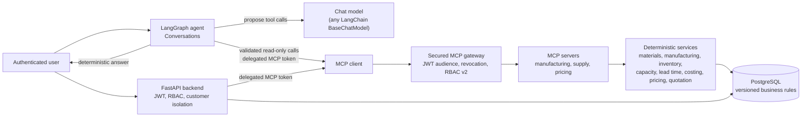

# Engineering RFQ Multi-Agent Copilot

An AI-assisted copilot for sheet-metal manufacturers that answers engineering requests for
quotation (RFQs) with verified data: material suitability, manufacturability, inventory,
capacity, lead time, cost and price.

The design separates **reasoning** from **deciding**. A language model only selects which
tool to call and with which arguments. Every business result comes from deterministic,
versioned Python services backed by PostgreSQL, reached through an authenticated MCP
gateway. The answer shown to the user is rendered from those validated results, never from
model prose. A human always approves and releases a quotation.

## Project overview

Quoting a custom part is slow, and mistakes are expensive. For each RFQ an engineer must
confirm that the material, thickness and finish exist and suit the part, check that the
shop can make it (bend radii, operations, tolerances), check stock and workcentre capacity,
and estimate the lead time, cost and price. Errors cost margin or delivery dates.

This project automates the analysis while keeping the decisions auditable:

- deterministic engines compute every number, with exact `Decimal` arithmetic and business
  rules pinned by version and SHA-256 hash;
- a secured REST backend and a secured MCP gateway expose those engines to authorized users
  and to the agent;
- a bounded LangGraph agent lets a chat model propose read-only tool calls, executes them
  through the gateway as the verified user, and returns a deterministic, grounded answer.

## Key features

- **Deterministic business engines:** material and manufacturing validation, inventory,
  weekly capacity planning, lead time, costing, pricing, multi-part quotation evaluation
  and approval-policy evaluation. Each result records the rule versions and fingerprints
  it used, and each evaluation reads one consistent snapshot.
- **Secured FastAPI backend:** customer profile, RFQs, the material catalog and released
  quotations (read), plus PDF/CSV attachment upload and listing.
- **Secured MCP gateway:** three MCP servers (manufacturing, supply, pricing) exposing ten
  read-only tools with strict Pydantic input and output contracts.
- **LangGraph agent:** provider-independent chat model injection, read-only tool
  execution through the gateway, checkpointed per-user conversations, and deterministic
  answer rendering.
- **Operator CLIs:** identity bindings, operator accounts, RFQ staff assignments and
  attachment reconciliation. All are dry-run by default and audited.

## System architecture



Further reading: [LangGraph agent](docs/architecture/langgraph_foundation.md),
[LLM integration](docs/architecture/llm_architecture.md),
[MCP architecture](docs/architecture/mcp_architecture.md) and
[MCP tool contracts](docs/architecture/mcp_tool_contracts.md).

## Technology stack

- **Language:** Python 3.12, managed with [uv](https://docs.astral.sh/uv/)
- **Backend:** FastAPI, Pydantic v2, Uvicorn, PyJWT, pypdf
- **Data:** PostgreSQL 18, SQLAlchemy 2 (async, asyncpg), Alembic
- **Agent:** LangGraph, LangChain Core
- **Tools:** Model Context Protocol (official `mcp` Python SDK, streamable HTTP)
- **Local model (development only):** Ollama via `langchain-ollama`
- **Quality:** pytest, pytest-asyncio, Ruff, GitHub Actions

## How it works

1. **Request.** An authenticated user asks a question through `Conversations`. Identity
   comes only from the verified application `Principal`, never from the model or the text.
2. **Tool selection.** The chat model sees code-authored instructions, the question as an
   untrusted data block, and the schemas of the offered tools. It may propose up to three
   tool calls. Planning tools are shown as a flat schema that converts deterministically
   to the unchanged MCP contract.
3. **Validation.** Every proposal is validated against the tool's contract (no identity,
   customer, role or permission fields can pass), the read-only allow-list and the
   argument-provenance rules. Planning dates must come from trusted application policy or
   an explicitly labelled user date.
4. **Execution.** Approved calls run once each, with no retries, through the MCP client
   and the gateway, using a short-lived MCP-audience token delegated for that user. The
   gateway re-verifies the token and re-resolves the user, customer and permissions.
5. **Deterministic services.** The MCP servers call the business engines inside a
   read-only, repeatable-read database transaction.
6. **Grounded response.** Results are re-validated against the output contracts and
   rendered as the answer, with exact statuses (such as `valid`, `needs_clarification`,
   `unsupported`, `costed`) and money rounded for display by the pinned pricing rule.
   Model prose is never shown. A turn without a tool result returns fixed guidance text,
   and failures return fixed, sanitized messages.

## Security and reliability

- **Authentication:** asymmetric JWT verification with issuer, audience and expiry checks,
  key rotation and token revocation. REST and MCP use separate audiences, and a REST
  token is never forwarded to the gateway.
- **Authorization:** roles and permissions are read from the database on every request
  (RBAC v2 on the gateway). Token claims never grant access.
- **Customer isolation:** customer scope comes from the verified identity and is enforced
  in SQL. Another customer's record answers "not found".
- **Read-only tools:** every MCP tool runs in a database-enforced `READ ONLY` transaction.
  The agent can execute only an explicit allow-list of these tools, and it cannot approve,
  release or persist anything.
- **Tool validation:** strict `extra="forbid"` contracts, credential screening of model
  output and tool results, and output re-validation before anything is rendered.
- **Bounded execution:** an acyclic graph, a recursion limit, a per-turn timeout, at most
  three tool calls per turn, and no automatic retries.
- **Checkpoint safety:** conversations are bound to a pseudonymous owner key and checked
  before every read. Turns run without a checkpointer, and only completed, successful
  turns are saved. Failed, cancelled or limit-exceeded turns persist nothing. Graph state
  never holds credentials, identities or raw provider metadata.
- **Grounding:** RFQ facts come only from the current turn's validated tool results.
  Conversation history and model text are never treated as evidence.

Secret screening is pattern-based and cannot recognize every possible secret format.

## Project structure

```
src/rfq_copilot/
  api/           FastAPI app, routers, auth, schemas, REST-to-MCP delegation
  mcp/           MCP contracts, servers, gateway (host), client, auth
  services/      deterministic business engines
  repositories/  read queries and verified rule loading
  models/        SQLAlchemy ORM models
  seeding/       dataset loading and validation
  graph.py       LangGraph agent and Conversations
  llm.py         provider-neutral model helpers and tool-call validation
  grounding.py   deterministic answers and argument provenance
alembic/         database migrations
tests/           unit, integration, security and live MCP tests
docs/            architecture, data, database and development documentation
```

## Local setup

**Prerequisites:** Python 3.12, uv and PostgreSQL 18 on localhost.

The database safety checks accept only the databases `rfq_copilot_dev` and
`rfq_copilot_test`, owned by a connecting role without SUPERUSER, CREATEDB, CREATEROLE,
REPLICATION or BYPASSRLS privileges:

```sql
CREATE ROLE rfq_copilot_dev LOGIN PASSWORD '<choose one>';
CREATE DATABASE rfq_copilot_dev  OWNER rfq_copilot_dev ENCODING 'UTF8' TEMPLATE template0;
CREATE DATABASE rfq_copilot_test OWNER rfq_copilot_dev ENCODING 'UTF8' TEMPLATE template0;
```

```bash
uv sync --locked
cp .env.example .env && chmod 600 .env
# Set DATABASE_URL, TEST_DATABASE_URL and TEST_DATABASE_NAME=rfq_copilot_test
```

**Dataset.** The synthetic dataset is private and is not committed. Authorized developers
receive the archive separately and extract it under `data/`. Then migrate and seed the
development database:

```bash
P=.venv/bin/python
D=(--source data/rfq_synthetic_data --archive data/rfq_synthetic_data_v1.1.0.zip --snapshot-dir data/rfq_seed_snapshots --env-file .env)
$P -m alembic -x target=development -x env_file=.env upgrade head
$P -m rfq_copilot.seeding.cli --target development "${D[@]}" --dry-run
$P -m rfq_copilot.seeding.cli --target development "${D[@]}" --apply --confirm-database rfq_copilot_dev
$P -m rfq_copilot.integrity --target development "${D[@]}"      # read-only audit
```

Leave `rfq_copilot_test` empty. The test fixtures migrate, seed and clean it up themselves.
Seeding details: [docs/development/database_seeding.md](docs/development/database_seeding.md).

## Running the application

**REST API:**

```bash
RFQ_API_ENVIRONMENT=development uv run uvicorn --factory rfq_copilot.api.app:create_app --host 127.0.0.1 --port 8000
```

`/health/live`, `/api/v1/system/info` and, in development only, `/docs` need no
credentials. All other `/api/v1` routes need a bearer JWT from a configured issuer
(`RFQ_API_JWT_*` settings), a database customer binding and the matching role permission.
Settings come only from `RFQ_API_*` process variables, and invalid values stop startup.

**MCP gateway** (loopback development):

```bash
uv run uvicorn --factory rfq_copilot.mcp.host:create_app_from_env --host 127.0.0.1 --port 8765 --no-proxy-headers --workers 1
```

It is configured by `RFQ_MCP_*` variables (JWT issuer, audience, algorithm, public key
file, resource URL) and `RFQ_MCP_HOST_*` variables (public base URL, allowed hosts and
origins). `RFQ_MCP_DATABASE_TARGET` selects the database, which is always opened read-only.
The gateway requires RBAC v2 and enforced token revocation.

**Agent.** The agent is a Python component (`rfq_copilot.graph.Conversations`), not yet an
HTTP endpoint. The application supplies the chat model, the verified `Principal`, an
`McpIntegration` with a trusted credential provider, and the planning-horizon policy.

## Testing

| Command | Needs | Covers |
| --- | --- | --- |
| `uv run pytest -q -m "not integration"` | `.env` | Unit, security, agent and mocked MCP tests |
| `uv run pytest -q` | dataset, `.env`, PostgreSQL | Full regression, including database lifecycle and end-to-end API security against `rfq_copilot_test` |
| `RFQ_AGENT_LIVE_MCP=1 uv run pytest -q tests/test_agent_tools.py -m integration` | as above | Agent executing read-only tools through a separate MCP gateway process over loopback TCP |
| `RFQ_OLLAMA_SMOKE=1 uv run pytest -q -s tests/test_ollama_smoke.py -m integration` | seeded dev DB, `ollama serve`, model `qwen3:4b-instruct-2507-q4_K_M` | Real local inference through the agent and the in-process gateway (dev data read-only) |
| `uv run ruff check .` and `uv run ruff format --check src tests alembic` | nothing | Lint and format |
| `uv lock --check` | nothing | The lockfile is current |

The public smoke suite that runs without the dataset is defined in
[the CI workflow](.github/workflows/smoke.yml).

The latest complete run, with both opt-in suites enabled, passed **2,501 tests** with no
failures or skips. Integration tests write only to the guarded `rfq_copilot_test` database
and clean it up afterwards.

The Ollama smoke test uses test-only signing keys and simulates one step, the user-to-customer
binding, because the development database contains no binding rows. Its other parts are real.

## Current capabilities and limitations

**Implemented and tested**

- The deterministic business engines and approval-policy evaluation, with a human-release
  requirement enforced in code.
- The secured REST backend, attachments and operator CLIs.
- The secured MCP gateway with ten read-only tools, tested end to end over TCP.
- The bounded LangGraph agent with read-only tool execution, per-user conversations and
  deterministic grounded answers, tested with mocked models and with a local Ollama model.

**Limitations**

- There is no production MCP credential provider (no token exchange with the identity
  provider), so the agent and the MCP-backed REST route run only with a test provider.
- Agent answers are deliberately terse: rendered tool data or fixed guidance, with no
  natural-language explanation.
- Conversation memory uses an in-memory, single-process checkpointer.
- Only local Ollama has been exercised as a real model. Hosted providers such as Claude
  have not been tested.
- Write APIs, quote-draft persistence and the approval workflow are not built.
- Several security features (permission policy v2, token revocation, upload idempotency,
  RFQ staff assignments) must be enabled per deployment.
- This is not production-ready.

Full register: [docs/development/technical_debt.md](docs/development/technical_debt.md).

## Future improvements

- Specialized agents (intake, engineering, supply, pricing, quotation review) under a
  supervisor orchestration layer.
- A human-in-the-loop review and approval workflow, with quote-draft persistence.
- A durable checkpoint store with cross-process locking.
- A production identity token exchange for delegated MCP credentials.
- A review frontend, containerization and production deployment.
