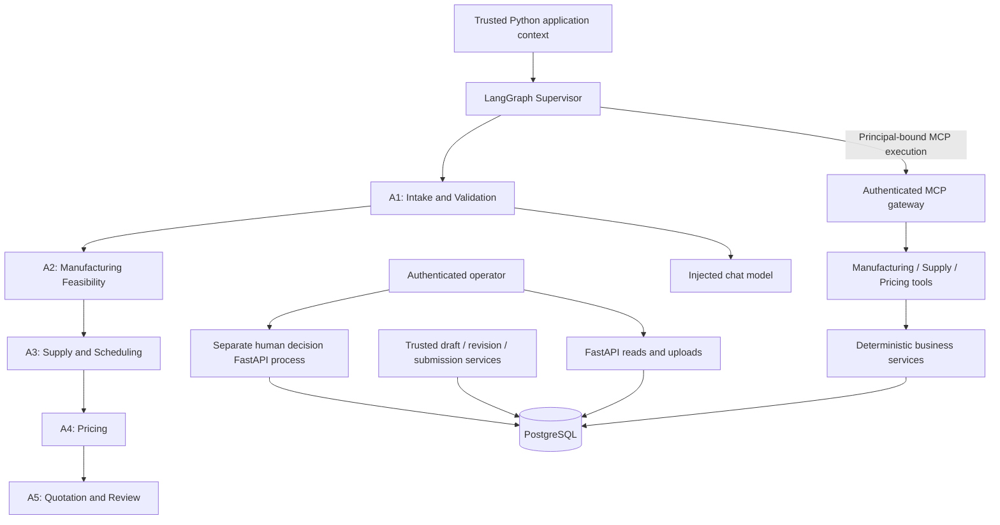

# Engineering RFQ Multi-Agent Copilot

An engineering quotation backend for sheet-metal manufacturers. It combines five specialized
agents with deterministic services for material suitability, manufacturing feasibility,
inventory, production capacity, lead time, costing, and pricing.

The language model assists extraction and proposes tool calls. Versioned Python services
compute business results with exact decimal arithmetic. Quotation persistence recomputes
those results from stored requirements; authorized humans approve, reject, and release
specific quotation versions.

**Status:** backend Phases 1–8 are complete, including the LangGraph Supervisor and persistent
quotation lifecycle. This is a development project: frontend integration and production
hardening remain open, and production deployment has not been approved.

## Capabilities

- **PostgreSQL foundation:** async SQLAlchemy models, guarded Alembic migrations, private
  synthetic-data seeding, schema contracts, and integrity checks.
- **Deterministic business services:** materials, manufacturing, inventory, capacity,
  lead time, costing, pricing, multi-part quotation evaluation, and approval-policy checks.
  Business rules are pinned by version and verified against trusted hashes.
- **Authenticated FastAPI reads and uploads:** customer-scoped RFQs, customer profiles,
  catalog reads, released quotations, and validated PDF/CSV BOM attachment uploads.
- **Secure MCP infrastructure:** manufacturing, supply, and pricing servers expose ten
  read-only tools through an independently authenticated gateway. Identity and grants come
  from the database, with separate REST/MCP token audiences.
- **Five specialized agents:** Intake and Validation; Manufacturing Feasibility; Supply
  and Scheduling; Pricing; Quotation and Review.
- **LangGraph Supervisor:** validated handoffs, deterministic routing, bounded parallel
  manufacturing checks, clarification/escalation, process-local recovery, and optional
  privacy-controlled Langfuse telemetry.
- **Persistent quotations:** drafts, immutable versions, calculation provenance, governed
  validity, revision, submission, rejection/resubmission, and transactional idempotency.
- **Controlled human decisions:** approval, rejection, and release through a separate
  FastAPI process and restricted decision credential, backed by PostgreSQL integrity guards.

## Architecture



The diagram separates implemented Python components from the HTTP surface. There is no
HTTP route that starts or streams a Supervisor workflow yet. The Supervisor produces a
non-binding assessment; persistent drafts are recomputed by the quotation services rather
than accepting serialized agent evidence as business authority.

The Supervisor has six internal stages: A1 extraction and validation, then A2 through A5.
Human approval and release are outside the agent tool set.

Read the [Supervisor foundation](docs/architecture/supervisor_foundation.md),
[delegation](docs/architecture/supervisor_delegation.md),
[recovery](docs/architecture/supervisor_recovery.md),
[specialized-agent integration](docs/architecture/specialized_agent_integration.md),
[MCP architecture](docs/architecture/mcp_architecture.md), and
[tool contracts](docs/architecture/mcp_tool_contracts.md) for the implementation boundaries.

## Security and authority

- JWT verification checks the configured asymmetric algorithm, key, issuer, audience,
  lifetime, and subject. Permissions and customer bindings are resolved from the database;
  role claims, browser fields, and model output do not grant authority.
- SQL queries enforce customer scope and, when configured, RFQ assignments. Existing users
  are staff/operator identities acting for a bound customer; a distinct external-customer
  identity policy has not been implemented.
- MCP enforces policy v2 and token revocation. REST revocation, permission-policy selection,
  assignment enforcement, and upload idempotency must be configured explicitly.
- MCP business tools use read-only, repeatable-read transactions and strict typed contracts.
  The browser must communicate with authenticated FastAPI routes, not PostgreSQL or MCP.
- Customer quotation responses select selling-price fields explicitly and require human
  release. Internal costs, margins, raw evidence, and credentials are not part of that DTO.
- Human decisions recheck the active actor, grants, customer binding, expected version,
  policy assessment, and required separation of duties. The approver differs from the
  creator/requester; the releaser differs from the approver.
- K2/K3/K4/K5 database guards protect history, calculation consistency, lifecycle transitions,
  and decision authority. The active development contract is K5, revision `20261116_04`.
  Proposed multi-customer migrations remain deferred.
- The decision credential belongs only to the human decision process. It must never be
  supplied to agent context/state, generic MCP tools, or the main API process.

Consistency hashes and database enforcement do not establish authenticated cryptographic
specialist authorship. Durable signed evidence remains incomplete. Secret screening is
pattern-based and cannot recognize every possible credential format.

## HTTP surface

All protected routes require a bearer JWT, a database identity/customer binding, and the
applicable permission. Customer-scoped RFQ operations also honor configured assignments.

| Application | Method / path | Purpose |
| --- | --- | --- |
| Main API | `GET /health/live` | Public process liveness; no dependency-readiness guarantee |
| Main API | `GET /api/v1/system/info` | Public service metadata |
| Main API | `GET /api/v1/customers/me` | Bound customer profile |
| Main API | `GET /api/v1/rfqs`, `GET /api/v1/rfqs/{rfq_id}` | Scoped RFQ reads |
| Main API | `GET /api/v1/materials` | Filtered, paginated catalog |
| Main API | `GET /api/v1/materials/{material_id}/specification` | Mounted only with explicit MCP integration |
| Main API | `GET /api/v1/quotes/{quote_id}` | Released quotation selling-price projection |
| Main API | `GET`, `POST /api/v1/rfqs/{rfq_id}/attachments` | Attachment metadata and PDF/CSV upload |
| Decision API | `POST /api/v1/quote-decisions/{quote_id}/approval` | Human approval of the pending version |
| Decision API | `POST /api/v1/quote-decisions/{quote_id}/rejection` | Human rejection with a reason |
| Decision API | `POST /api/v1/quote-decisions/{quote_id}/release` | Controlled release of an approved version |

Development-mode OpenAPI/Swagger documentation is available when configured. There is no
login/token-issuance route, RFQ submission/correction route, Supervisor job/progress route,
or complete operator quotation/version/review API. The decision application is served
separately; the main API does not mount its routes.

## Technology and repository layout

Python 3.12 · uv · PostgreSQL 18 · SQLAlchemy async/asyncpg · Alembic · FastAPI · Pydantic ·
LangGraph · LangChain Core · MCP · PyJWT · pytest · Ruff · GitHub Actions.

```text
src/rfq_copilot/
  api/                main API, separate decision app, authentication, schemas
  mcp/                contracts, servers, authenticated gateway and client
  services/           deterministic business calculations
  repositories/       scoped queries and trusted rule loading
  models/             SQLAlchemy models
  seeding/            guarded dataset, rule and policy registration
  supervisor.py       routing, custody and A1–A5 execution
  recovery.py         process-local workflow recovery
  intake.py           A1 extraction (validation in intake_validation.py)
  manufacturing_agent.py / supply_agent.py / pricing_agent.py / quotation_agent.py
  quote_drafts.py / quote_versions.py / quote_approval_policy.py / quote_approval.py
  quote_evidence.py    calculation and quotation evidence checks
  graph.py / llm.py    conversational agent and model abstraction
  schema_contract.py  active/deferred schema contracts and migration hash pins
alembic/              active and proposed/deferred migrations
tests/                unit, integration, security and opt-in live checks
docs/                 public architecture, schema and operational guidance
```

## Local setup

Prerequisites are Python 3.12, [uv](https://docs.astral.sh/uv/), and PostgreSQL 18 on loopback.
The current guarded development/test database names are `rfq_copilot_dev` and
`rfq_copilot_test`. Keep the dataset private and never use development data as a test target.

```bash
uv sync --locked
# Preserve an existing .env; otherwise create a private copy of the placeholder template.
test -e .env || (umask 077; cp .env.example .env)
chmod 600 .env
```

Configure credentials privately. The template contains placeholders only. Database settings
are read from process variables or an explicitly selected dotenv file; API/MCP settings use
process variables. Do not print URLs or export a shared file containing decision credentials
into the main API or agent/MCP process.

| Configuration | Intended authority |
| --- | --- |
| `DATABASE_URL`, `TEST_DATABASE_URL` | Owner access for reviewed migrations, seeding, administration and tests |
| `APP_DATABASE_URL`, `TEST_APP_DATABASE_URL` | Restricted application role |
| `DECISION_DATABASE_URL`, `TEST_DECISION_DATABASE_URL` | Separate restricted human-decision role |
| `TEST_DATABASE_NAME` | Explicit test database identity ending in `_test` |
| `RFQ_API_*` | JWT trust, API security profile and attachment storage |
| `RFQ_MCP_*`, `RFQ_MCP_HOST_*` | MCP trust, destination and ingress policy |

Authorized developers obtain synthetic dataset v1.1.0 separately, keep its ZIP under `data/`,
and extract it to `data/rfq_synthetic_data/`. Frozen evaluation inputs/answers are excluded
from iterative application development. Snapshot artifacts under `data/rfq_seed_snapshots/`
remain private and must be preserved when referenced by the database.

For a new database, review the [migration guide](docs/development/database_migrations.md)
and [seeding guide](docs/development/database_seeding.md). Provision the separate roles using
[K2 runtime grants](docs/database/k2_runtime_roles.sql) and
[K5 decision grants](docs/database/k5_decision_roles.sql); these are reviewed operator
artifacts, not automatic startup scripts. Preserve all applied migration files byte for byte.

Fresh baseline seeding is not full runtime bootstrap: subject/customer bindings, assignments,
runtime RFQ lines, and approvals are not created by the frozen dataset import. Approved
post-baseline rules (`approval-v1.2`, `workflow-v1.1`, `workflow-v1.2`) and the
`rbac-policy-v2` overlay have separate guarded registration CLIs in
[`seeding/rules.py`](src/rfq_copilot/seeding/rules.py) and
[`seeding/policy.py`](src/rfq_copilot/seeding/policy.py). Review and provision them explicitly
for the intended environment; do not change the frozen dataset to supply runtime state.

## Development entry points

These commands describe separate loopback processes. Supply reviewed, process-specific
settings first; none creates identities, runs migrations, or initializes a workflow.

```bash
# Main API; development mode enables interactive API documentation.
RFQ_API_ENVIRONMENT=development uv run uvicorn --factory rfq_copilot.api.app:create_app --host 127.0.0.1 --port 8000

# Human decision API, with its own environment and decision credential.
RFQ_API_ENVIRONMENT=development uv run uvicorn --factory rfq_copilot.api.decision_app:create_decision_app --host 127.0.0.1 --port 8001

# MCP gateway, configured independently; never a direct browser destination.
uv run uvicorn --factory rfq_copilot.mcp.host:create_app_from_env --host 127.0.0.1 --port 8765 --no-proxy-headers --workers 1
```

Protected operations fail closed when trust configuration, grants, bindings, storage, or
required credentials are missing. A working liveness response does not establish readiness.
The default API/MCP factories still use the owner URL, and runtime/decision configuration
currently validates an owner URL before selecting its credential. Serving credential
isolation remains open; these entry points are not hardened deployment instructions.

The [Supervisor](src/rfq_copilot/supervisor.py) and
[conversational agent](docs/architecture/langgraph_foundation.md) are Python integration
components. Their caller supplies the verified Principal, trusted rules/planning policy,
model, and principal-bound MCP executor. A runtime delegated-credential provider is not
shipped; test-only issuers/providers are not a production authentication solution.

## Verification

**Historical Phase 8 baseline, reported November 17, 2026:** 4,722 passed, 10 intentionally
skipped opt-in integrations. This is a prior verification record, not a result reproduced
by the repository-hygiene changes. Skipped integrations do not establish live readiness.

The public, dataset-free smoke selection is maintained in
[`.github/workflows/smoke.yml`](.github/workflows/smoke.yml). It is a subset of the regression.

| Manual command | Requirements / purpose |
| --- | --- |
| `uv run pytest -q` | Private dataset, configured test credentials/roles and PostgreSQL; full regression |
| `uv run ruff check .` | Lint |
| `uv run ruff format --check src tests alembic` | Python formatting |
| `uv lock --check` | Dependency-lock consistency |

Integration fixtures own the guarded `rfq_copilot_test` lifecycle and restore its expected
empty state. K5 tests require the distinct restricted test decision role. Never point the
test configuration at development or production, or run a second database suite concurrently.
Live MCP, Ollama, and Langfuse checks are explicitly opt-in and require their corresponding
services and settings. The Ollama dependency is in the development group; Langfuse is an
optional extra. Do not interpret mocked-model or offline results as a live demonstration.

## Current limitations

- No React frontend or complete browser-to-backend workflow exists yet. Authentication
  issuance, RFQ writes, workflow execution/progress, and operator review APIs need integration.
- Staff identities are customer-bound; external-customer authorization and multi-customer
  staff activation remain separate policy/schema decisions.
- Supervisor recovery and conversation memory are process-local. Cross-worker/restart
  continuation with durable specialist evidence is not implemented.
- Signed durable specialist authorship is incomplete. Stored calculation consistency and
  human context attestation are distinct from cryptographic source authentication.
- Automatic expiry/supersession transitions and verified engineering-review completion are
  incomplete. Human approval/release checks fail closed where required evidence is absent.
- Serving credential isolation, consistent decision retries, API contract gaps, and broader
  decision-HTTP/CI coverage remain follow-up work; this documentation cleanup fixes none of them.
- Production identity provisioning, observability, deployment and operational acceptance
  remain pending. Production deployment is not approved.

See the [current limitations register](docs/development/technical_debt.md) for component
references and the distinction between local-demo integration and production requirements.
Keep internal development logs, audit narratives, review bundles, and historical execution
receipts private; they are not required reading for the public project.
