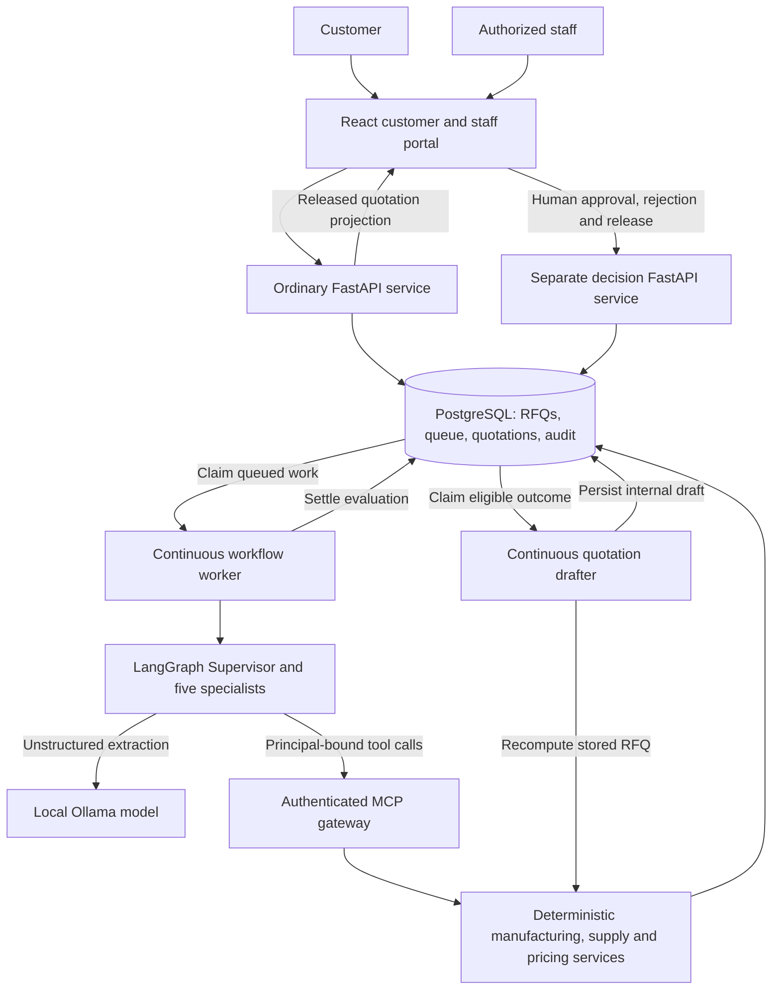

# RFQ_CoPilot — Manufacturing RFQ Platform

RFQ_CoPilot turns a manufacturing Request for Quotation into an engineering assessment
and a controlled customer quotation. It brings customer intake, feasibility checks,
supply planning, pricing, and staff review into one application, reducing manual
coordination while keeping commercial decisions under human authority.

**Status:** a complete local development application, demonstrated from customer
submission through automatic processing, independent approval, authorized release,
and customer quotation viewing with flat-panel and L-bracket RFQs. Production deployment
and operational acceptance remain outstanding.

## Customer and staff workflows

Customers can submit structured RFQs, add free-text requirements, upload PDF or CSV BOM
attachments, follow their RFQ history, and view quotations released to their account.
Internal drafts and approval information stay outside customer responses.

Staff can browse quotations in their authorized customer/assignment scope, inspect stored
manufacturing specifications and commercial totals, submit a version for review, and
perform permitted approval, rejection, or release actions. The server assesses available
actions and rechecks authorization, version, evidence, and policy when an action is confirmed.

1. **Submit:** the ordinary FastAPI service stores the RFQ, parts, idempotency receipt,
   audit event, and queued workflow in one transaction when automatic processing is enabled.
2. **Validate intake:** the worker loads the current persisted requirements and verifies
   part ownership, completeness, source evidence, catalog references, and contradictions.
3. **Evaluate:** a LangGraph Supervisor coordinates manufacturing feasibility, inventory,
   capacity, scheduling, pricing, and quotation review through authenticated MCP tools.
4. **Draft automatically:** a separate consumer claims eligible results and recomputes a
   deterministic internal quotation from the stored RFQ and trusted business rules.
5. **Review:** authorized staff submit the exact quotation version for independent human review.
6. **Approve and release:** an eligible independent approver records a context attestation;
   a separately authorized actor releases the approved version. The releaser must differ
   from the approver.
7. **View:** the customer discovers the released quotation through RFQ history and opens
   its selling-price projection.

Missing information, conflicting evidence, unsupported manufacturing requirements, or
required engineering review stop or redirect processing. A successful agent run alone
does not authorize a customer quotation.

## Architecture



### Supervisor and specialists

The Supervisor uses validated handoffs, deterministic routing, bounded parallel part
checks, clarification/escalation, and process-local evidence custody. Its five specialists are:

| Specialist | Responsibility |
| --- | --- |
| Intake and Validation | Extract or render requirements, verify provenance, resolve catalog references, identify missing or conflicting facts |
| Manufacturing Feasibility | Check material/process compatibility, dimensions, tolerances, finishes, and supported geometry |
| Supply and Scheduling | Assess inventory, procurement delay, workcentre capacity, and a feasible planning window |
| Pricing | Verify evidence and request deterministic costing and selling-price calculations |
| Quotation and Review | Check the combined assessment and identify policy or human-review requirements |

**Structured intake** uses the backend's current, customer-scoped persisted part fields
when there are no free-text notes. It renders exact values and source offsets without
asking a model to extract those fields again. These provisional facts still pass validation
and business checks. **Unstructured intake** uses local Ollama extraction; proposed fields
must be supported by their own source evidence. A worker-side SourceGate rejects invented
part identities and conflicts with stated persisted values before tool execution.

Manufacturing, inventory, capacity, lead-time, costing, and pricing results come from
versioned Python services using exact decimal arithmetic. Three MCP server families expose
ten read-only tools through an independently authenticated gateway. Model output cannot
set prices, change grants, or approve/release quotations.

See [specialist integration](docs/architecture/specialized_agent_integration.md),
[Supervisor delegation](docs/architecture/supervisor_langgraph_architecture.md),
[MCP architecture](docs/architecture/mcp_architecture.md), and
[tool contracts](docs/architecture/mcp_architecture.md).

### Continuous processing and persistence

PostgreSQL stores the durable processing queue. Independent workflow and drafting consumers
use row claims, leases, heartbeats, generation fences, bounded attempts, and idempotent writes.
The drafter accepts only eligible outcomes and re-evaluates persisted requirements instead
of accepting stored model conclusions as pricing authority.

Quotation versions, calculation provenance, review requests, decisions, releases, and
operation receipts are persisted with audit records. Queue recovery can repeat an interrupted
evaluation; process-local Supervisor evidence is not a durable continuation checkpoint.

The [background-processing guide](docs/development/background_processing.md) covers
configuration, startup, retry behavior, verification, and shutdown.

## Authorization and integrity

- Asymmetric JWT verification checks issuer, audience, signature, lifetime, and subject.
  Active identities, permissions, and customer bindings are resolved from PostgreSQL.
- Separate customer permissions restrict customer operations. Staff quotation reads also
  require a trusted staff role; customer scope and optional RFQ assignments are enforced in SQL.
- MCP has a dedicated token audience, database-derived grants, enforced revocation,
  typed contracts, and read-only evaluation transactions.
- The ordinary API, workflow worker, drafter, and human-decision service use separately
  restricted database authority. Owner credentials belong to reviewed administration.
- Submission, decisions, and release check the exact version and current policy.
  Approval requires separation from the quotation creator/requester, and release requires
  separation from the approver. Required unverified engineering review fails closed.
- Customer quotation DTOs select released selling-price fields explicitly. Browser
  identity changes clear cached data and reject stale responses from previous sessions.
- Database guards protect immutable history, calculation provenance, lifecycle transitions,
  and decision authority. Source hashes, rule fingerprints, schema contracts, and runtime
  integrity checks detect unexplained changes.

The current schema contract is defined in
[`schema_contract.py`](src/rfq_copilot/schema_contract.py), with active revision
`20261118_01`. Multi-customer staff migrations remain deferred. Consistency hashes do not
establish cryptographically signed specialist authorship.

See [authentication](docs/development/authentication.md),
[database architecture](docs/database/database_architecture.md), and the
[runtime](docs/database/k2_runtime_roles.sql),
[decision](docs/database/k5_decision_roles.sql),
[worker](docs/database/a1_workflow_role.sql), and
[drafter](docs/database/a4_drafter_role.sql) provisioning references.

## Technology and repository layout

| Area | Stack |
| --- | --- |
| Browser | React, TypeScript, Vite, React Router, TanStack Query, Tailwind CSS |
| API and persistence | Python 3.12, FastAPI, Pydantic, SQLAlchemy async, asyncpg, PostgreSQL 18, Alembic |
| Agent execution | LangGraph, LangChain Core, local Ollama, authenticated MCP |
| Engineering checks | Decimal calculations, versioned rules, provenance and integrity verification |
| Development verification | uv, pytest, Ruff, Vitest, Testing Library, GitHub Actions |

```text
frontend/              customer and staff portal, browser tests, development proxy
src/rfq_copilot/
  api/                 ordinary API, separate decision app, authentication, DTOs
  mcp/                 gateway, contracts, servers and client
  services/            deterministic engineering and commercial calculations
  models/              SQLAlchemy domain models
  repositories/        scoped queries and trusted rule loading
  seeding/             guarded private-source import and rule/policy registration
  policies/ / rules/   versioned authorization and business documents
  supervisor.py        specialist routing, handoffs and custody
  workflow_*.py        durable queue, evaluation worker and quotation drafter
  background.py        consumer polling, backoff and shutdown lifecycle
  quote_*.py           drafts, versions, evidence, review and human decisions
  *integrity.py        frozen baseline and explained runtime-state verification
alembic/               active and proposed/deferred migrations
scripts/dev_env.sh     process-specific local environment launcher
tests/                 backend regression, security, database and opt-in live checks
docs/                  architecture, database and operational references
```

## Local setup

Use Python 3.12, uv, PostgreSQL 18 on loopback, an installed Ollama model, and Node.js
matching `frontend/package.json` (`^20.19.0 || >=22.12.0`). The shell launcher and guarded
filesystem operations target a POSIX local environment. Run commands from the repository root.

```bash
uv sync --locked
npm --prefix frontend ci
# Preserve an existing private configuration.
test -e .env || (umask 077; cp .env.example .env)
```

The [environment template](.env.example) contains placeholders and non-secret local defaults.
Replace credential, key-path, and model placeholders privately. Serving processes read
process variables; the launcher loads only the selected process's settings. Do not export
the complete private file into every service or put secrets in browser configuration.

The synthetic dataset is private and supplied separately to authorized developers. The
full setup requires its frozen archive under `data/`, extracted sources under
`data/rfq_synthetic_data/`, and protected snapshot artifacts. Preserve all applied migrations,
registered rule bytes, manifests, and snapshots.

A fresh database additionally requires reviewed migrations, baseline seeding, current rule
and RBAC registrations, restricted roles, customer/staff/service identities and bindings,
any required assignments, and explicit queue activation. Dependency installation and
copying the template do not perform this provisioning. For an existing demonstrated
environment, reuse its approved configuration and state.

Consult [migrations](docs/development/local_development.md),
[seeding](docs/development/local_development.md), and the
[background-processing prerequisites and launch commands](docs/development/background_processing.md).
The current customer workflow selects API policy v3 with the registered RBAC v4 overlay.

| Local process | Default address |
| --- | --- |
| React portal | `http://127.0.0.1:5173` |
| Ordinary API | `http://127.0.0.1:8000` |
| Separate human-decision API | `http://127.0.0.1:8001` |
| MCP gateway | `http://127.0.0.1:8765` |
| Ollama | `http://127.0.0.1:11434` |

Start the two continuous consumers alongside these services using the operational guide.
The Vite development proxy sends ordinary API traffic and human decisions to their respective
processes. Local sign-in uses manually supplied, short-lived development JWTs for provisioned
identities; no production login or public registration service is provided.

## Verification

The [public smoke workflow](.github/workflows/smoke.yml) defines the dataset-free backend
selection and its lint/lock checks. It covers a subset of the regression suite. Frontend
tests use mocked HTTP requests; database and live integration checks have separate prerequisites.

| Manual command | Scope / prerequisites |
| --- | --- |
| `uv run pytest -q` | Full backend regression; private dataset, PostgreSQL, and guarded test credentials/roles required |
| `uv run ruff check .` | Python lint |
| `uv run ruff format --check src tests alembic` | Python formatting verification |
| `uv lock --check` | Dependency lock consistency |
| `npm --prefix frontend run test:run` | Frontend regression tests |
| `npm --prefix frontend run build` | TypeScript checking and production asset compilation |

Run database suites serially against the isolated `rfq_copilot_test` target; their fixtures
manage schema/data and must not share a concurrent test instance. Explicit development
integrity checks are read-only. Live Ollama, MCP, and optional Langfuse checks require
opt-in configuration. Offline or mocked tests do not establish live integration success.

## Demonstration screenshots

Real demonstration screenshots can be linked in this section after capture and privacy
review. Suggested views are customer RFQ submission, the automatically created staff draft,
independent human approval/release, and the customer's released quotation. Include the
demonstrated flat-panel and L-bracket examples without tokens or private contact information.

## Production limitations

- Local foreground processes require manual startup/restart. Deployment supervision,
  TLS, secrets distribution, monitoring, and operational acceptance remain outstanding.
- Development JWT issuance and the worker's local signing-key provider require replacement
  with a production identity and delegated-credential design.
- Restart recovery re-evaluates queued work; durable signed specialist evidence and
  cross-process continuation of trusted Supervisor custody remain incomplete.
- Inventory and weekly capacity checks provide planning estimates, without reserving
  stock, production slots, or shipment dates. Source freshness must be managed explicitly.
- Required engineering-review completion still needs verified evidence; approval refuses
  unsupported cases. Automatic expiry/supersession state transitions remain incomplete.
- The full regression and reproduction environment depend on separately supplied private
  data and reviewed database provisioning. Building frontend assets alone is not a deployment.

Detailed component limitations are recorded in
[technical debt and deferred decisions](docs/development/technical_debt.md).
