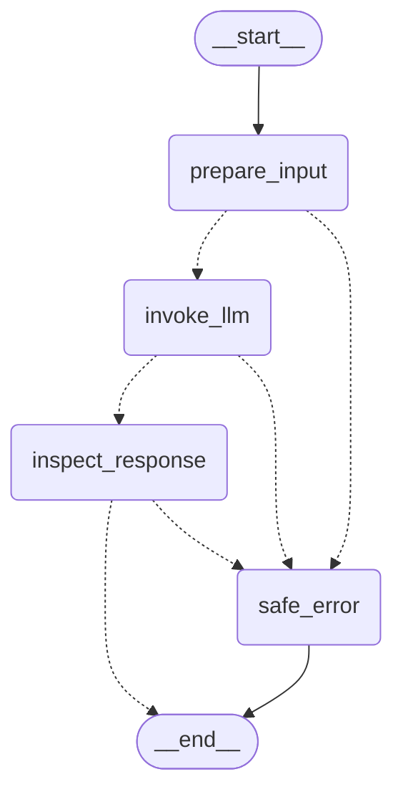

# LangGraph Foundation (Day 32)

Code: `src/rfq_copilot/graph.py`. Tests: `tests/test_graph.py`, mocked models only.
Dependency: `langgraph>=1,<2`, locked at 1.2.20. Memory and checkpointing were added on Day 33, and
bounded read-only MCP tool execution on Day 34 (see below; tests in `tests/test_agent_tools.py`).

## Graph

Produced by LangGraph's built-in `get_graph().draw_mermaid()`. Dashed lines are
conditional edges.



The graph has no cycles. The longest path is 4 node steps. `run_graph` passes
`recursion_limit=8`, and exceeding it gives `error="execution_limit"`.

## State (`GraphState`, a `TypedDict`)

| Key | Meaning |
|---|---|
| `question` | Untrusted user input. Checked for credentials before any checkpoint, and cleared on error |
| `history` | (Day 33) Completed turns, merged by the `add_messages` reducer: each untrusted question block plus the assistant's text, with tool calls stripped |
| `messages` | Output of `llm.build_messages`: the trusted system message plus the untrusted block |
| `response` | The `AIMessage` from `llm.invoke` |
| `reply` | Model text, or `None` |
| `proposals` | Contract-valid tool calls as plain dicts (`id`, `name`, `arguments`). JSON-safe and unexecuted |
| `status` | One of `pending`, `answered`, `proposed`, `error` |
| `error` | An `llm.FailureCode`, or `execution_limit` |

State never holds identity, tokens, roles, permissions, customer scope, ORM objects or
sessions. `run_graph` returns a frozen `GraphResult` (status, reply, proposals, error)
and leaves out the raw input.

## Nodes and routing

All nodes are async. Each one reuses a Day 31 helper and adds no validation of its own.

| Node | Day 31 helper | On success | On `LlmError` |
|---|---|---|---|
| `prepare_input` | `build_messages`, which refuses credential-shaped text | → `invoke_llm` | → `safe_error` |
| `invoke_llm` | `invoke` (the model is bound once at build time with `bind_contract_tools`) | → `inspect_response` | → `safe_error` |
| `inspect_response` | `inspect_tool_calls`: allow-list, contract check, all-or-nothing | `answered` or `proposed` → END | → `safe_error` |
| `safe_error` | none | clears input and model output, sets `status="error"` → END | none |

A reply with neither text nor tool calls gives `malformed_output`. `proposed` is a
terminal state. It does not authorize anything, and nothing executes the proposal.

## Execution safety

- `build_graph(model, instructions, allowed_tools)` injects the `BaseChatModel`. The graph
  never creates providers, reads keys or enables LangSmith; tracing variables were unset on
  Day 32.
- Node closures capture only immutable configuration, and each `ainvoke` gets fresh state,
  so concurrent runs are isolated (tested with interleaved runs).
- There are no retries, and nothing in the graph changes state outside it.
- Errors are fixed codes. Provider exception text never reaches state or results.

## Memory and checkpointing (Day 33)

- **Turns:** every turn starts from `TURN_RESET`, so a previous turn's messages, response,
  reply, proposals and error never carry over. Only successful turns are added to
  `history`. `prepare_input` sends the model
  `[fresh SystemMessage, *last N turns, new untrusted block]`. Instructions are rebuilt from
  code on every turn and never persisted, so remembered text cannot become instructions.
- **Bounded history:** `max_history_turns` (default 10, 0 means no memory) is enforced with
  `RemoveMessage`, so the stored history is trimmed as well as the model input.
- **Checkpointing:** `build_graph(..., checkpointer=None)`. The memoryless path and
  `run_graph` are unchanged. A checkpointer is any `BaseCheckpointSaver`. The default is
  `InMemorySaver(serde=SAFE_SERDE)`, where `SAFE_SERDE` is `JsonPlusSerializer` with no
  pickle fallback and msgpack decoding restricted to LangGraph's safe types (primitives and
  LangChain messages).
- **Access boundary, `Conversations`:**
  - It takes a verified `api.auth.Principal`, the existing identity type, and refuses to
    work without a customer and a user (fails closed).
  - Thread ids are server-generated (`token_urlsafe(24)`) and opaque.
  - Every checkpoint carries `metadata.owner`, a SHA-256 of customer and user that is never
    visible to the model.
  - `ask` (resume) and `history` (read) check the owner under a per-thread lock. A
    malformed, unknown, foreign or unbound thread gets the same `ThreadAccessError`.
  - No state-update operation is exposed, and callers never receive the graph or the saver.
- **Sensitive data:** question text is screened before it enters any graph state. Model text
  and tool-call arguments are screened in `invoke_llm`. Tests scan all stored checkpoints,
  blobs and pending writes, not just the final state.
- **Hardening review (Day 33):**
  - `invoke_llm` stores a minimal `AIMessage` holding only text and tool calls. Provider
    reasoning blocks, `additional_kwargs` and `response_metadata` are never persisted.
  - **Transient execution (exception-safety fix):** `durability="exit"` was not enough.
    LangGraph still writes the exit checkpoint when a turn ends in an unhandled exception,
    a cancellation or the recursion limit, and that checkpoint held the turn's question,
    model output and the exception text. Now:
    - Each turn runs on a graph with no checkpointer, so execution data exists only in
      memory.
    - Only after an `answered` or `proposed` turn does `Conversations` write one
      checkpoint, through `aupdate_state`. It holds only the completed, trimmed `history`
      channel, with owner metadata.
    - Handled errors, unexpected exceptions (returned as `internal_error`, with no text),
      cancellation (`CancelledError` propagates) and `execution_limit` write nothing.
    - Earlier history and ownership are unchanged.
    - Tests check that failed-turn markers appear in no retained checkpoint, blob or
      pending write.
    - Trade-off: an interrupted turn is simply lost. Nothing in it changes state.
  - The credential patterns also cover AWS, GitHub and Slack tokens, URLs with embedded
    credentials, and `password=`/`api_key:`-style assignments.
  - Residual risk: secrets in other formats are not detected, and the key=value rule can
    reject benign text.
  - Nothing in `src/` imports the graph yet, and a test enforces that. When it gets wired,
    wire `Conversations`, never the raw graph or saver.
- **Limitations:**
  - `InMemorySaver` is process-local: all threads are lost on restart, and memory grows
    until the process exits.
  - The per-thread locks only serialize turns within one process.
  - Credential screening is pattern-based.
  - Anyone holding a raw compiled graph or the saver bypasses `Conversations`. Keep them
    private.
- **PostgreSQL later:** inject `AsyncPostgresSaver` constructed with `SAFE_SERDE` (this
  needs a new dependency and its own tables, so it requires approval). The graph and
  `Conversations` stay the same, and owner metadata is stored with every checkpoint.

## Read-only MCP tool execution (Day 34)

```
START -> prepare_input -> invoke_llm -> inspect_response --(answer / no executor)--> END
                                              |
                                              +--(proposals + executor)--> execute_tools -> respond -> END
(any node error) -> safe_error -> END
```

**Flow.** One tool-selection model step (`invoke_llm`, tools bound). `inspect_response`
validates every call with the Day 31 `inspect_tool_calls` (allow-list plus contract input
model, `extra="forbid"`). If more than `MAX_TOOL_CALLS = 3` are proposed, the turn fails
before anything runs. `execute_tools` re-inspects the model message and runs each call
once, in order, through the trusted executor. Each result is re-validated against the tool's
output contract, screened with `reject_credentials` and turned into a `ToolMessage` by
`llm.tool_result_message`. `respond` makes one final model call with the **unbound** model.
If that call asks for a tool, the turn fails (`execution_limit`). Nothing executes a second
time.

**Authorization boundary.** The graph never calls handlers, services or the database. Tool
execution needs a `ToolExecutor` that the application supplies through LangGraph's run
**context** (`TurnContext`). That context is not graph state and is never checkpointed.
`mcp_executor(McpIntegration, Principal, rest_credential)` is the only executor in `src/`. It
delegates through the Day 29 `McpCredentialProvider` to get an MCP-audience token for exactly
`principal.subject`. It refuses a missing principal or REST credential, and `McpIntegration`
refuses the REST token itself, a wrong audience or another subject. `McpToolClient` then
calls the Day 28 gateway, which re-verifies the signature, issuer, audience, expiry and
revocation, re-resolves the user and customer, and enforces RBAC v2 per tool.
`Conversations(..., mcp=integration).ask(principal, question, rest_credential=...)` wires
this in. Without `mcp`, tool calls stay unexecuted proposals as on Days 32–33.

**Trusted vs untrusted.** Trusted: the verified `Principal`, the delegated token and the
executor, all held in Python locals or the run context. Untrusted: the model's tool names
and arguments, which can only select an offered contract and fill its forbid-extra input,
so no identity, customer, role, permission or token field can pass. Tool results are
untrusted too: they are schema-validated, screened and passed only as `ToolMessage` data
under the existing `TRUST_NOTICE`, never into the system message.

**Read-only allow-list.** `READ_ONLY_TOOLS` names all ten current contracts. They are
verified read-only by mechanism, not by name. Each handler runs in
`Database.snapshot_session()` (`REPEATABLE READ, READ ONLY`, enforced by PostgreSQL),
`rfq_copilot.mcp` has no write statements, and every tool is registered with `READ_ONLY`
annotations. `build_graph` refuses to offer any tool outside the list, so a future contract
is not executable by default. No state-changing tool exists, so none was deferred.

**Grounding.** The final answer is produced after, and only from, validated tool results.
If any tool fails, the turn fails with `error="tool_failed"` and `tool_error=<MCP code>`
(`forbidden`, `unauthenticated`, `not_found`, `timeout`, `unavailable`, `invalid_output`,
...), with no reply, so the model never gets to fill in a missing result.
`GraphResult.executed` lists the tools whose results the reply used. The prompt tells the
model not to invent numbers, and the final step is tool-free. Nothing deterministically
checks that the reply text matches the results. Callers that need exact figures must use
the validated contract outputs, not the prose.

**Retry, timeout, errors.** There are no automatic retries. `McpToolClient` has none, and the
graph calls each tool once. A per-turn `asyncio.timeout` (`DEFAULT_TURN_TIMEOUT = 120 s`,
configurable through `run_graph(timeout_seconds=)` and `Conversations(turn_timeout_seconds=)`)
plus `RECURSION_LIMIT = 8` (the longest path is 5 steps) bound every run. Both map to
`execution_limit`. Executor faults outside `McpCallError` map to `unavailable`, and their text
is discarded. Cancellation propagates.

**Checkpoint safety.** Turns still run on the checkpointer-free runner. `run_graph` refuses
to execute tools on a graph that has a checkpointer. `ToolMessage`s, tool arguments, tokens
and the executor never reach the saver. Only `(question, final reply)` text is saved, and
only after an `answered` turn. Failed, timed-out and cancelled tool turns persist nothing,
and earlier history stays intact. A checkpoint is not evidence of whether an MCP call took
place: none of these tools has side effects, and none is retried.

**Real MCP evidence.** Two layers.
- In process (non-integration): real `McpIntegration` → `McpToolClient` → Day 28 gateway
  over ASGI, with real JWT, audience and RBAC checks. Identity rows and the catalog handler
  are faked.
- Live over TCP: `test_agent_executes_read_only_tools_through_the_live_mcp_host`
  (`RFQ_AGENT_LIVE_MCP=1`, `integration`) was executed with authorization and passed. It ran
  against a separate `uvicorn` MCP host process on loopback TCP, with a read-only engine on
  `rfq_copilot_test` and synthetic data from the Day 30 `live` fixture, which is committed and
  then truncated. It checked a grounded `get_material` answer, cross-customer
  `check_inventory` returning `not_found`, and a revoked subject returning `unauthenticated`.

**Remaining limitations.** No production `McpCredentialProvider` exists (no token exchange),
so the agent can run only with a test provider. The memory limitations from Day 33 still
apply: an in-memory, single-process saver with in-process locks. Secret screening is
pattern-based and cannot catch every secret format. Nothing deterministically checks that
the answer is grounded. No live LLM provider has been exercised.

## Grounding guard and flat planning schema (Day 35)

Code: `src/rfq_copilot/grounding.py` (pure functions) and `graph.py`; flat schema in
`llm.py`. Tests: `tests/test_grounding.py`. Motivated by the Day 34 Qwen3 4B smoke run.

**Grounding.** Evidence means this turn's validated MCP results. The user's question may be
echoed. History is never evidence, since earlier assistant turns are unverified.
- *No tool ran* (`inspect_response`): the reply fails as `ungrounded` (nothing persisted)
  if it has a number or ISO date that is not in the question, or a business conclusion. The
  conclusions checked are: a feasibility or clarification status, stock, price, cost, lead
  time, ready date, approval, compatibility, and "`<property>` is …" phrasing. Ordinary
  text, questions to the user, and refusals pass, including "please provide …".
- *Tools ran* (`respond`): the prose is kept (`grounding="verified"`) only if every number
  and date in it appears in the results or the question, and every status it asserts
  belongs to the class of a returned status. The classes are clarification
  (`needs_clarification`), negative (`unsupported`, `infeasible`, `insufficient`,
  `not_manufacturable`) and positive. Otherwise the prose is dropped and only the rendering
  is returned (`grounding="rendered"`).
- The reply always ends with a deterministic **Verified tool data** block, rendered from
  the result fields exactly as returned (scalars and scalar lists, without fingerprints).
  Exact statuses therefore always come from the tools.
- The limit is the patterns: unsupported numbers and the listed conclusion phrases are
  caught. A wrong non-numeric detail worded differently, such as a wrong finish name in a
  list, can still pass as prose. The rendering beside it shows the authoritative value.

**Flat model-facing schema.** Cause of the Day 34 `estimate_costs` failures: `PlanningInput`
puts `parts` behind an `anyOf` of an array of `$ref` objects or null, and `rfq_id` behind an
`anyOf` of string or null. Qwen produced `rfq_id: {}` and `parts` as a single object. After
the first change it also produced `{"$numberDecimal": "450"}` for the `anyOf` of integer or
string decimals. `llm.model_facing(name)` now gives contracts that have `parts` a flat view:
- the contract's other fields plus one part's fields at top level
- no `null` branches, and no `$defs`
- exact decimals shown as a single decimal-string type (`StrictInt | str`, so floats are
  refused)

`llm.contract_arguments` validates the flat arguments (`extra="forbid"`, so identity,
customer, role, permission and token fields are rejected) and drops empty placeholders. It
moves the part fields into `parts=[part]` and validates with the **unchanged** contract
model. Nothing is defaulted: a missing `part_id`, `horizon_start` or source fails. The MCP
contracts, the server-side validation and the pricing services are unchanged. Stored
multi-part RFQs go by `rfq_id`, and the flat view carries one part per call.

**Real Ollama results (qwen3:4b-instruct-2507-q4_K_M, local; in-process real gateway on
dev read-only data, only the customer binding simulated).** Before → after:
1. Material lookup: correct → correct, verified.
2. Feasibility: prose misread `needs_clarification` as "cannot be manufactured" → prose
   dropped, exact status rendered.
3. Cost (estimator): `invalid_tool_call` → valid flat call executed, `needs_clarification`
   reported and verified.
4. a. Cost (engineer): `invalid_tool_call` → **gateway RBAC `forbidden`**.
   b. Unoffered price tool: declined → declined.
5. Follow-up density without a tool: hallucinated 7.85 → refused `ungrounded` (the model
   copied the correct 7750 from history this time, and that is refused too, since history
   is not evidence).

Remaining model limits:
- The model drops "finish none", so the services answer `needs_clarification`.
- In one run it ignored the instructed `horizon_start` and chose a Sunday, which the
  contract rejected. A model-chosen Monday would be accepted. A trusted horizon from the run
  context would close this gap.
- Tool selection depends on wording.

### Day 35 final: non-numeric facts, scheduling horizon, `finish none`

This supersedes the "Tools ran" rule above. After tools, **no fact is taken from model prose**,
even a correct one. `grounding.states_facts` flags any of these:
- a number or date not in the question
- a status claim
- "`<attribute>` is/are/include …" for an attribute such as grade, finish, category,
  operation, material, density, price, cost, lead time, availability or approval

Flagged prose is dropped (`rendered`). Fact-free prose, such as a lead-in or a request for
missing input, is kept (`verified`). The rendering now flattens nested results
(`material.material.grade=430`, `lines[0]…`, at most 10 list items) and leaves out
fingerprints. Contradicting grades, finishes and statuses therefore cannot reach the user,
and history is never evidence.

**Horizon provenance** (`graph._inspect`):
- The application passes `horizon_start` through `TurnContext`, via
  `run_graph(horizon_start=…)` or `Conversations.ask(horizon_start=…)`. This is trusted
  policy, and it is never placed in the prompt.
- In the flat view `horizon_start` and `requested_delivery_date` are optional, and their
  descriptions tell the model to leave them out.
- A model-supplied date must equal the policy horizon or appear as an ISO date in the user's
  question. A missing horizon is filled only from policy. A delivery date is taken only from
  the user's text.
- Anything else is rejected as `invalid_tool_call`. The contract still rejects a non-Monday
  horizon.

**`finish none`.** `none` is a master-data finish (`finishes.csv`: "Unfinished", valid for
all material categories), and `services.manufacturing` treats it specially. Qwen mapped
"finish none" to null, which produced `MISSING_FINISH_ID`. When the model left `finish_id`
unset and every finish the user names is `none` (or "no finish" / "unfinished"), `_inspect`
sets `"none"` and re-validates with the unchanged contract. Ambiguous text, unstated finishes
and model-supplied finishes are left alone. The flat schema's `finish_id` description also
says this.

**Real Ollama run after these fixes** (same setup as above):
1. Material lookup: rendered.
2. Feasibility: `finish_id` was normalized to `none` and the result is `valid` with a
   routing; before, it was `needs_clarification`.
3. Cost (estimator): the horizon was filled from policy and the result is `costed`.
4. a. Cost (engineer): `forbidden` by the gateway.
   b. Unoffered price tool: declined.
5. Follow-up without a tool: `ungrounded`.

All replies after tools now consist of the rendering alone, because Qwen's prose always
states facts.

## Phase 5 final remediation (supersedes the Day 35 grounding rules above)

Five defects from the independent audit. All were reproduced first (scratch reproducer) and
fixed, with adversarial tests in `tests/test_grounding.py` and real-model probes in
`tests/test_ollama_smoke.py`.

| # | Defect | Root cause | Correction |
|---|---|---|---|
| 1 | Tool-free business conclusions accepted | Pattern-based claim detection (`states_facts`) decided whether model prose could be shown; paraphrases, written-out numbers and reused question numbers passed | **Model text is never shown.** A turn without tool results answers with the fixed `grounding.GUIDANCE` (`grounding="guidance"`). Proposal-only turns return no reply. The claim regexes were deleted |
| 2 | Contradicting prose after tools | A second model call produced prose that was kept when it "looked fact-free" | **No model call after tools.** `respond` returns `grounding.render(results)` only (`grounding="rendered"`). The model only proposes tools. This supersedes the Day 34 "one response-generation step" |
| 3 | `finish none` copied to another item | Normalization checked only "every finish named is none" over the whole text | `single_item_finish_none`: the request must have at most one item/line number. Without numbers it must name at most one part kind. All finishes named must be none/unfinished, and a finish followed by an alternative ("none or brushed") does not count. Model-set finishes are never overridden. Checked against all 160 development and validation scenarios: no multi-item request is normalized |
| 4 | Incidental Monday became the horizon | Provenance was "the ISO string appears in the text" | Only `HORIZON_LABEL` dates ("planning start / horizon / plan from / schedule from YYYY-MM-DD") count as a user horizon. Several labelled dates, or a labelled date that differs from the policy horizon, fail closed as `clarification_required`. A model value must equal the resolved horizon, and a missing one is filled with it. A delivery date must equal the single `DELIVERY_LABEL` date. The Monday rule is still enforced by the contract |
| 5 | Unrounded money displayed | The rendering printed contract decimals verbatim | `MoneyDisplay.from_pricing_rule` reuses `services.costing.rounding` (price-v1.0: unit 0.0001, line 0.01, ROUND_HALF_UP; line `total_manufacturing_cost` at unit scale, as `display_costs`). It applies only to an explicit set of contract USD fields, using Decimal `quantize`, and is display only. `GraphResult.results` keeps the exact contract JSON. Density, dimensions, quantities and `gross_margin` are untouched. With no rule passed, the documented display fallback is 2 dp ROUND_HALF_UP |

Also new: `GraphResult.message` gives the reply or a fixed, sanitized text per error / MCP
failure code (`forbidden`, `not_found`, `unauthenticated`, `timeout`, ...).

**Evidence.**
- Mocked: `test_grounding.py` (83 tests).
- Real code on an in-process gateway with faked identity rows: `test_agent_tools.py`.
- Real TCP MCP host (live test, guarded test DB).
- Real Ollama inference with qwen3:4b on the in-process real gateway over dev read-only
  data, with only the customer binding simulated.
- Removing each guard makes a test fail.

**Remaining limitations.**
- The answers are terse by design: data or fixed guidance, with no natural-language
  explanation.
- Labelled dates and finishes inside pasted customer text count as user input (a conflict
  with policy still fails closed).
- The model itself can still put a wrong value into an argument it is allowed to set (for
  example, Qwen sent `material_id: "MAT-009 / 430"`). Contract and service validation decide
  the outcome, and the rendering shows the real result.
- Production must pass `MoneyDisplay.from_pricing_rule(pinned rule)` to use the rule's
  scales.

## Next

- Day 36: the RFQ Intake Agent is a separate, tool-free graph (`rfq_copilot.intake`); this
  graph is unchanged. See [intake_agent.md](intake_agent.md).
- Day 35+: per the phase plan. Any state-changing tool needs an approved idempotency and
  recovery design before it can join `READ_ONLY_TOOLS` or any execution list.
- Day 38: the Manufacturing Feasibility Agent (A2, `rfq_copilot.manufacturing_agent`) reuses
  `graph.ToolExecutor`, `graph.mcp_executor` and `READ_ONLY_TOOLS`. It runs one read-only tool
  (`check_manufacturing_feasibility`) and no model. This graph is unchanged. See
  [manufacturing_agent.md](manufacturing_agent.md).
- Day 39: the Supply and Scheduling Agent (A3, `rfq_copilot.supply_agent`) follows the A2
  pattern. It uses an injected executor, three read-only supply tools and no model, and does
  not import this module. See [supply_scheduling_agent.md](supply_scheduling_agent.md).
