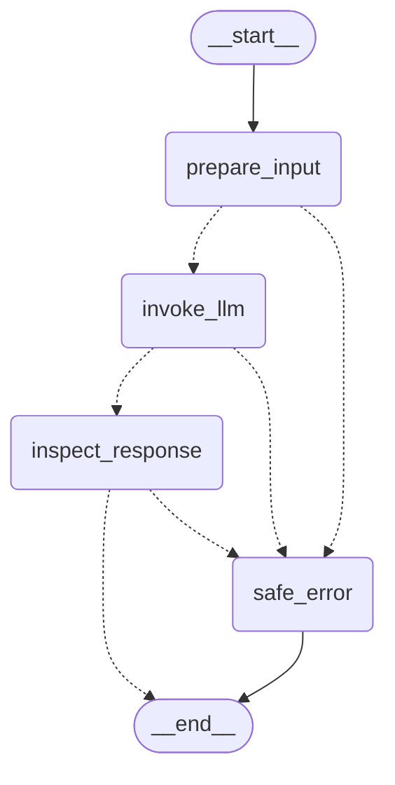

# LangGraph Foundation

Code: `src/rfq_copilot/graph.py`. Tests: `tests/test_graph.py`, mocked models only.
Dependency: `langgraph>=1,<2`, locked at 1.2.20. The graph supports memory, checkpointing, and
bounded read-only MCP tool execution (see below; tests in `tests/test_agent_tools.py`).

## Graph

Produced by LangGraph's built-in `get_graph().draw_mermaid()`. Dashed lines are
conditional edges.



The graph has no cycles. The longest path is 4 node steps. `run_graph` passes
`recursion_limit=8`, and exceeding it gives `error="execution_limit"`.

## State (`GraphState`, a `TypedDict`)

| Key | Meaning |
|---|---|
| `question` | Untrusted user input. Checked for credentials before any checkpoint, and cleared on error |
| `history` | Completed turns, merged by the `add_messages` reducer: each untrusted question block plus the assistant's text, with tool calls stripped |
| `messages` | Output of `llm.build_messages`: the trusted system message plus the untrusted block |
| `response` | The `AIMessage` from `llm.invoke` |
| `reply` | Fixed guidance, deterministic tool rendering, or `None` |
| `proposals` | Contract-valid tool calls as plain dicts (`id`, `name`, `arguments`). JSON-safe and unexecuted |
| `status` | One of `pending`, `answered`, `proposed`, `error` |
| `error` | An `llm.FailureCode`, or `execution_limit` |

State never holds identity, tokens, roles, permissions, customer scope, ORM objects or
sessions. `run_graph` returns a frozen `GraphResult` (status, reply, proposals, error)
and leaves out the raw input.

## Nodes and routing

All nodes are async. Each one reuses an LLM helper and adds no validation of its own.

| Node | LLM helper | On success | On `LlmError` |
|---|---|---|---|
| `prepare_input` | `build_messages`, which refuses credential-shaped text | → `invoke_llm` | → `safe_error` |
| `invoke_llm` | `invoke` (the model is bound once at build time with `bind_contract_tools`) | → `inspect_response` | → `safe_error` |
| `inspect_response` | `inspect_tool_calls`: allow-list, contract check, all-or-nothing | `answered` or `proposed` → END | → `safe_error` |
| `safe_error` | none | clears input and model output, sets `status="error"` → END | none |

A reply with neither text nor tool calls gives `malformed_output`. `proposed` is a
terminal state. It does not authorize anything, and nothing executes the proposal.

## Execution safety

- `build_graph(model, instructions, allowed_tools)` injects the `BaseChatModel`. The graph
  never creates providers, reads keys or enables LangSmith. Tracing requires a separate
  data-handling decision.
- Node closures capture only immutable configuration, and each `ainvoke` gets fresh state,
  so concurrent runs are isolated (tested with interleaved runs).
- There are no retries, and nothing in the graph changes state outside it.
- Errors are fixed codes. Provider exception text never reaches state or results.

## Memory and checkpointing

- **Turns:** every turn starts from `TURN_RESET`, so a previous turn's messages, response,
  reply, proposals and error never carry over. Only successful turns are added to
  `history`. `prepare_input` sends the model
  `[fresh SystemMessage, *last N turns, new untrusted block]`. Instructions are rebuilt from
  code on every turn and never persisted, so remembered text cannot become instructions.
- **Bounded history:** `max_history_turns` (default 10, 0 means no memory) is enforced with
  `RemoveMessage`, so the stored history is trimmed as well as the model input.
- **Checkpointing:** `build_graph(..., checkpointer=None)`. The memoryless path and
  `run_graph` are unchanged. A checkpointer is any `BaseCheckpointSaver`. The default is
  `InMemorySaver(serde=SAFE_SERDE)`, where `SAFE_SERDE` is `JsonPlusSerializer` with no
  pickle fallback and msgpack decoding restricted to LangGraph's safe types (primitives and
  LangChain messages).
- **Access boundary, `Conversations`:**
  - It takes a verified `api.auth.Principal`, the existing identity type, and refuses to
    work without a customer and a user (fails closed).
  - Thread ids are server-generated (`token_urlsafe(24)`) and opaque.
  - Every checkpoint carries `metadata.owner`, a SHA-256 of customer and user that is never
    visible to the model.
  - `ask` (resume) and `history` (read) check the owner under a per-thread lock. A
    malformed, unknown, foreign or unbound thread gets the same `ThreadAccessError`.
  - No state-update operation is exposed, and callers never receive the graph or the saver.
- **Sensitive data:** question text is screened before it enters any graph state. Model text
  and tool-call arguments are screened in `invoke_llm`. Tests scan all stored checkpoints,
  blobs and pending writes, not just the final state.
- **Hardening review:**
  - `invoke_llm` stores a minimal `AIMessage` holding only text and tool calls. Provider
    reasoning blocks, `additional_kwargs` and `response_metadata` are never persisted.
  - **Transient execution (exception-safety fix):** `durability="exit"` was not enough.
    LangGraph still writes the exit checkpoint when a turn ends in an unhandled exception,
    a cancellation or the recursion limit, and that checkpoint held the turn's question,
    model output and the exception text. Now:
    - Each turn runs on a graph with no checkpointer, so execution data exists only in
      memory.
    - Only after an `answered` or `proposed` turn does `Conversations` write one
      checkpoint, through `aupdate_state`. It holds only the completed, trimmed `history`
      channel, with owner metadata.
    - Handled errors, unexpected exceptions (returned as `internal_error`, with no text),
      cancellation (`CancelledError` propagates) and `execution_limit` write nothing.
    - Earlier history and ownership are unchanged.
    - Tests check that failed-turn markers appear in no retained checkpoint, blob or
      pending write.
    - Trade-off: an interrupted turn is simply lost. Nothing in it changes state.
  - The credential patterns also cover AWS, GitHub and Slack tokens, URLs with embedded
    credentials, and `password=`/`api_key:`-style assignments.
  - Residual risk: secrets in other formats are not detected, and the key=value rule can
    reject benign text.
  - Nothing in `src/` imports the graph yet, and a test enforces that. When it gets wired,
    wire `Conversations`, never the raw graph or saver.
- **Limitations:**
  - `InMemorySaver` is process-local: all threads are lost on restart, and memory grows
    until the process exits.
  - The per-thread locks only serialize turns within one process.
  - Credential screening is pattern-based.
  - Anyone holding a raw compiled graph or the saver bypasses `Conversations`. Keep them
    private.
- **PostgreSQL later:** inject `AsyncPostgresSaver` constructed with `SAFE_SERDE` (this
  needs a new dependency and its own tables, so it requires approval). The graph and
  `Conversations` stay the same, and owner metadata is stored with every checkpoint.

## Read-only MCP tool execution

```
START -> prepare_input -> invoke_llm -> inspect_response --(answer / no executor)--> END
                                              |
                                              +--(proposals + executor)--> execute_tools -> respond -> END
(any node error) -> safe_error -> END
```

**Flow.** One tool-selection model step (`invoke_llm`, tools bound). `inspect_response`
validates every call with the LLM `inspect_tool_calls` (allow-list plus contract input
model, `extra="forbid"`). If more than `MAX_TOOL_CALLS = 3` are proposed, the turn fails
before anything runs. `execute_tools` re-inspects the model message and runs each call
once, in order, through the trusted executor. Each result is re-validated against the tool's
output contract, screened with `reject_credentials` and turned into a `ToolMessage` by
`llm.tool_result_message`. `respond` makes one final model call with the **unbound** model.
If that call asks for a tool, the turn fails (`execution_limit`). Nothing executes a second
time.

**Authorization boundary.** The graph never calls handlers, services or the database. Tool
execution needs a `ToolExecutor` that the application supplies through LangGraph's run
**context** (`TurnContext`). That context is not graph state and is never checkpointed.
`mcp_executor(McpIntegration, Principal, rest_credential)` is the only executor in `src/`. It
delegates through the MCP client `McpCredentialProvider` to get an MCP-audience token for exactly
`principal.subject`. It refuses a missing principal or REST credential, and `McpIntegration`
refuses the REST token itself, a wrong audience or another subject. `McpToolClient` then
calls the MCP gateway gateway, which re-verifies the signature, issuer, audience, expiry and
revocation, re-resolves the user and customer, and enforces RBAC v2 per tool.
`Conversations(..., mcp=integration).ask(principal, question, rest_credential=...)` wires
this in. Without `mcp`, tool calls stay unexecuted proposals in proposal-only mode.

**Trusted vs untrusted.** Trusted: the verified `Principal`, the delegated token and the
executor, all held in Python locals or the run context. Untrusted: the model's tool names
and arguments, which can only select an offered contract and fill its forbid-extra input,
so no identity, customer, role, permission or token field can pass. Tool results are
untrusted too: they are schema-validated, screened and passed only as `ToolMessage` data
under the existing `TRUST_NOTICE`, never into the system message.

**Read-only allow-list.** `READ_ONLY_TOOLS` names all ten current contracts. They are
verified read-only by mechanism, not by name. Each handler runs in
`Database.snapshot_session()` (`REPEATABLE READ, READ ONLY`, enforced by PostgreSQL),
`rfq_copilot.mcp` has no write statements, and every tool is registered with `READ_ONLY`
annotations. `build_graph` refuses to offer any tool outside the list, so a future contract
is not executable by default. No state-changing tool exists, so none was deferred.

**Grounding.** Evidence consists of this turn's validated MCP results. Model prose and
conversation history never establish business facts. Tool-free turns return fixed guidance;
after tools, the response is deterministic rendering only. The model proposes tool calls
but does not write the customer-visible factual answer. The detailed controls appear below.

**Flat model-facing schema.** The model-facing view avoids nested nullable unions: `PlanningInput`
puts `parts` behind an `anyOf` of an array of `$ref` objects or null, and `rfq_id` behind an
`anyOf` of string or null. Qwen produced `rfq_id: {}` and `parts` as a single object. After
the first change it also produced `{"$numberDecimal": "450"}` for the `anyOf` of integer or
string decimals. `llm.model_facing(name)` now gives contracts that have `parts` a flat view:
- the contract's other fields plus one part's fields at top level
- no `null` branches, and no `$defs`
- exact decimals shown as a single decimal-string type (`StrictInt | str`, so floats are
  refused)

`llm.contract_arguments` validates the flat arguments (`extra="forbid"`, so identity,
customer, role, permission and token fields are rejected) and drops empty placeholders. It
moves the part fields into `parts=[part]` and validates with the **unchanged** contract
model. Nothing is defaulted: a missing `part_id`, `horizon_start` or source fails. The MCP
contracts, the server-side validation and the pricing services are unchanged. Stored
multi-part RFQs go by `rfq_id`, and the flat view carries one part per call.

## Grounding and display controls

These controls prevent unsupported model claims and preserve exact tool evidence.
Adversarial coverage lives in `tests/test_grounding.py`; opt-in local-model probes live in
`tests/test_ollama_smoke.py`.

- **Tool-free turns:** return fixed `grounding.GUIDANCE` (`grounding="guidance").
  Proposal-only turns return no reply. Model text is never shown as a business answer.
- **After tools:** `respond` returns only `grounding.render(results)`
  (`grounding="rendered"). No second model call generates prose.
- **Finish attribution:** `single_item_finish_none` applies only to a single item or part
  kind with no alternative finish. It never overrides a model-set finish or spreads one
  item's finish to another.
- **Dates:** only labelled `HORIZON_LABEL` dates count as user horizons. Multiple or
  conflicting dates fail closed as `clarification_required`; delivery dates must match
  `DELIVERY_LABEL`. The contract still requires a Monday horizon.
- **Money display:** `MoneyDisplay.from_pricing_rule` reuses trusted costing rounding:
  unit scale 0.0001, line scale 0.01, `ROUND_HALF_UP` for `price-v1.0`. It formats only
  declared USD fields. `GraphResult.results` retains exact contract JSON; density,
  dimensions, quantities and gross margin are untouched. Without a rule, the display
  fallback is two decimal places with `ROUND_HALF_UP`.

Response contract: `GraphResult.message` gives the reply or a fixed, sanitized text per error / MCP
failure code (`forbidden`, `not_found`, `unauthenticated`, `timeout`, ...).

**Remaining limitations.**
- The answers are terse by design: data or fixed guidance, with no natural-language
  explanation.
- Labelled dates and finishes inside pasted customer text count as user input (a conflict
  with policy still fails closed).
- The model itself can still put a wrong value into an argument it is allowed to set (for
  example, Qwen sent `material_id: "MAT-009 / 430"`). Contract and service validation decide
  the outcome, and the rendering shows the real result.
- Production must pass `MoneyDisplay.from_pricing_rule(pinned rule)` to use the rule's
  scales.

## Specialized-agent integration

The separate [intake](intake_agent.md), [manufacturing](manufacturing_agent.md),
[supply](supply_scheduling_agent.md), [pricing](pricing_agent.md), and
[quotation review](quotation_review_agent.md) components are coordinated by the
[Supervisor](supervisor_delegation.md). They reuse secured tool execution without giving
models write authority. State-changing services require their own reviewed idempotency,
authorization and recovery contracts; they do not join `READ_ONLY_TOOLS`.
