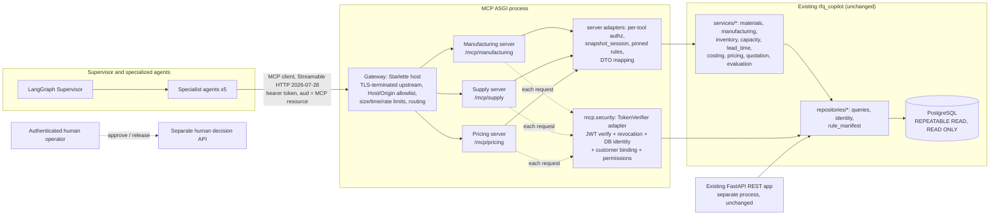

# Authenticated MCP services and contracts

The implemented gateway exposes ten read-only contracts from `src/rfq_copilot/mcp/contracts.py`
across manufacturing, supply and pricing server families. Frozen dataset proposals include
fourteen tools with different names and proposed writes; they are reference inputs, not the
live executable registry. Human approval/release and quotation persistence are outside the
MCP tool authority.

The workflow worker uses a development-only principal-bound credential provider signing
short-lived MCP-audience service tokens with an existing private key. The gateway independently
verifies them and re-resolves identity, binding, grants and revocation. REST tokens are never
forwarded. Production delegated token issuance remains a deployment requirement.


## MCP architecture

<a id="mcp-architecture-1-goal-and-non-goals"></a>
### 1. Goal and non-goals

Expose the existing deterministic read and evaluation services to the LangGraph
Supervisor and specialist agents as authenticated, customer-scoped MCP tools.

MCP tools are read-only. Quotation persistence, submission, approval, rejection and release
belong to separate backend services; human decisions use the separate decision API.

<a id="mcp-architecture-2-chosen-design-summary"></a>
### 2. Chosen design (summary)

Option C, the hybrid: **one MCP package inside the existing `rfq_copilot` distribution,
three logical MCP servers, run as a separate ASGI process from the FastAPI REST app**.
The servers share a transport-neutral security core and service adapters with the REST
API. They do not share its FastAPI dependencies, its process or its port.



<a id="mcp-architecture-3-server-responsibilities"></a>
### 3. Server responsibilities

Boundaries follow the service modules; no calculation is duplicated. Each adapter calls an
existing public `async` entry point inside one `Database.snapshot_session()`.

| Server | Capability | Existing entry point |
|---|---|---|
| Manufacturing | Material catalog | `repositories.queries.find_materials`, `list_materials`, `services.materials.get_material_spec` |
| Manufacturing | Material suitability | `services.materials.check_part_material` |
| Manufacturing | Manufacturing feasibility | `services.manufacturing.check_manufacturing_capability` |
| Supply | Inventory availability | `services.inventory.check_inventory` |
| Supply | Production capacity | `services.capacity.check_capacity` |
| Supply | Lead-time estimate | `services.lead_time.estimate_lead_time` (`select_snapshots` picks snapshots) |
| Pricing | Manufacturing costing | `services.costing.estimate_costs` |
| Pricing | Price calculation | `services.pricing.calculate_quote` |
| Pricing | Multi-part quotation evaluation | `services.quotation.quote_parts` / `quote_rfq` |
| Backend service outside MCP | Commercial-policy evaluation | `services.evaluation.evaluate_stored_rfq` / `evaluate_rfq`; not an exposed MCP tool |

Refinement from the audit: supply and pricing tools take *upstream results*
(`InventoryCheck`, `CostEstimate`) as inputs in the Python API. Those must **not** be accepted
from an agent, because they are untrusted. Each composite MCP tool recomputes its
prerequisites server-side inside one snapshot (as `quote_parts` already does) rather than
trusting a prior tool's output passed back by the LLM.

<a id="mcp-architecture-4-transport"></a>
### 4. Transport

- **Streamable HTTP, protocol revision `2026-07-28`** for every networked deployment. It is
  sessionless: no `Mcp-Session-Id` and no GET stream. Every request carries its own
  `_meta` protocol version and capabilities, and the server implements `server/discover`.
  This fits the existing one-session-per-request, read-only evaluation model.
- **stdio** only for local developer inspection of a server, with an injected test
  principal and no network listener. The spec says HTTP authorization does not apply to
  stdio. That makes stdio a development tool, never the agent path.
- **Legacy (handshake-era) revisions**: not served at first (decision D-3 in the ADR). The
  SDK client in `auto` mode falls back automatically; our own clients pin `2026-07-28`.
- SSE: deprecated; not used.
- No custom JSON-RPC parsing or transport code. The official SDK (`mcp` 2.x) owns both.

<a id="mcp-architecture-5-integration-with-existing-code"></a>
### 5. Integration with existing code

| Concern | Reuse | New |
|---|---|---|
| Token verification | `api.tokens.TokenVerifier.verify` (issuer, audience, algorithm, kid, lifetime) | SDK `TokenVerifier` adapter that calls it |
| Identity, revocation, binding, grants | `repositories.find_active_user`, `token_revoked`, `granted_permissions`, the binding logic in `api.auth._customer_for` | One transport-neutral `resolve_identity()` extracted on shared identity and used by **both** REST and MCP (one implementation per rule) |
| Settings | `ApiSettings` flags (`permission_policy`, `token_revocation`, `customer_context`, `rfq_assignments`) | `McpAuthSettings` that **refuses to start** unless v2 + enforced revocation (finding F4) |
| DB sessions | `Database.snapshot_session()` (REPEATABLE READ, READ ONLY) | none; one snapshot per tool call |
| Rules | `repositories.get_rule_version(..., expected_sha256=...)` via `rule_manifest` | Server-side pinning: callers never choose versions |
| Results | frozen dataclasses in `services/*` | Pydantic output models mapped from them; `Decimal` serialized as strings |

`api.auth.get_principal` reads `Request` and `app.state`, so it cannot secure an MCP mount.
This is the concrete evidence for F4.

<a id="mcp-architecture-6-trust-boundaries"></a>
### 6. Trust boundaries

**Untrusted (validate, never authorize on):** every tool argument produced by an LLM;
customer, RFQ, user and material identifiers in arguments; role, permission or customer
claims in arguments or `_meta`; agent instructions; RFQ attachment text; any workflow state
passed between agents; upstream tool results passed back in.

**Trusted only after server-side verification:** the principal resolved from a verified
token plus active `business.users` row; the customer from `business.user_customer_bindings`
(or the selectable-context header checked against bindings); permissions from
`business.role_permissions`; rule documents loaded by pinned version with sha256 match;
RFQ ownership from `get_rfq(..., customer_id=principal.customer_id)`; snapshots chosen by
`select_snapshots` on the server.

<a id="mcp-architecture-7-security-architecture"></a>
### 7. Security architecture

Request flow for every tool call (each step fails closed):

1. Gateway: TLS (terminated in front of the process in deployment), Host and Origin
   allowlist (SDK `TransportSecuritySettings`), body size cap, timeout, rate limit.
   Failure → 421/403/413/429 with no detail.
2. SDK bearer auth → our `TokenVerifier` adapter: signature, `iss`, `aud` equal to the
   one dedicated MCP audience (not the REST audience; §11 Resource scope), `exp`/`iat`/max
   lifetime, `kid`. Then
   active user, revocation (unknown status → 503, never "not revoked"), customer binding,
   permissions. Failure → 401 with RFC 9728 `WWW-Authenticate`, or 403.
3. Per-tool authorization in the adapter: required permission from a tool → permission
   table keyed by policy version (mirrors `ROUTE_PERMISSIONS`); an unknown tool is a
   startup error. Failure → protocol error, generic message.
4. Argument validation (Pydantic, strict, bounded lengths, `Decimal` as string). Customer
   is taken from the principal, never from arguments. Failure → `-32602`.
5. One `snapshot_session()`, pinned rules, existing service call. Domain outcomes
   (decline, review, insufficient stock) are **successful structured results**, not errors.
   Unexpected exceptions → tool error with a generic text; traceback logged server-side
   only, with no tokens, DSNs or customer data in logs.

Defense in depth: steps 2–5 run inside each server, so a request that bypasses gateway
routing still meets authentication and per-tool authorization. The MCP process connects
with a **read-only database role** (deployment control, MCP gateway) in addition to READ ONLY
transactions.

No token passthrough: the MCP servers call Python services in-process. They never forward
the caller's token to the REST API or any other service.

<a id="mcp-architecture-operations-that-stay-unavailable-to-ai-agents"></a>
#### Operations that stay unavailable to AI agents

Quote approval, rejection and release; any draft persistence; RFQ submission and attachment
upload; identity, binding, operator and assignment administration (`*_admin` CLIs);
seeding, migrations, reconciliation; rule-version registration; reading frozen evaluation
data. `services.evaluation.require_human_release` stays the policy gate for quotation lifecycle.

<a id="mcp-architecture-controls-required-before-any-mcp-endpoint-listens-on-a-non-loopback-address"></a>
#### Controls required before any MCP endpoint listens on a non-loopback address

All of: F1 (v2 enforced for MCP), F2 (revocation enforced), F4 steps 1–5 implemented and
tested, dedicated MCP audience (§11 Resource scope), read-only DB role, rate and size limits. Until then the
only allowed binding is `127.0.0.1` with the SDK's default loopback Host allowlist.

<a id="mcp-architecture-8-preserved-business-behaviour"></a>
### 8. Preserved business behaviour

Unchanged and authoritative: the deterministic services and their reference parity;
pinned, sha256-checked rule versions; `approval-v1.2` for new evaluations and
`approval-v1.1` for historical reproducibility (the MCP layer selects v1.2 server-side;
v1.1 only for replaying a historical fingerprint); material and routing constraints;
snapshot selection; one REPEATABLE READ, READ ONLY transaction per evaluation; `Decimal`
with ROUND_HALF_UP; `evaluation_fingerprint`; source evidence on results; customer
isolation; the structured findings; human-only release.

| Stage | Meaning | Layer |
|---|---|---|
| Evaluation | Compute outcome, price, fingerprint for a prospective quote; no write | **MCP tool** |
| Draft eligibility | Whether an evaluation *could* become a draft (outcome, review flags) | MCP: reported as a field of the evaluation result only |
| Draft persistence | Store the draft after revalidating the fingerprint (TD-007) | Separate backend service |
| Human approval | A human approver ≠ creator, under the pinned approval policy | Separate backend service |
| Release | Human release makes the quote customer-facing | Separate backend service |

<a id="mcp-architecture-10-implemented-host"></a>
### 10. Implemented host

`rfq_copilot.mcp.host`: one ASGI process (`McpGateway`), separate from the REST app.

- **Endpoints:** exact POST endpoints `/mcp/manufacturing`, `/mcp/supply` and
  `/mcp/pricing`, plus `GET /.well-known/oauth-protected-resource/<same path>`. Every
  other path is 404, and so is every trailing-slash variant.
- **Routing:** in-process. Each SDK app keeps its full path (`streamable_http_path`), so
  nothing is rewritten. Each server has its own `McpTokenVerifier`, whose resource URL is
  `public_base_url + path` (the RFC 9728 metadata identifier only). The JWT audience is
  the one dedicated MCP audience, and it is the token binding (§11, live MCP integration).
- **Edge order:** Host → Origin → route → per-client rate limit → concurrency limit → POST
  only → `MCP-Protocol-Version: 2026-07-28` → body limit → modern-only JSON-RPC policy
  (single object, not `initialize`, `_meta` version, and `Mcp-Method`/`Mcp-Name` matching
  the body) → timeout. After that the SDK applies its own Host/Origin check, body limit,
  bearer authentication and per-tool permissions.
- **Lifespan:** the host's ASGI lifespan enters the three `session_manager.run()` contexts
  (and the owned `Database`) in an `AsyncExitStack`, and closes them on shutdown.
- **Configuration:** `RFQ_MCP_*` (auth) and `RFQ_MCP_HOST_*` (edge). `create_app_from_env`
  raises on anything missing or unsafe:
  - no wildcards;
  - the public host must be in `allowed_hosts`;
  - non-loopback requires https, `tls_terminating_proxy=true` and the proxy address in
    `trusted_proxies`.
- **Run:** `uvicorn --factory rfq_copilot.mcp.host:create_app_from_env --host 127.0.0.1
  --no-proxy-headers --workers 1`. Rate and concurrency limits live in memory, per process.

<a id="mcp-architecture-read-only-database-role-manual-dba-reviewed-not-automated"></a>
#### Read-only database role (manual, DBA-reviewed; not automated)

Run as a DBA. The password comes from the secret store and is never written here or
committed.

```sql
CREATE ROLE rfq_mcp_reader LOGIN NOSUPERUSER NOCREATEDB NOCREATEROLE NOREPLICATION NOBYPASSRLS;
ALTER ROLE rfq_mcp_reader SET default_transaction_read_only = on;
GRANT CONNECT ON DATABASE <database> TO rfq_mcp_reader;
GRANT USAGE ON SCHEMA business TO rfq_mcp_reader;
GRANT SELECT ON ALL TABLES IN SCHEMA business TO rfq_mcp_reader;
```

- The host connects with `Database(config, read_only=True)` (session default read-only),
  and every evaluation additionally runs in a `REPEATABLE READ, READ ONLY` transaction
  (verified through the host).
- `Database.verify_connection` already rejects superuser, createdb, createrole,
  replication and bypassrls roles.

<a id="mcp-architecture-11-backend-mcp-client-and-rest-delegation"></a>
### 11. Backend MCP client and REST delegation

**Client (`rfq_copilot.mcp.client.McpToolClient`)**
- Endpoints: one base URL plus fixed `SERVER_PATHS`. Tool → server comes from
  `contracts.TOOLS`; there is no caller-supplied URL or tool destination.
- Transport: SDK `mcp.Client` over `streamable_http_client`, pinned to
  `mode="2026-07-28"`. One short-lived `httpx2` connection per call, with a bounded
  overall timeout.
- Validation: inputs and outputs against the MCP contract models. Exact decimals stay strings.
- Failures: every failure is `McpCallError(code)`, with codes `invalid_input`,
  `unauthenticated`, `forbidden`, `not_found`, `conflict`, `busy`, `timeout`,
  `unavailable`, `tool_error` and `invalid_output`. HTTP statuses come from an httpx
  response hook, because the SDK hides them.
- No retries.

**Delegation (`rfq_copilot.api.mcp_integration`)**
- The REST token is never forwarded.
- A `McpCredentialProvider` must return an MCP-audience token for exactly the verified REST
  subject. The integration refuses a token that equals the REST token, has another
  audience, or names another subject.
- The MCP host still verifies the token cryptographically and re-resolves the user,
  revocation, binding and v2 permissions.
- The ordinary API has no production token exchange and never mints tokens.
  `create_app(mcp=None)` does not mount the optional MCP-backed REST route. The workflow
  worker separately supplies a development-only MCP service-token signing provider.

**Demonstration route:** `GET /api/v1/materials/{material_id}/specification`.
- REST `catalog_read` permission (v2: `view_catalog`), then the Manufacturing
  `get_material` tool.
- Errors map to fixed REST responses: 404, 422, 403, 503, 504 and 502.

**Resource scope**
- The three endpoints are **one shared protected resource**. The
  binding is the JWT `aud`, verified with `strict_aud` against the one MCP audience;
  `AccessToken.resource` reports that audience and the SDK's `validate_token_resource` is
  off, as the SDK prescribes for verifiers that check `aud` themselves. Resource binding
  must be issuer-verified; copying a configured endpoint into `resource` is not proof.
- A token for the MCP audience therefore works on all three endpoints. Each tool still
  enforces its own v2 permission from the database, so the token grants nothing beyond
  the user's grants.
- Issuer requirements: mint `aud` = `RFQ_MCP_JWT_AUDIENCE` for every MCP endpoint
  (an RFC 8707 per-endpoint `aud` such as `https://host/mcp/pricing` is rejected), sign
  with the configured key and algorithm, keep the lifetime at or below the maximum, and
  never mint the MCP audience from a REST credential without a token exchange.
- REST rejects MCP tokens (REST audience), and the MCP host rejects REST tokens.
- Per-server audiences would need issuer support for RFC 8707 resource indicators;
  that remains a provider integration item.


## ADR-001: MCP deployment architecture

- Status: **Accepted**
- Context doc: [mcp_architecture.md](mcp_architecture.md)

<a id="mcp-architecture-decision-context"></a>
### Context

The repository has a FastAPI REST app (`rfq_copilot.api.app.create_app`) whose security
lives in FastAPI dependencies (`api.auth.get_principal`, `require_route_permission`).
Those read `Request` and `app.state`. The deterministic services (`rfq_copilot.services.*`)
are transport-neutral `async` functions over a caller-owned `AsyncSession`. Agents arrive
and need read/evaluation tools only. The official Python SDK is `mcp` 2.x
(2.3.0 on PyPI at decision time), with `MCPServer`, Streamable HTTP and protocol `2026-07-28`.

<a id="mcp-architecture-decision-options"></a>
### Options

| Criterion | A: mount in FastAPI app | B: separate services per server | C: hybrid (chosen) |
|---|---|---|---|
| Security boundary | Weak: shares port and process with REST; FastAPI deps do **not** apply to a mounted Starlette sub-app, so it is easy to believe it is protected when it is not | Strong | Strong: separate process and audience, shared verified core |
| Deployment complexity | Lowest | Highest (3 deployables) | Medium (1 extra deployable) |
| Code reuse | High | Low unless a shared library is extracted anyway | High: one package, one principal resolver |
| Auth integration | Must re-implement in middleware anyway | Per service | Once, through the SDK `TokenVerifier` hook |
| Horizontal scaling | Coupled to REST | Independent per server | Independent of REST; servers scale together |
| Runtime isolation | None (agent load hurts REST) | Full | REST vs MCP isolated |
| Observability | Mixed logs | Three streams | One MCP stream, tagged per server |
| Independent testing | Mixed | Yes | Yes (each server's ASGI app tested alone) |
| Latency | In-process | In-process per service | In-process (services called directly) |
| LangGraph fit | OK | Three endpoints to configure | One gateway, three paths |
| Operational load | Low | High | Medium |

<a id="mcp-architecture-decision-decision"></a>
### Decision

**Option C.** New package `rfq_copilot.mcp` in the same distribution:

```
src/rfq_copilot/mcp/
  settings.py      # McpSettings; refuses unsafe flag combinations
  security.py      # SDK TokenVerifier adapter -> shared resolve_principal()
  permissions.py   # tool -> permission, per policy version
  adapters/        # one module per server; snapshot_session + pinned rules + DTO mapping
  contracts/       # MCP contract Pydantic input/output models
  servers/         # manufacturing.py, supply.py, pricing.py: MCPServer instances
  gateway.py       # Starlette host app, lifespan enters each session_manager.run()
```

Run it as its own ASGI process (`uvicorn --factory rfq_copilot.mcp.host:create_app_from_env`), separate from the
REST app. Each server is mounted at `/mcp/<name>` with `streamable_http_path="/"`. The host
lifespan enters every `session_manager.run()` in an `AsyncExitStack`, as the SDK ASGI guide
requires, because mounted sub-app lifespans never run.

Supporting decisions:

- **D-1 SDK:** high-level `from mcp.server import MCPServer`. The v1 `mcp.server.fastmcp` /
  `FastMCP` import no longer exists in v2 and must not be used. The low-level `Server` is
  rejected: it skips argument validation and maps exceptions to `-32603`.
- **D-2 Transport:** Streamable HTTP, `2026-07-28`, sessionless; stdio for local inspection.
- **D-3 Legacy revisions:** not served initially. `stateless_http` applies only to the
  legacy leg, so it is irrelevant until we serve that leg.
- **D-4 Errors:** domain outcomes are structured results. Bad input is `-32602` /
  `MCPError`. Unexpected failure is a tool error with generic text.
- **D-5 Auth:** SDK `token_verifier` with `validate_token_resource=False`. The adapter
  reuses the REST JWT verifier and shared database identity checks, and verifies `aud`
  against the dedicated MCP audience. REST and MCP audiences remain distinct. See
  [resource scope](#mcp-architecture-11-backend-mcp-client-and-rest-delegation).
- **D-6 Dependency:** `mcp>=2.3,<3` is declared and locked. Keep `uv.lock` committed,
  check it with `uv lock --check`, and review SDK upgrade notes before changing versions.

<a id="mcp-architecture-decision-consequences"></a>
### Consequences

- Positive: REST security stays untouched. MCP gets a boundary that does not depend on
  FastAPI and is enforced inside each server. No business logic is duplicated.
- Negative: one more process to deploy and monitor. Shared principal
  resolution must keep REST behavior consistent (covered by the existing RBAC and JWT suites).
- Limitation: the three servers share one process, so a crash or overload hits all three.
  Splitting them later is a deployment change (same package, three entry points).

<a id="mcp-architecture-decision-deployment-decisions"></a>
### Deployment decisions

- Configure the identity provider and dedicated MCP audience values.
- Retain the in-process gateway limits and apply reviewed proxy limits where needed.
- Serve legacy transports only if a real client requires them.
- Supply on-behalf-of user credentials through the provider interface. Tools must never
  substitute a universal privileged service identity for the verified user.


## MCP tool contracts

Source of truth: `src/rfq_copilot/mcp/contracts.py` (`TOOLS`). Tests:
`tests/test_mcp_contracts.py`. SDK: `mcp` 2.3.0. Contracts only: no server, endpoint or
adapter exists yet. Architecture: [mcp_architecture.md](mcp_architecture.md).

All tools are read-only (`ToolAnnotations(read_only_hint=True, destructive_hint=False,
idempotent_hint=True, open_world_hint=False)`). Permissions are rbac-policy-v2 names. MCP
runs under v2 only (F1). JSON schemas come from the Pydantic models through the SDK.
Nothing is maintained by hand.

| Tool | Server | Input | Output | Permission | Service |
|---|---|---|---|---|---|
| `search_materials` | manufacturing | `MaterialListQuery` (category, grade, thickness_mm, finish_id, limit ≤100, offset) | `MaterialPage` | `view_catalog` | `repositories.queries.find_materials` |
| `get_material` | manufacturing | `GetMaterialInput` (material_id) | `MaterialSpecOutput` | `view_catalog` | `services.materials.get_material_spec` |
| `check_material_suitability` | manufacturing | `PartCheckInput` (part) | `MaterialSuitabilityOutput` | `view_catalog` | `services.materials.check_part_material` |
| `check_manufacturing_feasibility` | manufacturing | `PartCheckInput` | `ManufacturingFeasibilityOutput` | `view_catalog` | `services.manufacturing.check_manufacturing_capability` |
| `check_inventory` | supply | `PlanningInput` | `InventoryOutput` | `view_assigned_rfqs` | `services.inventory.check_inventory` |
| `check_capacity` | supply | `PlanningInput` | `CapacityOutput` | `view_assigned_rfqs` | `services.capacity.check_capacity` |
| `estimate_lead_time` | supply | `DeliveryPlanningInput` | `LeadTimeOutput` | `view_assigned_rfqs` | `services.lead_time.estimate_lead_time` |
| `estimate_costs` | pricing | `PlanningInput` | `CostOutput` | `view_quote` | `services.costing.estimate_costs` |
| `calculate_price` | pricing | `PlanningInput` | `PriceOutput` | `view_quote` | `services.pricing.calculate_quote` |
| `evaluate_quotation` | pricing | `DeliveryPlanningInput` | `QuotationOutput` | `view_quote` | `services.quotation.quote_parts` / `quote_rfq` |

<a id="mcp-tool-contracts-inputs"></a>
### Inputs

- `part` / `parts`: the existing `api.schemas.rfq.PartSpecification` (millimetres,
  structural only; missing fields become clarification findings), 1–50 parts.
- `PlanningInput`: exactly one of `rfq_id` or `parts`, plus `horizon_start` (ISO date, a
  Monday). `DeliveryPlanningInput` adds an optional `requested_delivery_date`.
- Exact numbers: an integer or a plain decimal string. JSON floats, exponents, signs and
  NaN are rejected.

<a id="mcp-tool-contracts-outputs"></a>
### Outputs

Field names match the frozen service dataclasses. Each output keeps the provenance fields
(rule version and fingerprint, snapshot ids). Decimals serialize as strings at service
scale. A business rejection (`unsupported`, `needs_clarification`, `insufficient`,
`infeasible`, `not_manufacturable`) is a **successful** result whose `result` and
`findings` explain it.

<a id="mcp-tool-contracts-restrictions"></a>
### Restrictions

- **Identity:** no input has a customer, user, role, permission or tenant field
  (`extra="forbid"`, enforced by the SDK before a tool body runs). The customer comes only
  from the verified principal. `rfq_id` is an untrusted key. The adapter loads it
  with `customer_id=principal.customer_id`, and a missing RFQ and someone else's RFQ both
  answer `NOT_FOUND`.
- **Upstream results:** no input accepts `InventoryCheck`, `CapacityCheck`, `CostEstimate`,
  `PriceCalculation`, rule documents or snapshot pins. component/26 adapters must recompute
  the prerequisites (inventory → capacity/costs → price) in one `snapshot_session()`, and
  rules and snapshots must be selected server-side (`select_snapshots`, pinned
  `get_rule_version`).
- **Approval:** `NEW_EVALUATION_APPROVAL_RULE_VERSION = "approval-v1.2"` is a server-side
  constant, and no input can override it. `approval-v1.1` stays reachable only on trusted
  internal replay paths. The commercial-policy tool (`evaluate_stored_rfq`) is **deferred**:
  it needs a dedicated permission (a new grant in a policy overlay), which is not approved.
- **No writes:** no tool approves, releases, persists, submits or uploads. No output has
  an approval, release, draft or customer field.

<a id="mcp-tool-contracts-errors"></a>
### Errors

| Code | When | MCP form |
|---|---|---|
| `INVALID_INPUT` | arguments fail the schema (SDK) or a service `ValueError` on input | tool error (`is_error`) |
| `UNAUTHENTICATED` | principal unavailable mid-call (normally HTTP 401 before any tool runs) | tool error |
| `PERMISSION_DENIED` | principal lacks the tool's permission | tool error |
| `NOT_FOUND` | RFQ or material absent **or not visible** | tool error |
| `SNAPSHOT_CONFLICT` | `SnapshotMismatchError`, `RuleIntegrityError` | tool error |
| `INTERNAL` | anything else; traceback logged server-side only | tool error |

`tool_failure(code)` builds `ToolError("CODE: <fixed message>")`. The texts are fixed and
never echo exceptions, SQL, paths or identifiers.

**SDK note (verified):** in `mcp` 2.3.0 the high-level server reports argument-validation
failures as a tool error whose text includes the Pydantic message. That message contains
the caller's own input values, but no server data. It does not report them as JSON-RPC
`-32602`.

**Runtime (component, `mcp/safety.py`):** the servers register the SDK `ServerMiddleware`
`sanitize_tool_errors`.
- **Error text:** it rewrites every `tools/call` error result to one of the six fixed
  texts (an allow-list), so SDK validation errors no longer echo input.
- **Unknown arguments:** it refuses unknown top-level arguments (only `request` is
  allowed); the SDK would otherwise drop them silently.
- **Malformed params:** these become `-32602` with a fixed message.
- **Coverage limit:** the middleware runs on the wire path (`Client`, stdio, HTTP), not on
  direct in-process `MCPServer.call_tool()` calls.

Failures inside a tool body go through `safe_call`:
- `RuleIntegrityError` and `SnapshotMismatchError` → `SNAPSHOT_CONFLICT`.
- `DatabaseError` → `INTERNAL`.
- Input conversion (`runtime.to_parts`: `Part.from_mapping` plus the existing
  `validate_lines`, e.g. duplicate part IDs) → `INVALID_INPUT`.
- Any other `ValueError` (a service or output-contract check after validation), or any
  other exception → `INTERNAL`, with details logged server-side only (component A1).

**Dispatch boundary:** call servers only through the SDK dispatch path (`mcp.Client` or a
transport). Direct `MCPServer.call_tool()` bypasses `sanitize_tool_errors` and must not
be used by application code.

**Authorization:** every tool runs only with a verified, request-scoped
`McpPrincipal`. `McpTokenVerifier` checks the bearer token over HTTP:
- signature, issuer, the dedicated MCP audience, exp/nbf/iat, and `sub`;
- revocation, which is always enforced;
- an active user and a single customer binding.

Then `runtime._authorized` checks the tool's v2 permission before the handler runs.
Missing principal → `UNAUTHENTICATED`; missing permission → `PERMISSION_DENIED`. Neither
opens a business snapshot. An in-memory `Client` carries no principal, so it always gets
`UNAUTHENTICATED`.

**Stored RFQs:** an `rfq_id` is read inside the business snapshot with
`get_rfq(customer_id=principal.customer_id, assigned_user=...)`. Absent, foreign and
unassigned RFQs all give the same `NOT_FOUND`. A visible RFQ without runtime lines gives
`INVALID_INPUT`. Over MCP the customer comes only from the single binding: there is no
customer-selection header, so a user with several bindings is refused.

**Recomputation:** every supply and pricing call runs in one snapshot session:
`select_snapshots` → `check_inventory` → (`estimate_costs` → `calculate_quote`), and
capacity/lead time via `estimate_lead_time`, quotation via `quote_parts`. The rule
versions `mfg-v1.0` and `price-v1.0` are pinned in `mcp/runtime.py`, sha256-checked. No
component tool needs approval rules.

**Protocol versions:** the SDK may negotiate legacy revisions. Restricting them is a runtime
responsibility and is not enforced by these contracts.
