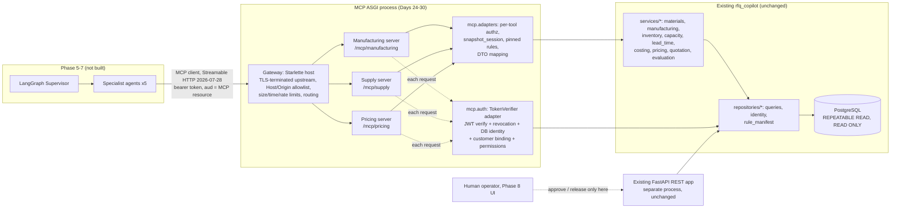

# MCP architecture (Phase 4)

Status: **design only (Day 23, 2026-11-11)**. No MCP code, dependency or endpoint exists yet.
Decision record: [mcp_architecture_decision.md](mcp_architecture_decision.md).
Findings: [phase_04_findings_tracker.md](../development/phase_04_findings_tracker.md).
Audit evidence: [day_23_architecture_report.md](../development/day_23_architecture_report.md).

## 1. Goal and non-goals

Expose the existing deterministic read and evaluation services to the future LangGraph
Supervisor and specialist agents (Phases 5–7) as authenticated, customer-scoped MCP tools.

Out of scope for every Phase 4 day: quotation persistence, draft storage, approval,
rejection, release, and any write to business tables. Those belong to **Phase 8**.

## 2. Chosen design (summary)

Option C, the hybrid: **one MCP package inside the existing `rfq_copilot` distribution,
three logical MCP servers, run as a separate ASGI process from the FastAPI REST app**.
The servers share a transport-neutral security core and service adapters with the REST
API. They do not share its FastAPI dependencies, its process or its port.



## 3. Server responsibilities

Boundaries follow the service modules; no calculation is duplicated. Each adapter calls an
existing public `async` entry point inside one `Database.snapshot_session()`.

| Server | Capability | Existing entry point |
|---|---|---|
| Manufacturing | Material catalog | `repositories.queries.find_materials`, `list_materials`, `services.materials.get_material_spec` |
| Manufacturing | Material suitability | `services.materials.check_part_material` |
| Manufacturing | Manufacturing feasibility | `services.manufacturing.check_manufacturing_capability` |
| Supply | Inventory availability | `services.inventory.check_inventory` |
| Supply | Production capacity | `services.capacity.check_capacity` |
| Supply | Lead-time estimate | `services.lead_time.estimate_lead_time` (`select_snapshots` picks snapshots) |
| Pricing | Manufacturing costing | `services.costing.estimate_costs` |
| Pricing | Price calculation | `services.pricing.calculate_quote` |
| Pricing | Multi-part quotation evaluation | `services.quotation.quote_parts` / `quote_rfq` |
| Pricing | Commercial-policy evaluation (authorized roles only) | `services.evaluation.evaluate_stored_rfq` / `evaluate_rfq` |

Refinement from the audit: supply and pricing tools take *upstream results*
(`InventoryCheck`, `CostEstimate`) as inputs in the Python API. Those must **not** be accepted
from an agent, because they are untrusted. Each composite MCP tool recomputes its
prerequisites server-side inside one snapshot (as `quote_parts` already does) rather than
trusting a prior tool's output passed back by the LLM.

## 4. Transport

- **Streamable HTTP, protocol revision `2026-07-28`** for every networked deployment. It is
  sessionless: no `Mcp-Session-Id` and no GET stream. Every request carries its own
  `_meta` protocol version and capabilities, and the server implements `server/discover`.
  This fits the existing one-session-per-request, read-only evaluation model.
- **stdio** only for local developer inspection of a server, with an injected test
  principal and no network listener. The spec says HTTP authorization does not apply to
  stdio. That makes stdio a development tool, never the agent path.
- **Legacy (handshake-era) revisions**: not served at first (decision D-3 in the ADR). The
  SDK client in `auto` mode falls back automatically; our own clients pin `2026-07-28`.
- SSE: deprecated; not used.
- No custom JSON-RPC parsing or transport code. The official SDK (`mcp` 2.x) owns both.

## 5. Integration with existing code

| Concern | Reuse | New (Day 24+) |
|---|---|---|
| Token verification | `api.tokens.TokenVerifier.verify` (issuer, audience, algorithm, kid, lifetime) | SDK `TokenVerifier` adapter that calls it |
| Identity, revocation, binding, grants | `repositories.find_active_user`, `token_revoked`, `granted_permissions`, the binding logic in `api.auth._customer_for` | One transport-neutral `resolve_principal()` extracted on Day 27 and used by **both** REST and MCP (one implementation per rule) |
| Settings | `ApiSettings` flags (`permission_policy`, `token_revocation`, `customer_context`, `rfq_assignments`) | `McpSettings` that **refuses to start** unless v2 + enforced revocation (finding F4) |
| DB sessions | `Database.snapshot_session()` (REPEATABLE READ, READ ONLY) | none; one snapshot per tool call |
| Rules | `repositories.get_rule_version(..., expected_sha256=...)` via `rule_manifest` | Server-side pinning: callers never choose versions |
| Results | frozen dataclasses in `services/*` | Pydantic output models mapped from them; `Decimal` serialized as strings |

`api.auth.get_principal` reads `Request` and `app.state`, so it cannot secure an MCP mount.
This is the concrete evidence for F4.

## 6. Trust boundaries

**Untrusted (validate, never authorize on):** every tool argument produced by an LLM;
customer, RFQ, user and material identifiers in arguments; role, permission or customer
claims in arguments or `_meta`; agent instructions; RFQ attachment text; any workflow state
passed between agents; upstream tool results passed back in.

**Trusted only after server-side verification:** the principal resolved from a verified
token plus active `business.users` row; the customer from `business.customer_bindings`
(or the selectable-context header checked against bindings); permissions from
`business.role_permissions`; rule documents loaded by pinned version with sha256 match;
RFQ ownership from `get_rfq(..., customer_id=principal.customer_id)`; snapshots chosen by
`select_snapshots` on the server.

## 7. Security architecture

Request flow for every tool call (each step fails closed):

1. Gateway: TLS (terminated in front of the process in deployment), Host and Origin
   allowlist (SDK `TransportSecuritySettings`), body size cap, timeout, rate limit.
   Failure → 421/403/413/429 with no detail.
2. SDK bearer auth → our `TokenVerifier` adapter: signature, `iss`, `aud` equal to the
   one dedicated MCP audience (not the REST audience; §11 Resource scope), `exp`/`iat`/max
   lifetime, `kid`. Then
   active user, revocation (unknown status → 503, never "not revoked"), customer binding,
   permissions. Failure → 401 with RFC 9728 `WWW-Authenticate`, or 403.
3. Per-tool authorization in the adapter: required permission from a tool → permission
   table keyed by policy version (mirrors `ROUTE_PERMISSIONS`); an unknown tool is a
   startup error. Failure → protocol error, generic message.
4. Argument validation (Pydantic, strict, bounded lengths, `Decimal` as string). Customer
   is taken from the principal, never from arguments. Failure → `-32602`.
5. One `snapshot_session()`, pinned rules, existing service call. Domain outcomes
   (decline, review, insufficient stock) are **successful structured results**, not errors.
   Unexpected exceptions → tool error with a generic text; traceback logged server-side
   only, with no tokens, DSNs or customer data in logs.

Defense in depth: steps 2–5 run inside each server, so a request that bypasses gateway
routing still meets authentication and per-tool authorization. The MCP process connects
with a **read-only database role** (deployment control, Day 28) in addition to READ ONLY
transactions.

No token passthrough: the MCP servers call Python services in-process. They never forward
the caller's token to the REST API or any other service.

### Operations that stay unavailable to AI agents

Quote approval, rejection and release; any draft persistence; RFQ submission and attachment
upload; identity, binding, operator and assignment administration (`*_admin` CLIs);
seeding, migrations, reconciliation; rule-version registration; reading frozen evaluation
data. `services.evaluation.require_human_release` stays the policy gate for Phase 8.

### Controls required before any MCP endpoint listens on a non-loopback address

All of: F1 (v2 enforced for MCP), F2 (revocation enforced), F4 steps 1–5 implemented and
tested, dedicated MCP audience (§11 Resource scope), read-only DB role, rate and size limits. Until then the
only allowed binding is `127.0.0.1` with the SDK's default loopback Host allowlist.

## 8. Preserved business behaviour

Unchanged and authoritative: the deterministic services and their reference parity;
pinned, sha256-checked rule versions; `approval-v1.2` for new evaluations and
`approval-v1.1` for historical reproducibility (the MCP layer selects v1.2 server-side;
v1.1 only for replaying a historical fingerprint); material and routing constraints;
snapshot selection; one REPEATABLE READ, READ ONLY transaction per evaluation; `Decimal`
with ROUND_HALF_UP; `evaluation_fingerprint`; source evidence on results; customer
isolation; the structured findings; human-only release.

| Stage | Meaning | Phase |
|---|---|---|
| Evaluation | Compute outcome, price, fingerprint for a prospective quote; no write | **Phase 4 MCP tool** |
| Draft eligibility | Whether an evaluation *could* become a draft (outcome, review flags) | Phase 4: reported as a field of the evaluation result only |
| Draft persistence | Store the draft after revalidating the fingerprint (TD-007) | Phase 8 |
| Human approval | A human approver ≠ creator, under the pinned approval policy | Phase 8 |
| Release | Human release makes the quote customer-facing | Phase 8 |

## 9. Implementation sequence

| Day | Work |
|---|---|
| 24 | Tool contracts: names, Pydantic input/output models, permission per tool, error taxonomy. No registration. |
| 25 | Manufacturing server tools on adapters (loopback only, injected principal in tests). |
| 26 | Supply and Pricing server tools. |
| 27 | Security core: extract `resolve_principal()`, SDK `TokenVerifier` adapter, MCP settings that require v2 + revocation, tool permission table, provisioning runbook (F1–F4). |
| 28 | Gateway: host process, Host/Origin, limits, timeouts, rate limiting, logging, read-only role. |
| 29 | Client integration tests with the SDK `Client` over Streamable HTTP; cross-customer tests. |
| 30 | Phase 4 verification, tracker closure. |

## 10. Implemented host (Day 28)

`rfq_copilot.mcp.host`: one ASGI process (`McpGateway`), separate from the REST app.

- **Endpoints:** exact POST endpoints `/mcp/manufacturing`, `/mcp/supply` and
  `/mcp/pricing`, plus `GET /.well-known/oauth-protected-resource/<same path>`. Every
  other path is 404, and so is every trailing-slash variant.
- **Routing:** in-process. Each SDK app keeps its full path (`streamable_http_path`), so
  nothing is rewritten. Each server has its own `McpTokenVerifier`, whose resource URL is
  `public_base_url + path` (the RFC 9728 metadata identifier only). The JWT audience is
  the one dedicated MCP audience, and it is the token binding (§11, Day 30).
- **Edge order:** Host → Origin → route → per-client rate limit → concurrency limit → POST
  only → `MCP-Protocol-Version: 2026-07-28` → body limit → modern-only JSON-RPC policy
  (single object, not `initialize`, `_meta` version, and `Mcp-Method`/`Mcp-Name` matching
  the body) → timeout. After that the SDK applies its own Host/Origin check, body limit,
  bearer authentication and per-tool permissions.
- **Lifespan:** the host's ASGI lifespan enters the three `session_manager.run()` contexts
  (and the owned `Database`) in an `AsyncExitStack`, and closes them on shutdown.
- **Configuration:** `RFQ_MCP_*` (auth) and `RFQ_MCP_HOST_*` (edge). `create_app_from_env`
  raises on anything missing or unsafe:
  - no wildcards;
  - the public host must be in `allowed_hosts`;
  - non-loopback requires https, `tls_terminating_proxy=true` and the proxy address in
    `trusted_proxies`.
- **Run:** `uvicorn --factory rfq_copilot.mcp.host:create_app_from_env --host 127.0.0.1
  --no-proxy-headers --workers 1`. Rate and concurrency limits live in memory, per process.

### Read-only database role (manual, DBA-reviewed; not automated)

Run as a DBA. The password comes from the secret store and is never written here or
committed.

```sql
CREATE ROLE rfq_mcp_reader LOGIN NOSUPERUSER NOCREATEDB NOCREATEROLE NOREPLICATION NOBYPASSRLS;
ALTER ROLE rfq_mcp_reader SET default_transaction_read_only = on;
GRANT CONNECT ON DATABASE <database> TO rfq_mcp_reader;
GRANT USAGE ON SCHEMA business TO rfq_mcp_reader;
GRANT SELECT ON ALL TABLES IN SCHEMA business TO rfq_mcp_reader;
```

- The host connects with `Database(config, read_only=True)` (session default read-only),
  and every evaluation additionally runs in a `REPEATABLE READ, READ ONLY` transaction
  (verified through the host).
- `Database.verify_connection` already rejects superuser, createdb, createrole,
  replication and bypassrls roles.

## 11. Backend MCP client and REST delegation (Day 29)

**Client (`rfq_copilot.mcp.client.McpToolClient`)**
- Endpoints: one base URL plus fixed `SERVER_PATHS`. Tool → server comes from
  `contracts.TOOLS`; there is no caller-supplied URL or tool destination.
- Transport: SDK `mcp.Client` over `streamable_http_client`, pinned to
  `mode="2026-07-28"`. One short-lived `httpx2` connection per call, with a bounded
  overall timeout.
- Validation: inputs and outputs against the Day 24 models. Exact decimals stay strings.
- Failures: every failure is `McpCallError(code)`, with codes `invalid_input`,
  `unauthenticated`, `forbidden`, `not_found`, `conflict`, `busy`, `timeout`,
  `unavailable`, `tool_error` and `invalid_output`. HTTP statuses come from an httpx
  response hook, because the SDK hides them.
- No retries.

**Delegation (`rfq_copilot.api.mcp_integration`)**
- The REST token is never forwarded.
- A `McpCredentialProvider` must return an MCP-audience token for exactly the verified REST
  subject. The integration refuses a token that equals the REST token, has another
  audience, or names another subject.
- The MCP host still verifies the token cryptographically and re-resolves the user,
  revocation, binding and v2 permissions.
- No provider ships: the identity provider has no token exchange yet, and this service
  never mints tokens. `create_app(mcp=None)` (the default) does not mount the MCP-backed
  route.

**Demonstration route:** `GET /api/v1/materials/{material_id}/specification`.
- REST `catalog_read` permission (v2: `view_catalog`), then the Manufacturing
  `get_material` tool.
- Errors map to fixed REST responses: 404, 422, 403, 503, 504 and 502.

**Resource scope**
- Day 30 (corrected): the three endpoints are **one shared protected resource**. The
  binding is the JWT `aud`, verified with `strict_aud` against the one MCP audience;
  `AccessToken.resource` reports that audience and the SDK's `validate_token_resource` is
  off, as the SDK prescribes for verifiers that check `aud` themselves. Until Day 29 the
  verifier copied each endpoint URL into `resource`, so the SDK resource check could
  never fail; it was not issuer-verified binding.
- A token for the MCP audience therefore works on all three endpoints. Each tool still
  enforces its own v2 permission from the database, so the token grants nothing beyond
  the user's grants.
- Issuer requirements: mint `aud` = `RFQ_MCP_JWT_AUDIENCE` for every MCP endpoint
  (an RFC 8707 per-endpoint `aud` such as `https://host/mcp/pricing` is rejected), sign
  with the configured key and algorithm, keep the lifetime at or below the maximum, and
  never mint the MCP audience from a REST credential without a token exchange.
- REST rejects MCP tokens (REST audience), and the MCP host rejects REST tokens.
- Per-server audiences would need issuer support for RFC 8707 resource indicators;
  that remains a provider integration item.
