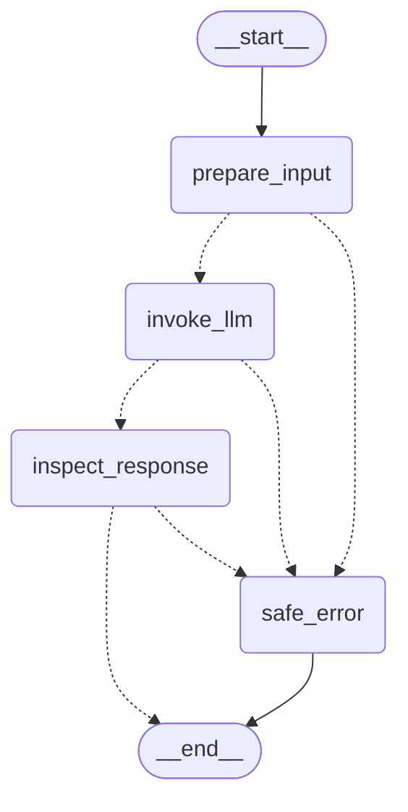

# Specialized agents, evidence and integration

The five specialists are Intake and Validation, Manufacturing Feasibility, Supply and
Scheduling, Pricing, and Quotation and Review. Intake has separate extraction and validation
stages, so the Supervisor executes six stages. Specialists return non-binding typed evidence;
the PostgreSQL drafter separately creates persistent quotations and humans own decisions.

## Persisted structured source and unstructured extraction

The worker constructs `StructuredIntakeSource` only from current scoped persisted parts
when `raw_request` is absent. `render()` preserves exact decimal scale, part ownership,
field evidence and source offsets. A1 records provisional facts without a model proposal;
validation rechecks the rendered digest, complete candidate provenance, catalog IDs/names,
pinned requirements, missing fields and contradictions. Catalog wording never replaces IDs.

Requests containing free-text notes retain the unstructured model extraction path. Every
proposed value needs its own source evidence, field attribution and part boundary. Missing
values remain missing. Trusted part-ID resolution preserves stored spelling and refuses
colliding aliases. `SourceGate` checks tool specifications against the persisted RFQ before
execution, rejecting invented owners or contradictions with stated stored values. Neither
path may bypass manufacturing, catalog, injection or credential screening.

The detailed extraction contract below describes unstructured proposals unless explicitly
stated otherwise. Its model-call count does not apply to structured extraction. The worker
still configures its local Ollama dependency at startup for requests that need extraction.


## Specialized Agent Integration (A1 → A5)

<a id="specialized-agent-integration-1-end-to-end-architecture"></a>
### 1. End-to-end architecture

```text
preflight ─► A1 extraction ─► A1 validation ─► A2 ─► A3 ─► A4 ─► A5
   │              │                │            │     │     │     │
   └──────────────┴────────────────┴────────────┴─────┴─────┴─────┴─► stop + typed result
```

- One module, one public coroutine, one result model. No new framework and no second
  LangGraph graph. A1 keeps its existing four-node graph, and the other agents are plain
  coroutines.
- Every agent runs **at most once**. There are no retries and no loops. The only model call
  is A1's single extraction.
- After each stage, that stage's own status is looked up in the fixed table `_NEXT`. Anything
  other than "continue" ends the workflow, so no later agent and no later tool runs.

<a id="specialized-agent-integration-2-entry-point"></a>
### 2. Entry point

```python
async def evaluate_rfq_workflow(
    text: str,                                    # untrusted customer content, used only by A1
    *,
    source_id: str,                               # trusted, caller-assigned
    rfq_id: str | None,                           # trusted, caller-assigned
    intake_graph: CompiledStateGraph,             # intake.build_intake_graph(model)
    execute: ToolExecutor | None,                 # graph.mcp_executor(mcp, principal, credential)
    horizon_start: date | None,                   # trusted planning policy (a Monday)
    manufacturing_rules: RuleVersionDetails | None,  # pinned_rules(session, "mfg-v1.0")
    pricing_rules: RuleVersionDetails | None,        # pinned_rules(session, "price-v1.0")
    approval_rules: RuleVersionDetails | None,       # pinned_rules(session, "approval-v1.2")
    timeout_seconds: float = 390.0,
) -> RFQWorkflowAssessment
```

The caller cannot pass any of the following:

- an `IntakeResult` or `IntakeValidation`
- any earlier stage result
- a customer id, role or permission

A test pins this parameter list.

<a id="specialized-agent-integration-3-execution-order"></a>
### 3. Execution order

| # | Stage | Agent call | Tools (RBAC v2) |
|---|---|---|---|
| 0 | `preflight` | none: checks `execute`, `price-v1.0` and `approval-v1.2` against the manifest | none |
| 1 | `intake_extraction` | `intake.run_intake(intake_graph, text, ...)` | none (one model call) |
| 2 | `intake_validation` | `intake_validation.validate_intake(extraction, text, rules=mfg, catalog=execute)` | `search_materials` |
| 3 | `manufacturing` | `evaluate_manufacturing_feasibility(intake, execute)` | `check_manufacturing_feasibility` (`view_catalog`), once per part |
| 4 | `supply` | `evaluate_supply(a2, execute, horizon_start=, extraction=<same object>)` | `check_inventory`, `check_capacity`, `estimate_lead_time` (`view_assigned_rfqs`) |
| 5 | `pricing` | `evaluate_pricing(a2, a3, execute, pricing_rules=)` | `estimate_costs`, `calculate_price` (`view_quote`) |
| 6 | `quotation` | `evaluate_quotation_review(a2, a3, a4, execute, pricing_rules=, approval_rules=)` | `evaluate_quotation` (`view_quote`) |

The preflight runs before the model call. A missing executor, or an untrusted pricing or
approval rule, therefore costs nothing.

<a id="specialized-agent-integration-4-inputoutput-contracts"></a>
### 4. Input/output contracts

| Agent | Receives (from the integration) | Returns (kept unchanged) |
|---|---|---|
| A1 extraction | text, trusted `source_id` / `rfq_id` | `IntakeResult` (with `source_sha256`) |
| A1 validation | that `IntakeResult`, the same text, mfg rules, executor | `IntakeValidation` |
| A2 | that `IntakeValidation` | `ManufacturingAssessment` |
| A3 | that `ManufacturingAssessment`, trusted horizon, **the same `IntakeResult` object** | `SupplyAssessment` |
| A4 | the A2 and A3 objects, trusted pricing rule | `PricingAssessment` |
| A5 | the A2, A3 and A4 objects, trusted pricing and approval rules | `QuotationReviewAssessment` |

`RFQWorkflowAssessment` is frozen, has `extra="forbid"`, and contains:

- **Identity and provenance:** `source_id`, `rfq_id`, `source_sha256`.
- **Outcome:** `status`, `stopped_at`, and `stages`, the trace of each stage's own status
  and reason code.
- **Diagnostics:** `error` (a fixed code), `clarifications`, `review_reasons`,
  `unevaluated_conditions`.
- **Rules and draft:** `rules`, the (version, fingerprint) pairs used; `draft_available`.
- **Human boundary:** `human_approval_required: Literal[True]`, `approved: Literal[False]`,
  `released: Literal[False]`.
- **Internal stage results:** every stage result that passed its handoff checks.

Workflow statuses:

| Status | Meaning |
|---|---|
| `draft_ready_for_review` | A5 assembled a verified, non-binding draft. Human approval is still required. |
| `requires_review` | A human must review. A draft may exist; `draft_available` says whether it does. |
| `clarification_required` | The customer must answer `clarifications`. |
| `not_quotable` | A2 found a part not manufacturable. |
| `not_evaluated` | A gate refused: an untrusted rule, a forged or stale upstream result, or a bad horizon. |
| `error` | A tool, timeout, identity or agent failure; see `error`. |

<a id="specialized-agent-integration-5-verified-intake-pairing"></a>
### 5. Verified Intake pairing

`IntakeValidation` has no `source_sha256`. The workflow therefore never accepts an
Intake pair from outside:

- The extraction and its validation are produced here, from the same `text`, within one
  call.
- `validate_intake` re-checks `extraction.source_sha256` against that text. A test shows
  that an extraction of other text under the same ids is refused: `internal_error` at
  `intake_validation`, and no tool runs.
- **The same `IntakeResult` object** goes to A3. It is never re-fetched or rebuilt; a test
  asserts object identity.
- Each stage result must carry the requested `(source_id, rfq_id)`, else
  `identity_mismatch`. A2 must carry exactly A1's specifications, else
  `specification_mismatch`.
- A result that fails a handoff check is not kept in the workflow result. Nothing downstream
  can read it.

**Accepted limitation.** This protects pairing inside one workflow call. It does not
cryptographically authenticate assessment objects built elsewhere: upstream evidence is
unsigned.

<a id="specialized-agent-integration-6-trusted-principal-and-tool-authorization"></a>
### 6. Trusted principal and tool authorization

- There is one executor per evaluation (`graph.mcp_executor`, bound to the verified
  `Principal` and its delegated credential), and every stage uses it. Results from different
  principals cannot be mixed within one result. Two concurrent workflows for two customers
  stay separate (tested).
- No tool argument carries identity, role, permission or rule version. The contracts use
  `extra="forbid"`, and a test inspects every request.
- Authorization stays with each MCP server. No later stage is authorized by an earlier stage
  having succeeded. A principal without `view_quote` gets `forbidden` at A4 or A5 and sees no
  cost or price.
- A missing or malformed principal makes the executor raise `unauthenticated` before any
  call. A1's catalog lookup reports that as unavailable, the workflow stops at
  `intake_validation`, and no tool is reached.
- The integration has no database access. Rules are loaded by the caller with
  `mcp.runtime.pinned_rules`.

<a id="specialized-agent-integration-7-rule-pinning-and-verification"></a>
### 7. Rule pinning and verification

- `price-v1.0` and `approval-v1.2` are checked against `TRUSTED_RULES` in the preflight. The
  check uses A4's and A5's own helpers (`pricing_agent._trusted`,
  `quotation_agent._approval_trusted`), so there is one implementation of each check.
- A4 and A5 then repeat their own checks. A3's acceptance of the pricing rule (version and
  cross-tool fingerprint) is **not** treated as proof of authenticity. A4's manifest check
  still runs.
- `mfg-v1.0` is not manifest-checked here. `pinned_rules` checks its source sha256, and A2
  compares every tool result's server-pinned rule and fingerprint with the ones Intake
  validated against. A difference means `requires_review`.
- The same pricing rule object is passed to A4 and A5. Customer text never supplies a rule.
  A test shows that a prompt asking for `price-v9.9` and zero margin changes nothing.

<a id="specialized-agent-integration-8-stage-gating-and-status-transitions"></a>
### 8. Stage gating and status transitions

| Stage | Continue on | Stop with |
|---|---|---|
| A1 extraction | `extracted`, `extracted_with_issues`, `no_parts_found` | `error` → `error` |
| A1 validation | `ready_for_manufacturing_evaluation` | `needs_clarification` → `clarification_required`; `requires_review` → `requires_review`; `not_evaluated` → `not_evaluated` |
| A2 | `feasible` | `infeasible` → `not_quotable`; `needs_clarification` → `clarification_required`; `requires_review` → `requires_review`; `not_evaluated`; `error` |
| A3 | `available`, `constrained` | `needs_clarification` → `clarification_required`; `requires_review`; `not_evaluated`; `error` |
| A4 | `priced`, `requires_review` | `not_evaluated`; `error` |
| A5 | (final) | its status, unchanged |

- **Unknown status:** stops with `error` / `unexpected_stage_status`.
- **A4 `requires_review`** (rule drift or contradiction) continues to A5. A5 replays A4 over
  its recorded evidence, returns a no-amount `requires_review`, and **does not call its
  tool**. A forged A4 status fails that replay (`pricing_assessment_invalid`).
- **A forged A3 `constrained`** fails A4's gate (`supply_evidence_invalid`). No pricing tool
  runs.
- **`stopped_at`** is `None` only when A5 assembled a verified draft (`draft_ready_for_review`
  or `requires_review` with lines). Otherwise it names the stage that ended the workflow.

<a id="specialized-agent-integration-9-business-authority-boundaries"></a>
### 9. Business-authority boundaries

Every decision belongs to the agent, or the service behind its tool, that owns it:

| Decision | Owner |
|---|---|
| Completeness and catalog | A1 |
| Feasibility, routing and bend minimum | A2 |
| Stock, capacity and dates | A3 |
| Cost and price | A4 |
| Draft and approval-policy conditions | A5 |

The integration compares identities and specifications only. It computes no feasibility,
schedule, amount, discount, tax, freight, validity or approval.

<a id="specialized-agent-integration-10-cross-agent-evidence-propagation"></a>
### 10. Cross-agent evidence propagation

The integration hands over the agents' own objects. It does not copy or transform them, so
every existing check still applies:

- **manufacturing evidence control and cross-agent evidence control:** A2 refuses forged nested evidence and a missing, lowered or
  contradicting `min_bend_radius_mm`. Stops at A2 (tested through the workflow).
- **supply evidence control:** A2 evidence that is no longer bound to its specification. Stops at A3:
  `manufacturing_evidence_invalid`.
- **supply evidence control, supply evidence control and cross-agent evidence control:** inconsistent stock lines, chronology, procurement delay,
  start week or ready date. A3 `invalid_evidence`.
- **quotation evidence control:** per-line procurement delay agrees with the stock line and the RFQ delay (A5).
- **quotation evidence control:** the customer `conditional` flag reflects outstanding review and the
  unevaluated customer checks (A5's `customer_view`).

<a id="specialized-agent-integration-11-snapshot-consistency-limitations"></a>
### 11. Snapshot consistency limitations

- A3's three tools each run in their own read-only snapshot. The integration never claims
  they are atomic and never invents a shared snapshot id.
- A4's tools do not report snapshot ids. A4 records A3's.
- A5's quotation service reads its own snapshot. A disagreement with A3 or A4 is
  `invalid_evidence` (tested with another schedule and other stock).
- `invalid_evidence` is propagated as a stop. A new attempt is a fresh, caller-controlled
  `evaluate_rfq_workflow` call. Results from different calls are never spliced together.

<a id="specialized-agent-integration-12-internal-versus-customer-facing-outputs"></a>
### 12. Internal versus customer-facing outputs

| Output | Contents | Audience |
|---|---|---|
| `RFQWorkflowAssessment` | All stage results, including A4 internal costs and raw tool evidence | Internal only (Supervisor, audit). Never serialize it to a customer. |
| `.summary()` | Trace, statuses, codes, reasons, rule provenance. No amount and no evidence. | Logs, handoffs |
| `.customer_view()` | A5's `CustomerQuotationDraft` (selling lines, total, exclusions, estimate, `conditional`, notice). `None` unless `draft_available`. | Customer-facing draft, after a human decision |

A4 diagnostic amounts kept under rule drift stay inside `pricing.evidence`. They never reach
`summary()` or `customer_view()` (tested).

<a id="specialized-agent-integration-13-human-approval-and-release"></a>
### 13. Human approval and release

- `approved` and `released` are `Literal[False]`, and `human_approval_required` is
  `Literal[True]`, both on the workflow and on A5. Validation refuses any other value.
- There is no quote number, version, validity or expiry, and there is no persistence. The
  module source has no database session, commit or rule registration, and a test checks this.
- `unevaluated_conditions` lists `customer_account_status` and `credit_limit` on every
  draft. No trusted source evaluates them.

<a id="specialized-agent-integration-14-failure-and-timeout-handling"></a>
### 14. Failure and timeout handling

- **Overall deadline** (`timeout_seconds`): each agent gets `min(its default, remaining)` and
  fails closed through its own timeout path:
  - A1 extraction: `execution_limit`.
  - A1 validation: `catalog_unavailable` → review.
  - A2 to A5: `timeout`.
  - If no time is left before a stage, it is recorded as `not_run` / `timeout` and nothing is
    called.
- **Tool failures** keep the agent's fixed code (`forbidden`, `unauthenticated`, `busy`,
  `invalid_output`, `unavailable`, ...). There are no retries.
- **An exception raised by an agent** stops with `internal_error`. Exception text never
  reaches the result (tested with a credential-shaped message).
- **No partial result counts as complete.** The stages that did run stay visible in `stages`
  and in the stage results.

<a id="specialized-agent-integration-15-testing-and-live-mcp-strategy"></a>
### 15. Testing and live MCP strategy

- **Offline:** `tests/test_specialized_agent_integration.py`. One `Router` executor sends
  each tool to the existing specialist fake, which runs the real services. A1 runs its real
  graph on the intake extraction fake chat model. Bent-part scenarios replace only A1's validation
  output. Status-override tests patch one agent's result to check gating. Every stop asserts
  that no later stage's tool ran.
- **Live (opt-in):** `tests/test_specialized_agent_integration_live_mcp.py`, with
  `RFQ_AGENT_LIVE_MCP=1` and marked `integration`. It uses the quotation review host fixtures over the
  guarded test database, with no paid or local model:
  - An authorized principal reaches A5.
  - A restricted principal (`manufacturing_engineer`) and a revoked principal get no price
    and no draft.
  - `approval-v1.2` is registered with the existing idempotent `register_rule_version`, as
    on quotation review.
- **Observability:** the agents have no logging convention, so none was added. `stages` plus
  `summary()` is the structured trace a caller may log. It never contains credentials,
  customer text, amounts or raw evidence.

<a id="specialized-agent-integration-16-accepted-limitations-and-supervisor-handoff"></a>
### 16. Accepted limitations and Supervisor handoff

| Limitation | specialist workflow handling |
|---|---|
| `IntakeValidation` has no source sha | The pair is created in-process from one text; the same extraction goes to A3 |
| Upstream evidence is unsigned | Consistency is validated; no cryptographic authenticity is claimed |
| A2 bend-radius evidence | cross-agent evidence control is enforced by A2 and reached through the workflow |
| A3 separate snapshots | No atomicity claimed; no merge, no hidden retry |
| A3 RFQ-level scheduling | No per-part or partial schedule is produced |
| A3 planning estimates | `estimated_ready_date` is an estimate in A5's draft and notice |
| A3 rule verification | A4's manifest check is preserved and also run in the preflight |
| A4 raw monetary evidence | Internal only; drift amounts are never promoted |
| A4 prices are advisory | The draft needs human approval; `approved` is always `False` |
| A5 procurement checks | quotation evidence control is unchanged |
| A5 customer conditional | quotation evidence control is unchanged; `conditional` is always true while checks are unevaluated |
| A5 has no credit/account source | `unevaluated_conditions` |
| A5 has no validity rule | No expiry |
| A5 has no persistence | No quote id or version |
| Human approval | Never automatic |

Supervisor integration boundaries:

| The Supervisor may | The Supervisor must never |
|---|---|
| Call `evaluate_rfq_workflow` with trusted ids, a principal-bound executor, a trusted horizon and the results of `pinned_rules` | Pass caller- or model-supplied rules, ids, roles or Intake objects |
| Read `status`, `stopped_at`, `clarifications`, `review_reasons`, `summary()` | Treat `draft_ready_for_review` as approval, or release or send a draft |
| Show `customer_view()` after a human decision | Serialize the full `RFQWorkflowAssessment` (A4 costs, raw evidence) to a customer |
| Start a **new** evaluation after a clarification or failure | Retry a stage, splice results across calls, or override a stage status |
| Route review to humans (`required_approver_role`) | Approve, persist, number or set expiry for a quotation |


## Engineering RFQ Multi-Agent Copilot — Agent Responsibilities

<a id="agent-responsibilities-10-required-workflow-order-and-dependencies"></a>
### 10. Required workflow order and dependencies

The **business dependency graph** is:

```text
Authorized RFQ submission
          |
          v
A0 Supervisor -> A1 Intake
          |
          v
   Requirements valid? ---- no ---> Clarification / blocked path
          |
         yes
          v
     A2 Engineering -------- unsupported/uncertain ---> Decline or engineering review
          |
     supported
          v
 A3 Supply & Scheduling ---- shortage/date conflict ---> Review / alternative / revised estimate
          |
    validated basis
          v
      A4 Pricing ----------- missing input/policy issue ---> Clarification / commercial review
          |
    verified price
          v
  A5 Quotation & Review ---- draft_creation_allowed=false ---> No draft write
          |
       draft
          v
 Authorized human review/approval of exact quote version
          |
          v
 Eligible for customer-facing release only after backend checks
```

The arrows represent **required information and decision dependencies**, not a blanket requirement to execute every tool sequentially. Independent safe reads may be concurrent, but downstream results must not be relied upon when their required inputs are unverified or have changed.

**Rework rule:** A change to material, dimensions, quantity, finish or other materially relevant requirements can invalidate prior engineering, supply, pricing and draft results. The workflow must re-run affected checks and use a new quote version as appropriate.

<a id="agent-responsibilities-11-decision-ownership-escalation-and-approval"></a>
### 11. Decision ownership, escalation and approval

| Event | Primary evaluator | Routing decision | Required external authority |
|---|---|---|---|
| Missing/contradictory RFQ field | A1 Intake | A0 Supervisor | Customer or authorized RFQ coordinator provides clarification |
| Unsupported process, material or design | A2 Engineering | A0 Supervisor | Engineer for exceptions; customer for any specification change |
| Inventory shortage / date not achievable | A3 Supply & Scheduling | A0 Supervisor | Customer acceptance if requirements or timeline are changed; relevant internal review |
| Commercial/pricing exception | A4 Pricing | A0 Supervisor | Authorized commercial/manager reviewer where required |
| Draft creation eligibility | A5 Quotation & Review + backend policy | A0 Supervisor coordinates | Authenticated service policy, not LLM discretion |
| Additional managerial review | A5 + policy | A0 Supervisor coordinates | Authorized human manager when required |
| Customer-facing release | Backend policy + authorized humans | A0/A5 may observe and route, **not approve** | Authorized human approval bound to current quote version |
| System/tool fault | Affected agent + recovery service | A0 Supervisor | Idempotency/reconciliation policy; operations human if escalation required |

**Approval gates from v1.1.0:**

- `draft_creation_allowed` controls creation of an internal draft.
- `manager_review_required` controls **additional** managerial/commercial review.
- `human_release_approval_required` is required for **every customer-facing quote release**.

**A draft is not a release.** A human approver must be authenticated and authorized for the **specific current quote version**. An agent cannot self-approve or bypass the server-side release checks.

<a id="agent-responsibilities-12-dataset-outcome-mapping"></a>
### 12. Dataset outcome mapping

The dataset's eight expected **RFQ-level** labels are distinct from internal agent/task statuses:

| Dataset outcome | Typical accountable coordination |
|---|---|
| `quote_draft_ready_for_approval` | A5 prepares an eligible internal draft; A0 records approval-ready workflow result; not customer release |
| `clarification_required` | A1 identifies missing/conflicting requirements; A0 routes clarification |
| `engineering_review_required` | A2 reports technical uncertainty; A0 routes human engineering review |
| `commercial_review_required` | A4/A5 identifies a commercial policy condition; A0 routes designated review |
| `customer_hold_blocked_release` | Backend/customer policy blocks release; A0/A5 must preserve the hold |
| `unsupported_declined` | A2 confirms modeled capability failure; A0 records supported decline |
| `recoverable_workflow_failure` | A0 coordinates policy-compliant bounded recovery or reconciliation |
| `nonrecoverable_workflow_failure` | A0 stops safely, audits and escalates after unrecoverable/unsafe failure |

**Important:** These labels describe the dataset's expected scenario outcomes. They are **not** an instruction to let an LLM classify solely by intuition or by customer text.

<a id="agent-responsibilities-13-tool-data-and-security-boundaries"></a>
### 13. Tool, data, and security boundaries

- Agent-visible data: assigned RFQ, its referenced customer attachments, authorized business records and tool responses needed for the task.
- Scorer-only data: `evaluation/ground_truth/`, hidden coordination expectations, frozen answers, security fixture expected outcomes and fault oracles. **Never expose these to runtime agents.**
- Customer text, PDF attachments, BOMs and Markdown descriptions are **untrusted input** and cannot grant permissions or alter system instructions.
- The MCP gateway/backend must validate authentication, role/permissions, customer/tenant scope, tool parameters, and any write preconditions **server-side**.
- Persistent writes must be authorized and idempotent. Scope idempotency identity to the appropriate tenant, RFQ/workflow, and operation.
- Quote and approval identities must be version-specific. Retries must not produce duplicate drafts or approvals.
- Agent-to-agent output is evidence to be validated, not a credential or a substitute for policy checks.
- Do not assume a timed-out write did nothing. Reconcile uncertain side effects before retrying.
- Maintain execution/audit trace without copying unrelated customer-sensitive records into handoffs.

<a id="agent-responsibilities-14-example-requested-5052-available-6061"></a>
### 14. Example: requested 5052, available 6061

**Illustrative scenario, not a packaged dataset record:** Customer requests an enclosure in Aluminum 5052. Engineering determines the required material/process combination is unsupported, while Supply sees 6061 in stock.

1. **A1 Intake:** Preserve the requested 5052 specification and its source; do not rewrite it.
2. **A2 Engineering:** Report *why* the original requirement is unsupported. Evaluate 6061 only as a **candidate**, if technical assessment is permitted.
3. **A3 Supply & Scheduling:** Report stock and planning implications of the candidate and any relevant sourcing details. **More stock of 5052 does not fix a process/capability incompatibility.**
4. **A0 Supervisor:** Preserve the blocker, coordinate authorized engineering evaluation and request the necessary customer decision before a substitute becomes the requirement.
5. **A4 Pricing:** Calculate an authoritative price only for an appropriately validated quotation basis, not for an unapproved silent substitution.
6. **A5 Quotation & Review:** Prepare a draft only when prerequisites and `draft_creation_allowed` permit it; route human review. Never release autonomously.

**Correct principle:** Stock availability cannot override technical feasibility or customer specifications. A workflow may end in clarification, review or decline instead of a quote.


## RFQ Intake Agent (A1): extraction and validation

`src/rfq_copilot/intake.py` turns customer-authored RFQ text into a **provisional,
evidence-checked** per-part extraction. It does not validate for manufacturing, check
feasibility, map catalog ids, price or approve anything. Every result has
`readiness="pending_validation"`. The validation layer in `src/rfq_copilot/intake_validation.py`
checks completeness, contradictions, catalog recognition, clarification and downstream readiness;
see [validation and clarification](#intake-agent-validation-and-clarification) below.

<a id="intake-agent-interface-supervisor-integration"></a>
### Interface (Supervisor integration)

```python
graph = intake.build_intake_graph(model)            # injected BaseChatModel, no tools
result = await intake.run_intake(graph, text, source_id="email-1", rfq_id="RFQ-0001")
spec = intake.candidate_specification(result, result.parts[0])  # PartSpecification | None
```

- `text`: customer text, supplied by an authorized caller. It is untrusted, 1 to 20,000
  characters (`MAX_RAW_REQUEST_CHARS`).
- `source_id`, `rfq_id`: trusted values from the caller. Never taken from the model. A bad
  value raises `ValueError`, because it is a caller bug.
- `IntakeResult` is a frozen Pydantic model, so it round-trips through JSON. Its fields:
  - `status`: `extracted`, `extracted_with_issues`, `no_parts_found` or `error`
  - `error`: a fixed code
  - `part_boundaries`: `single_part`, `labelled`, `unverified` or `none`
  - `injection_suspected`
  - `parts`: tuple of `IntakePart`
  - `rfq_fields`: delivery date and general notes
- `IntakePart` has:
  - `index`: 1-based, ours, never a customer part number
  - `label`: the customer's name for the part
  - `label_verified`
  - `fields`: tuple of `FieldEvidence`
  - `missing`: scalar fields not stated
- `FieldEvidence` has:
  - `field`
  - `value`: as the model proposed it
  - `evidence`: the source text at `span`
  - `span`: `[start, end)` offsets into `text`
  - `status`: `verified`, `ambiguous`, `unverified` or `invalid`
  - `reason`: a fixed code
  - `normalized`: set only when the status is `verified`
  - `transformation`: the deterministic rule applied

The Supervisor can call `run_intake` directly, or add the compiled graph as a subgraph. No
state is shared between runs.

<a id="intake-agent-graph"></a>
### Graph

```
START -> prepare_input -> extract -> verify -> END
   (prepare_input | extract error) -> safe_error -> END
```

- `prepare_input`: `llm.build_messages(INSTRUCTIONS, {"customer_rfq": text})`.
  Instructions are written in code. Customer text goes in an `<untrusted_data>` block.
  Credential-looking text is refused.
- `extract`: makes exactly one `llm.invoke_structured(model, messages,
  ExtractionProposal)` call, then screens the proposal for credentials.
- `verify`: `verify_extraction`, pure deterministic code.
- `safe_error`: clears the text, messages and proposal.

The graph is acyclic, with no tools and no checkpointer. `RECURSION_LIMIT = 6`, and
`run_intake` applies a timeout (120 s by default). There are no retries. Cancellation
propagates.

<a id="intake-agent-proposal-schema-what-the-model-fills"></a>
### Proposal schema (what the model fills)

`ExtractionProposal`:
- `parts[]` (at most `MAX_PARTS` = 50)
- `requested_delivery_date`
- `general_notes[]`

`PartProposal`:
- `label`
- `description`, `quantity`, `material`, `material_grade`
- `thickness`, `width`, `length`, `height`
- `hole_count`, `finish`, `tolerance`
- `operations[]`, `notes[]`

Every value is an `Evidenced`: `{value, quote}`. `value` is a string or an integer, never
a float. All models use `extra="forbid"`, so a proposal fails as `malformed_output` if it:
- carries identity, customer, price, feasibility or source/page fields, or
- uses floats or has the wrong shape.

A `"null"`/`"null"` pair counts as not stated.

`invoke_structured` (shared, `llm.py`, intake extraction control) checks the raw response. With
`include_raw=True`, every LangChain chat model returns its `AIMessage` as `raw`. The
following are accepted:
- zero tool calls (JSON or json_schema modes, such as ChatOllama)
- exactly one call named after the schema (`title` or class name, as LangChain's
  `PydanticToolsParser`)

The following are refused:
- a missing or non-`AIMessage` raw: `malformed_output`
- invalid tool calls, non-list call fields, several calls, or any other tool name:
  `invalid_tool_call`

<a id="intake-agent-verification-rules-verify_extraction"></a>
### Verification rules (`verify_extraction`)

1. **Evidence in source.** The quote must occur in the text. Matching is case-insensitive,
   tolerates whitespace and needs whole words at both ends, so "2 mm" never matches inside
   "12 mm". The recorded `span` and `evidence` come from the original text. Failing this
   gives `unverified/evidence_not_in_source`.
2. **Evidence in the part's own segment.** With established boundaries, the quote must
   occur within the part's segment. Otherwise: `unverified/evidence_outside_part`. This
   blocks cross-part leaks, for example Part A's finish proposed for Part B.
3. **Value in evidence.** The value must occur inside the quoted span:
   - numbers as whole numbers, never one preceded by a minus or dash sign
   - lengths with the same unit factor
   - text as whole words

   Otherwise: `unverified/value_not_in_evidence`.
3a. **Clause context.** For each occurrence of the value, the
   clause around it is checked. Clauses split at `, ; ( ) [ ] ! ?`, a full stop, "and",
   "with", "plus", "but" and "while". At least one occurrence must pass all three checks
   below. Otherwise the field is `ambiguous`, with the first failing reason.
   - **Not negated or conditional** (`negated_or_conditional`). Examples: not, never,
     without, avoid, exclude, except, instead, unless, if, optional, maybe, possibly,
     prefer, n't, and "no" (but not "No." before a number). "No later than" counts as a
     deadline, not a negation. Free-text `notes` and `general_notes` are exempt, because a
     prohibition is their content.
   - **No alternatives or ranges in the source** (`alternatives`). Examples: "or", "either",
     "between", "alternatively", "word/word", and `N-N` or `N to N`. ISO dates, `p/n` and
     `+/-` are excluded first.
   - **Attributable to the field** (`field_not_attributable`):
     - **Dimensions.** The clause names this dimension (thick/thickness/t=, wide/width/w=,
       long/length/l=, high/height/tall/h=). It names no other dimension, tolerance or
       hole. It has exactly one measurement and no `N x N` product. No ordering convention
       is assumed: "120 mm x 80 mm" is ambiguous.
     - **Tolerance.** The clause names a tolerance (tolerance/tol, ±, +/-, +-).
     - **Hole count.** The clause says "hole(s)".
     - **Delivery date.** The clause has delivery wording (deliver, due, ship, by, before,
       arrive, later than).
     - **Quantity.** The number is not followed by a unit, the clause has no "hole", and
       either the clause has a quantity word (qty, quantity, pcs, pieces, units, off, ea,
       each, sets) or a part noun (the conversational agent `grounding.PART_KIND` vocabulary) follows
       within three words.
4. **Exact parsing.** Counts must be whole integers. Lengths must be one exact decimal with
   an explicit unit. Unit conversion uses only the fixed table:
   - mm ×1
   - cm ×10
   - in or `"` ×25.4

   Every minus or dash variant is read as a minus sign: U+2212, the figure, en and em
   dashes, and the small and full-width hyphen-minus. A negative value is
   `invalid/out_of_range`. Non-ASCII digits and an explicit `+5` are
   `invalid/unsupported_format`. A tolerance prefix (`±`, `+/-`, `+-`) is removed before
   parsing.

   These are never interpreted:
   - no unit (`ambiguous/unit_not_stated`)
   - gauge, m, ft, mils, comma decimals (`invalid/unsupported_format`)
   - several numbers (`ambiguous/multiple_values`)
   - zero or negative (`invalid/out_of_range`)
   - more than 3 decimal places in mm (`invalid/precision_exceeds_contract`; never rounded)

   A tolerance designation such as "ISO 2768-m" is kept verbatim. Delivery dates parse
   only from ISO or month-name forms; "03/04/2026" is `invalid`.
5. **Undecided choices.** "or", "either" or "/" in a material, grade or finish gives
   `ambiguous/alternatives`.
6. **One value, two fields.** The same stated value under two fields of one part (for
   example "3 mm thick" as both thickness and height) gives `ambiguous/value_reused` for
   both.
7. **Shared evidence.** Without established boundaries, a source span cited for the same
   field by several parts gives `ambiguous/shared_evidence` for all of them.
8. **Explicit no-finish.** "unfinished", "no finish" and similar normalize to `"none"`,
   only when the customer stated it.

`normalized` is set only for `verified` fields.

<a id="intake-agent-part-boundaries"></a>
#### Part boundaries

| Value | When |
|---|---|
| `single_part` | one part, and the source does not itself name several parts (several item numbers, several "Part X" markers or several part kinds). The whole text is its segment |
| `labelled` | every part has an identifier-shaped label that occurs exactly once; labels differ; no label overlaps any field's evidence; every part states at least one field. Segments run from each label to the next |
| `unverified` | anything else: unnamed parts, duplicate or repeated labels, description labels, empty parts, or one entry for a multi-part source |
| `none` | no parts |

**Unverified boundaries.** When boundaries are `unverified`, every field that would
have been verified becomes `ambiguous/part_association_unverified`. Its evidence, span and
value are kept for review; `normalized` is cleared. No value is trusted as belonging to a
particular part.

**Labels.** Single-part and multi-part requests use the same checks. A label is
verified only if all of these hold:
- it is identifier-shaped: a keyword form ("Part A", "Item 2", "P/N 7731", "drawing …") or
  one code token with a digit ("BRK-200") or of at most two letters ("A")
- it occurs exactly once in the source
- it does not overlap any field's evidence (this catches a grade "6061-T6" proposed as a
  label)
- no other entry claims it

Descriptions such as "200 aluminum brackets" are never identifiers, so
`candidate_specification` cannot use them as `part_id`.

Text before the first label (RFQ-wide wording) is outside every segment. It is therefore
never applied to a part automatically.

`status` is `extracted` only when boundaries are not `unverified`, all labels are verified,
every part states a field and every field is `verified`. Otherwise it is
`extracted_with_issues`. Neither status means validated.

<a id="intake-agent-downstream-contract"></a>
#### Downstream contract

`candidate_specification` builds the unchanged `PartSpecification` only when all of these
hold:
- the part's label is verified
- boundaries are not `unverified`
- at least one verified field maps

Only verified quantity, hole count, dimensions, a numeric tolerance and an explicit
no-finish (`finish_id="none"`) are mapped. `material_id`, `finish_id` (other than
`"none"`) and `part_type` need catalog mapping, which comes later.

<a id="intake-agent-security-boundaries"></a>
### Security boundaries

- Customer text is data. It cannot close its data block, and the instructions are rebuilt
  from code on every run.
- No MCP tool is offered, bound or called. No database access. No writes. Attachment
  retrieval waits for an authorized intake tool (none exists in `mcp/contracts.py`).
- Identity and scope come only from the caller (`source_id`, `rfq_id`). The proposal schema
  cannot carry them.
- Credentials:
  - refused in the input before any graph state (`unsafe_content`)
  - refused in the model output
  - never in state

  `IntakeState` holds the text, trusted ids, messages, proposal, result and error only.
- Failures return fixed codes:
  - `invalid_input`, `unsafe_content`, `unsupported`, `model_error`
  - `malformed_output`, `invalid_tool_call`, `execution_limit`, `internal_error`

  Provider exception text is never carried.
- `injection_suspected` flags instruction-like customer text for review. It does not
  change extraction. Injected values are still checked as data; a value the injection
  invents has no source evidence.

**What "verified" means:** the value is stated in the source, in that part's scope,
and parsed deterministically. It does not mean the customer's request is correct,
consistent, complete or manufacturable.

<a id="intake-agent-extraction-integrity-controls"></a>
### Extraction integrity controls

- **Signs outside the quote.** The sign is read from the source just before the
  digits, even when it lies outside the quoted span. A positive proposal never verifies
  against a source that has "-3", "−3", "–3", "+3" or "±3". `±`, `+/-` and
  `+-` are accepted only for tolerance.
- **Material, grade and finish attribution.** Recognition is narrow and aligned
  with the catalog's material categories and finishes (`master_data`). It is not catalog
  mapping:
  - A **material** needs a material term (aluminum/aluminium, steel, stainless, copper,
    brass, …) and no finish term. "galvanized steel" is a catalog category and is allowed.
  - A **finish** needs a finish term (powder coat, anodized, passivated, galvanized,
    brushed, painted, …, or an explicit no-finish) and no material term.
  - A **grade** must be code-shaped (304, 6061-T6, A36, C110, CRS) and not a measurement.

  Anything else is `field_not_attributable`.
- **Part ownership.** `candidate_specification(result, part)` accepts an
  `IntakePart` only by object identity with one of `result.parts`, or a 1-based index. It
  refuses:
  - a foreign part (even an equal copy), a missing part, or `bool`/`None`
  - an `error` or `no_parts_found` result, or a non-`IntakeResult`
  - unverified boundaries or an unverified label
- **Superseded statements.** A source containing correction wording (wrong,
  incorrect, mistake, typo, correction, revised, superseded, amended, disregard, cancel,
  obsolete, "scratch that") trusts no structured value:
  `ambiguous/superseded_or_contradicted`. Notes are exempt. Deciding which value survives
  is intake validation.
- **Coded parts.** Two or more distinct code labels followed by a colon
  ("BRK-200:", "BRK-201:") mark a multi-part source. One entry for such a source gets
  `unverified` boundaries.
- **Grounding names.** Grounding now exports `ITEM_NUMBER` and `PART_KIND` as public
  aliases of the same objects; its behaviour is unchanged. Intake no longer imports private
  names.

<a id="intake-agent-known-limitations"></a>
### Known limitations

- **Attribution and negation are lexical clause rules, not language understanding.** They
  fail conservatively: a legitimate value whose clause lacks a cue word becomes
  `field_not_attributable`. Examples: "3 mm sheet", "120 x 80 mm", "30 covers" ("cover"
  is not in the part-kind vocabulary). A negation anywhere in the clause makes the value
  `negated_or_conditional`.
- **Negation and conditions spread only within a clause.** A prohibition stated in one
  clause or sentence and referring to a value in another is not detected. Example:
  "Coating: none of the following. Black powder coating." The validation layer's contradiction checks
  should cover this.
- **Unverified boundaries hide useful values.** With `unverified` boundaries (including the
  real 4B model's habit of adding an empty second part), no field is verified. Recall is
  sacrificed for ownership safety.
- **Shared clause cues can still verify a wrong value.** Within one clause carrying the
  same cue, the rules cannot tell which of two equal-shaped values the customer meant.
  The one-measurement rule blocks the common dimension case. Quantities rely on part
  nouns or quantity words.

<a id="intake-agent-validation-and-clarification"></a>
### Validation and clarification

```python
graph = intake.build_intake_graph(model)
result = await intake.run_intake(graph, text, source_id="email-1", rfq_id="RFQ-0001")
rules = await mcp.runtime.pinned_rules(session, MANUFACTURING_RULE_VERSION)  # trusted caller
catalog = graph_module.mcp_executor(mcp_integration, principal, rest_credential)  # optional
validation = await intake_validation.validate_intake(result, text, rules=rules, catalog=catalog)
```

<a id="intake-agent-flow"></a>
#### Flow

```
customer text --run_intake--> IntakeResult (intake extraction, provisional, evidence-checked)
             --validate_intake(text, pinned rules, catalog executor)--> IntakeValidation
```

`validate_intake` is deterministic and makes no model call. It refuses:
- a text whose sha256 differs from `IntakeResult.source_sha256`
- a non-manufacturing rule version

An `error` result gives `not_evaluated`.

<a id="intake-agent-output-contract-intakevalidation"></a>
#### Output contract: `IntakeValidation`

These are additional models. `IntakeResult` and `PartSpecification` are unchanged, apart
from three backward-compatible fields with defaults: `IntakeResult.source_sha256`,
`IntakeResult.discarded_empty_entries` and `IntakePart.scope`.

- **`IntakeValidation`:**
  - `source_id`, `rfq_id`: trusted, copied from the result
  - `readiness`
  - `manufacturing_rule_version`, `manufacturing_rule_fingerprint`
  - `parts`
  - `findings`: RFQ level
  - `clarifications`
  - `feasibility_evaluated`: always `False`
- **`PartValidation`:**
  - `readiness`
  - `part_type`
  - `verified`: intake fields verified and not contradicted
  - `derived`: values from the source scan; see below
  - `findings`
  - `material`, `finish`: each a `CatalogCheck` (`status`, `tool`, `query`, `material_id` or
    `finish_id`, catalog `options`)
  - `operations`
  - `specification`: a `PartSpecification`, built **only when ready**
- **`Finding`:**
  - `part_index`, `field`, `kind`
  - `detail`: a fixed code
  - `evidence`, `spans`: exact source text and offsets
  - `action`: `clarify` (customer) or `review` (internal)
- **`Clarification`:**
  - `id`: stable, `"<part>:<field>:<kind>"`
  - `part_index`, `part_label`, `field`, `kind`
  - `question`

| Readiness | Meaning |
|---|---|
| `needs_clarification` | at least one `clarify` finding: missing, ambiguous, contradiction, ownership, invalid, unknown operation, no parts |
| `requires_review` | no customer question, but an internal finding: catalog not checked, unavailable or no match; rules not supplied; an unsupported requirement from the pinned rules; a tolerance standard; suspected injection |
| `ready_for_manufacturing_evaluation` | every pinned mandatory field is verified, the material id and finish id are catalog-recognized, and there are no findings. **Not** a feasibility, stock, schedule or price result |
| `not_evaluated` | the intake extraction result was an error |

The RFQ readiness is the worst of the RFQ-level findings and all parts.

<a id="intake-agent-rules-and-their-sources"></a>
#### Rules and their sources

- **Required fields.** Required fields are the pinned rule document's `mandatory_fields`
  (`mfg-v1.0`: part_type, material_id, length_mm, width_mm, thickness_mm, quantity,
  tolerance_mm, finish_id). `height_required` part types add height, and
  `weld_length_required` part types add weld length. Without rules, the result is
  `rules_not_checked` and nothing is ready. A `part_id` (a verified customer identifier) is
  required to build a `PartSpecification`. The agent never invents one.
- **Part type.** Mapped only from the contract `PartType` words in the verified description
  or in the part's own segment ("L bracket" → `l_bracket`, "panel" → `flat_panel`, and so
  on). A plain "bracket" is asked about ("L- or U-bracket?"). Several kinds in one segment
  are asked about. A type outside `allowed_part_types` needs review.
- **Catalog.** Uses the read-only `search_materials` tool only, through the trusted
  executor (`graph.mcp_executor`: delegated credential, authenticated gateway, RBAC v2).
  Lookups are sequential, at most `MAX_CATALOG_CALLS = 20` per validation, with a timeout
  and no retries. Every failure, including off-contract output, is `unavailable`; text is
  never surfaced.
  - **Pagination.** Every page of a query is read (`limit = MAX_PAGE_SIZE`, `offset`
    advanced) within the same call budget. An incomplete result is `unavailable`, never a
    match: an empty page with `has_more`, offsets past `MAX_OFFSET`, or an exhausted budget
    (`incomplete_results` or `call_budget`).
  - **Row consistency.** Every returned row must have the requested category (and
    grade, case-insensitive), and the page must echo the requested offset. Otherwise the
    response is `unavailable` / `inconsistent_response`, and the catalog is not trusted for
    the rest of the validation. This also applies to finish queries. The material text maps to a catalog category:
  - aluminum, stainless steel, galvanized steel, mild steel, copper, brass
  - plain "steel" is asked about

  `material_id` is set only for exactly one catalog row with that category and grade. With
  no grade, the customer is asked, with the catalog's grades as options. `finish_id` is set
  only when `search_materials(category, grade, finish_id)` lists the matched material.
  Otherwise the finish is `no_match` and needs review: it may be incompatible or unknown,
  and deciding that is manufacturing's job. The query and tool are recorded in
  `CatalogCheck`.
- **Operations.**
  - Words naming the pinned rules' `unsupported_operations` (casting, forging, additive) are
    `unsupported_requirement` (review), as is anodized steel (`anodize_steel`).
  - **intake validation control:** the source itself is scanned too, independent of the model, so an omitted
    "Also cast the panels." is still found.
    - Negated or prohibited mentions ("Do not cast", "No forging") are not requests.
    - Inside a part's segment, the finding belongs to that part.
    - Outside every segment (RFQ-wide text, or the whole text when boundaries are
      unverified), it is RFQ-level and clears every part's specification.
  - Operation words matching the catalog's operation ids are `recognized_not_checked`; no
    MCP operation catalog exists.
  - Other words are `unknown_operation`, and the customer is asked to describe them.
  - **intake validation control: requests the model omitted.** A narrow source detector finds two shapes:
    - an imperative after "also", "please" or "then" followed by an object word ("Also
      knurl the edges", "Please emboss the logo");
    - a gerund after "requires", "with", "including" and similar, ending a phrase
      ("requires knurling").

    These are skipped: recognized operation words, finish or material words, a short
    stop-list of non-manufacturing verbs (send, quote, note, …), negated requests, and words
    already extracted. Unsupported words go to the intake validation control check. Anything else is
    `unknown_operation` (`source_request`), owned by its part. Outside every segment it is
    RFQ-level and blocks every part (`needs_clarification`, no spec). Several unknown
    operations of one part share one question that quotes each word.

    **Limitation:** operation requests phrased in other shapes ("knurled edges", "edges to
    be knurled") are not detected unless the model extracts them. This is deliberately not
    open natural-language understanding.
- **RFQ-wide requirements.** Text outside every part's segment (for example
  "All parts must be stainless steel." before the labelled parts) is scanned for material
  category, grade and finish, both requested and prohibited. Each value is compared with
  each part's own verified or source-scanned value; it is never copied into a part.
  - A sentence with an explicit quantifier (all, every, each, both, any) applies to every
    part. A conflict or prohibition gives a `contradiction` (`rfq_wide_conflict` or
    `rfq_wide_prohibited`) with both spans.
  - Without a quantifier the scope is unclear. A conflict gives `ownership_unverified`
    (`rfq_wide_scope_unclear`). Agreeing introductory text is ignored.
  - A contested value is not catalog-checked, and the affected parts get no
    specification.
  - A statement limited to one part names its label. After that part's section it belongs
    to that segment; before it, the repeated label interleaves and boundaries fail safe as
    `unverified`.
- **Contradictions.** Each scanned field is scanned across clauses and sentences within the
  part's own segment, with the intake extraction attribution, negation and alternative rules. The
  scanned fields are quantity, hole count, thickness, width, length, height, tolerance,
  finish, **material category** and **grade**.
  - A grade counts only next to a material word, before or after it ("aluminum 6061-T6",
    "6061-T6 aluminum", intake validation control), or after "grade", "alloy" or "type", or in a clause naming
    a grade. It must not be a size, a count, a date or a part label.
  - A bare number before a material word that reads as a quantity ("25 aluminum panels") is
    a count, not a grade. A verified part label ("BRK-200 aluminum plates") is never a
    grade.
  - Limitation: a bare-number grade written before the material and followed by a part noun
    ("304 stainless brackets") reads as a quantity, so it is not taken as a grade there.
  - A contested material or grade is never looked up in the catalog.
  - **Prohibitions.** The same value both requested and prohibited, in any clause
    of the segment ("powder coat finish … Do not powder coat these parts"), is a
    `contradiction` with detail `requested_and_prohibited`. Two or more firm
  values give a `contradiction`, with every value's evidence. When correction wording is
  nearby, the detail is `correction_stated`. **Corrections are never resolved
  automatically**: the customer confirms. A value stated only as alternatives gives an
  `ambiguous` finding quoting the options, even if the model dropped them.
- **Source scan (`derived`).** A field gets the part segment's single firm value, with
  provenance `source_scan`, only when all of these hold:
  - the model gave no usable value
  - the field has no finding
  - the segment states exactly one firm value, once, with no alternatives

  This needs established boundaries, and it reuses the intake extraction rules. Values are never
  moved between parts.

<a id="intake-agent-clarification-behaviour"></a>
#### Clarification behaviour

- Questions are rendered from findings only, by fixed templates. No model is used, so
  nothing can be dropped or invented.
- There is one question per (part, field). The most specific finding wins: contradiction,
  then ownership, invalid, ambiguous, unknown operation, missing.
- Verified fields are never asked about. Free-text description and notes are never asked
  about. A rejected model value with no source support (`unverified`) is never quoted back;
  if the field is required, the question simply asks for it.
- Questions name the customer's label ("Part 'BRK-201': …"), quote only the customer's own
  text (at most 80 characters) and, for grades, offer the catalog options.
- The stable `id` lets a future conversation map an answer to the finding. An answer is
  appended as new customer text, and `run_intake` + `validate_intake` run again. No
  persistence or Supervisor exists yet.

<a id="intake-agent-extraction-normalization"></a>
#### Extraction normalization

- **Prompt.** One entry per part, null for unstated fields, short values, an identifier-only
  label, and a complete example.
- **Provider schema.** Every key is required in the JSON schema shown to the provider
  (`json_schema_extra`); Pydantic validation still accepts omitted keys. This made the 4B
  model consider each field.
- **Safe proposal cleanup:**
  - Entries with no label and nothing stated are dropped and counted
    (`discarded_empty_entries`). They carry no information.
  - Split digits ("30 0 mm", "BRK- 201") are rejoined only when the original is not in the
    source and the rejoined text is. The result is the customer's own wording, and it is
    still verified.
- **Verifier safeguards:**
  - A count token is never part of a code ("5052-H32") or the year of an ISO date.
  - A number after a material word, "grade", "alloy" or "type" is not a quantity
    ("steel 1018").
  - A numeric tolerance stated with words ("tolerance ±0.2 mm") is parsed as a number;
    only named standards (ISO, DIN, ASME, …) stay verbatim.
  - A label may repeat inside its own section ("Correction: Part B must be …"); another
    label in between makes the split unsafe.
  - The label-overlap check compares the label with verified structured values, not with
    whole quotes.

<a id="intake-agent-outside-the-intake-scope"></a>
#### Outside the Intake scope

- **Attachment retrieval and cross-document checks.** No authorized intake or attachment
  MCP tool exists. Only caller-supplied text with a trusted `source_id` is validated.
- **Manufacturing feasibility, inventory, capacity, lead time, pricing, approval and
  persistence.** These belong to the later agents and services.
- **Applying clarification answers in a conversation.** This needs the Supervisor and
  conversation state.

<a id="intake-agent-end-to-end-behavior"></a>
### End-to-end behavior

- **Two layers.** The LLM reads free text and proposes structured values with quotes. Deterministic code then decides what is true (verifier) and what is enough (completeness validation). The model never decides readiness and never writes a question.
- **Evidence first.** Every trusted value points at exact source text in that part's own
  segment, attributed to the right field, not negated, with no alternatives. Contradictions
  are found by scanning the source itself, not by trusting the model.
- **Rules from the source of truth.** Required fields come from the pinned manufacturing
  rule version, and catalog ids come from the authorized read-only catalog tool. When
  either is unavailable, the answer is "not checked", never a guess.
- **Readiness is not feasibility.** `ready_for_manufacturing_evaluation` hands a complete,
  catalog-recognized `PartSpecification` to the Manufacturing Agent, which may still
  decline it.
- **Supervisor integration.** The Supervisor must:
  1. call `run_intake`, then `validate_intake` with the pinned rules and a principal-bound
     catalog executor;
  2. route on `readiness`: ask the customer the `clarifications`, send `requires_review`
     to a human, or pass `specification`s to the Manufacturing Agent;
  3. rerun both steps when answers arrive.

  Both outputs are immutable and serializable, and they carry the trusted ids.
- **Not a chatbot.** One bounded model call. Typed output. No tools in the extraction step.
  No free-text answers. Every question is traceable to a finding.


## Manufacturing Feasibility Agent (A2)

Module: `src/rfq_copilot/manufacturing_agent.py`. Tests: `tests/test_manufacturing_agent.py`
(offline) and `tests/test_manufacturing_agent_live_mcp.py` (opt-in live MCP).

A2 answers one question per part: can the fictional manufacturer make this part under the
pinned manufacturing rules (`mfg-v1.0`), and through which operations? It does not cover
inventory, capacity, lead time, cost, price, approval or orchestration.

<a id="manufacturing-agent-interface-supervisor-integration"></a>
### Interface (Supervisor integration)

```python
await evaluate_manufacturing_feasibility(
    intake: IntakeValidation,          # intake validation output
    execute: ToolExecutor | None,      # trusted, principal-bound: graph.mcp_executor(...)
    *, timeout_seconds: float = 60.0,
) -> ManufacturingAssessment
```

- **Input gate.** A2 calls no tool unless `intake.readiness` and every part are
  `ready_for_manufacturing_evaluation` and every part has a built `PartSpecification`.
  Otherwise the result is `not_evaluated`, with `not_evaluated_reason` set to the blocking
  Intake readiness, `specification_missing` or `no_parts`.
- **Executor.** The executor is the shared `ToolExecutor`. `graph.mcp_executor` binds
  it to a verified `Principal`. Each call goes through `McpIntegration`, which uses the
  delegated MCP credential and the authenticated gateway, and re-checks the user, the customer
  and the RBAC v2 `view_catalog` permission. If `execute` is `None`, the result is
  `error / unauthenticated`.

<a id="manufacturing-agent-tool-permissions"></a>
### Tool permissions

| Tool | Server | Permission | Service it runs |
|---|---|---|---|
| `check_manufacturing_feasibility` | manufacturing | `view_catalog` | `services.manufacturing.check_manufacturing_capability` (runs `services.materials.check_part_material` inside) |

The allow-list is `ALLOWED_TOOLS`. A test asserts that it is a subset of
`graph.READ_ONLY_TOOLS`. The module does not import the graph, because application modules
must not (`test_conversations.py`). A2 does not need these tools:

- `check_material_suitability`: its result is already embedded as `output.material`.
- `get_material`: the spec is in `output.material.material`.
- `search_materials`: catalog mapping is Intake's job.

No MCP contract was changed.

<a id="manufacturing-agent-execution-flow"></a>
### Execution flow

1. Gate the input (see above). A2 never edits the specification.
2. For each part, sequentially, once each, with no retries, inside one `asyncio.timeout`:
   build `PartCheckInput(part=spec)` and record the sha256 of its JSON. Then call the executor
   and re-validate the result against `ManufacturingFeasibilityOutput`.
3. Check the evidence (fail closed). These results become `invalid_evidence`, and their
   evidence is not kept:
   - the material check's rule version or fingerprint differs from the outer result's
   - a finding code is not one the services produce. `MISSING_<field>` and
     `OUT_OF_RANGE_<field>` are accepted only for real `PartSpecification` fields (plus
     `OUT_OF_RANGE_BEND_COUNT`). The material check may carry only material codes.
   - the outer result or the material check breaks the services' status rule: `valid` has no
     findings, `needs_clarification` has only `MISSING_*` findings, and `unsupported` has
     findings but no `MISSING_*`
   - a `MISSING_*` code names a field the part states
   - the catalog entry is another material, is present alongside `UNSUPPORTED_MATERIAL`, or
     is absent without `UNSUPPORTED_MATERIAL` or a clarification
   - the material findings are not carried into the outer result unchanged (a clarification
     keeps only the material asks)
   - `needs_clarification` has a route
   - `valid` lacks a route or catalog entry, or the catalog entry does not list the part's
     thickness, finish and every routed operation (manufacturing evidence control)
   - `valid` has a `bend` route without `min_bend_radius_mm`, or a minimum below
     `thickness x` the catalog's `min_bend_radius_factor` (the service's floor), or above the
     part's stated bend radius. A5's borderline-bend review reads this value (cross-agent evidence control)

   The services' own exception is accepted: when a non-material field is missing, they report
   only what to ask for.
4. Check the rule pins. The tool's `rule_version` and `rule_fingerprint` must equal `mfg-v1.0`
   and the fingerprint Intake validated against. Otherwise the part is `requires_review`, with
   the evidence kept for the reviewer.
5. Map the result. `valid` becomes `feasible`, `unsupported` becomes `infeasible`, and
   `needs_clarification` keeps its name, with `clarifications` set to the `PartSpecification`
   fields named by `MISSING_*`.
6. Write the explanation from finding codes using fixed templates, naming the part by its index.
   The explanation never includes customer text such as `part_id` or model prose.
7. Set the RFQ-level status to the most blocking part status:
   `error > infeasible > needs_clarification > requires_review > feasible`.

Tool failures map to `error`, using the `McpCallError` code (`unavailable`, `timeout`, `busy`,
`forbidden`, `not_found`, `unauthenticated`, `conflict`, `tool_error`, `invalid_input`). They
also map to `invalid_output` for an off-contract result, `unavailable` for an executor fault
(its text is never surfaced) and `timeout` for every part still pending when the deadline hits.

<a id="manufacturing-agent-output-manufacturingassessment-frozen-extraforbid-json-round-trips"></a>
### Output: `ManufacturingAssessment` (frozen, `extra="forbid"`, JSON round-trips)

| Field | Meaning |
|---|---|
| `source_id`, `rfq_id` | From the trusted `IntakeValidation` |
| `status` | `feasible`, `infeasible`, `needs_clarification`, `requires_review`, `not_evaluated` or `error` |
| `manufacturing_rule_version`, `manufacturing_rule_fingerprint` | The pin Intake validated against |
| `parts[]` | One `PartFeasibility` per part (fields below) |
| `not_evaluated_reason`, `error` | Why nothing was concluded |

Each `PartFeasibility` has these fields:

- `index`, `part_id`
- `status`
- `specification`: unchanged
- `clarifications`
- `explanation`
- `evidence`: a `ToolEvidence`, or `None` when no conclusion was reached
- `error`

`ToolEvidence` has these fields:

- `tool`, `server`
- `arguments_sha256`
- `output`: the exact `ManufacturingFeasibilityOutput`, which holds:
  - `result`, `findings`, `operations` (the route), `min_bend_radius_mm`
  - `material`: the material and finish assessment with the catalog spec
  - `rule_version`, `rule_fingerprint`

A part is `feasible` only when `evidence` holds a validated, consistent tool result.

<a id="manufacturing-agent-authority-and-security"></a>
### Authority and security

- There is no LLM. The deterministic services decide feasibility, findings and routing.
  The grounding policy forbids displaying model prose, so a model would only have chosen
  the one fixed tool. A2 therefore cannot calculate, override or invent feasibility, and
  prompt injection has nothing to steer. The tests make every model `ainvoke` fail.
- MFG-001 is preserved through the service: 300 holes pass and 301 give
  `OUT_OF_RANGE_HOLE_COUNT`. This is tested offline with the real pure services and in the
  live test.
- Tool arguments are just `{"part": PartSpecification}` (`extra="forbid"`). They have no
  customer, role, permission or rule-version field. The customer comes only from the
  executor's verified principal.
- Each call carries only its own part. A failure stays with its own part, and the RFQ status
  is the most blocking status.
- A2 makes no writes. The tool runs in a `READ ONLY` snapshot transaction on the server.

<a id="manufacturing-agent-testing"></a>
### Testing

- `tests/test_manufacturing_agent.py` (offline). A fake executor runs the real
  `evaluate_material` and `evaluate_manufacturing` over the frozen catalog and maps the result
  as the MCP server does. It covers:
  - feasible parts, unsupported material, finish and thickness
  - envelope and tolerance violations
  - MFG-001 (0, 300 and 301 holes)
  - missing height and routing per part type and finish
  - every tool failure code, executor faults, timeouts and a missing executor
  - off-contract and forged results, and rule drift
  - injection in `part_id`
  - argument scope, per-part isolation and principal binding through `graph.mcp_executor`
  - not-ready input, the part bound and serialization
  - the real Intake → A2 handoff
- `tests/test_manufacturing_agent_live_mcp.py` (`RFQ_AGENT_LIVE_MCP=1`). It runs through the
  real uvicorn MCP host and the seeded test database. It covers:
  - the Intake → A2 handoff
  - MFG-001 300/301
  - unsupported thickness
  - a revoked subject

<a id="manufacturing-agent-known-limitations"></a>
### Known limitations

- The explanation has no rule limits or numbers in it, only codes and fixed text. The MCP
  output does not carry the rule document, and A2 does not re-read it.
- The services have no engineering-review outcome. A2 uses `requires_review` only for rule
  drift between Intake and evaluation.
- The offline routing table in the tests stands in for `operation_routing`. The live test reads
  the stored routing.
- A2 does not evaluate substitute materials. That would be a separate candidate evaluation and
  is not implemented.
- A2 is a plain async function rather than a LangGraph `StateGraph`. One deterministic tool
  call per part has no branching for a graph to add. The Supervisor can wrap it as a
  node.


## Supply and Scheduling Agent (A3)

Module: `src/rfq_copilot/supply_agent.py`. Tests: `tests/test_supply_agent.py` (offline) and
`tests/test_supply_agent_live_mcp.py` (opt-in live MCP).

For the parts A2 found manufacturable, A3 asks the existing supply tools four questions:

- Is the material in stock?
- When can the job start?
- Is there workcentre capacity in the planning horizon?
- When will the parts be ready, and does that meet the customer's requested delivery date?

The answer is a planning estimate. A3 does not reserve stock, change capacity, create an
order, set a price or approve anything.

<a id="supply-scheduling-agent-interface-supervisor-integration"></a>
### Interface (Supervisor integration)

```python
await evaluate_supply(
    a2: ManufacturingAssessment,         # manufacturing output
    execute: ToolExecutor | None,        # trusted, principal-bound: graph.mcp_executor(...)
    *, horizon_start: date | None,       # trusted planning policy (a Monday)
    extraction: IntakeResult | None = None,  # intake extraction result of the same source
    timeout_seconds: float = 60.0,
) -> SupplyAssessment
```

<a id="supply-scheduling-agent-input-gate"></a>
#### Input gate

If any of these checks fails, the result is `not_evaluated` and no tool is called:

- The A2 status must be `feasible`, and every part must be `feasible`, without an error,
  and backed by a `valid` tool result (`manufacturing_<status>`,
  `manufacturing_evidence_missing` or `no_parts`).
- The tool result's rule version and fingerprint must equal `mfg-v1.0` and the fingerprint
  Intake validated with (`manufacturing_rule_mismatch`).
- A2's evidence must be bound to this part (supply evidence control). Otherwise the reason is
  `manufacturing_evidence_invalid`. Binding means all of these hold:
  - `part_id` equals `specification.part_id`
  - `arguments_sha256` is the sha256 of `PartCheckInput(part=specification)`, so a
    specification changed after evaluation, or another part's evidence, is rejected
  - A2's own evidence checks (`manufacturing_agent._forged`) accept the result for this
    specification: consistent findings and status, the route, the material evidence, and
    the catalog entry matching the part's material, thickness, finish and operations
- Part IDs must be unique (`duplicate_part_ids`).
- `horizon_start` must be given (`planning_horizon_missing`).
- `horizon_start` must be a plain `date` that falls on a Monday (`invalid_planning_horizon`).

A3 schedules all parts of the RFQ or none of them. It never schedules a subset, because that
would describe a different order.

<a id="supply-scheduling-agent-dates"></a>
#### Dates

- **Planning horizon.** It comes only from the trusted caller policy, never from customer
  text.
- **Requested delivery date.**
  - It is used only when `extraction` is the intake extraction result of the same `source_id` and
    `rfq_id`, and holds exactly one `requested_delivery_date` with status `verified` and a
    `date` value.
  - If the date is stated but not verified, A3 returns `needs_clarification` and calls
    nothing.
  - A3 never reads dates from any other field or from part IDs.
  - If `extraction` comes from another source, A3 raises `ValueError`.

<a id="supply-scheduling-agent-tools-and-permissions"></a>
### Tools and permissions

| Tool | Permission | Service it runs (in its own READ ONLY snapshot) |
|---|---|---|
| `check_inventory` | `view_assigned_rfqs` | `services.inventory.check_inventory` on the server-selected inventory snapshot |
| `check_capacity` | `view_assigned_rfqs` | `services.lead_time.estimate_lead_time` → `services.capacity.check_capacity` from the material-ready week |
| `estimate_lead_time` | `view_assigned_rfqs` | `services.lead_time.estimate_lead_time` (procurement delay, start week, ready date, delivery feasibility) |

- **Allow-list.** It is `ALLOWED_TOOLS`. A test asserts that it is a subset of
  `graph.READ_ONLY_TOOLS`. The module does not import the graph.
- **Call scope.** Each tool is called once for the whole RFQ, because stock is aggregated by
  material and thickness and capacity is shared by every part. The calls carry A2's verified
  specifications as prospective `parts`, plus the horizon and, for lead time only, the
  verified delivery date.
- **No `rfq_id`.** It is never sent, so A3 does no stored-RFQ lookup.
- **Pinned on the server.** The rule versions (`mfg-v1.0`, `price-v1.0`) and snapshot
  selection are pinned on the server and never arrive as arguments.
- No MCP contract, service or rule was changed.

<a id="supply-scheduling-agent-execution-flow"></a>
### Execution flow

1. Apply the gate and resolve the dates (see above).
2. Call `check_inventory`, `check_capacity` and `estimate_lead_time`, in that order, once
   each, with no retries, inside one `asyncio.timeout`. Re-validate each result against its
   output contract. These map to `error` and keep no evidence:
   - any `McpCallError` (A3 keeps its code)
   - an off-contract result (`invalid_output`)
   - an executor fault (`unavailable`; its text is never shown)
   - a timeout
   - a missing executor (`unauthenticated`)
3. Check the evidence. These results become `error / invalid_evidence`, and their evidence is
   not kept:
   - the inventory and capacity results use different pricing rules (version or fingerprint)
   - the horizon or requested delivery date in a result differs from what A3 sent
   - the lead-time snapshot IDs differ from those in the inventory or capacity results
   - a stock row comes from another snapshot
   - the three results do not agree:
     - if the stock check says `needs_clarification` or `not_manufacturable`, the other two
       must say the same
     - otherwise the capacity plan must be `feasible` (lead time `estimated`) or `infeasible`
       (lead time `infeasible`), with the same start week
   - the stock lines do not cover each requested part exactly once with that part's own
     material and thickness
   - there is more than one line for the same material and thickness. Parts sharing stock
     must share its one aggregated line (supply evidence control).
   - a line breaks the stock service's own rules (supply evidence control):
     - required kg must be positive
     - `shortage = max(required - available, 0)`
     - the status must be `sufficient` when available ≥ required, `insufficient` when
       available > 0, and `unavailable` otherwise
   - the overall stock result does not match the lines
   - the procurement delay does not match the stock: it must be 0 exactly when all stock is
     sufficient
   - an `infeasible` lead time does not carry the service's finding for the capacity reason
     (`services.lead_time.CAPACITY_FINDINGS`)
   - the dates are out of order (supply evidence control). This checks that:
     - the earliest start equals `add_business_days(horizon, procurement days)`, using the
       service's own helper
     - no planned capacity week is before `horizon + start_week` weeks
     - `final_week_start` is the last planned week
     - the ready date is not before the Friday of that week (`FRIDAY_OFFSET`) or the
       earliest start
     - the ready date is exactly `max(final week Friday, earliest start)`, and, under the
       pinned pricing rule, the procurement delay and start week equal
       `services.lead_time.plan_start` of the reported stock lines (cross-agent evidence control). Under
       pricing-rule drift the default delay is undefined, so that one comparison is skipped
       and the result is `requires_review`
     - the lead business days equal `business_days_between(horizon, ready)`
   - an `estimated` lead time is missing a ready date or business days
   - a delivery verdict is given with no requested date, or is missing when one was requested
   - `delivery_feasible` does not equal `ready <= requested`, or the findings disagree with it

   These checks only test consistency. Nothing is recalculated.
4. Set the status:

| Condition | Status |
|---|---|
| Pricing version is not the server pin (`price-v1.0`) | `requires_review`, evidence kept |
| The supply tools agree the parts are `needs_clarification` or `not_manufacturable`, contradicting A2 | `requires_review` |
| The capacity plan is `infeasible` with `NO_CAPACITY_IN_HORIZON` | `constrained` |
| The capacity plan is `infeasible` with `MISSING_CAPACITY_DATA` | `requires_review` |
| Stock is short (`insufficient` or `unavailable` lines), or the requested delivery date cannot be met | `constrained` |
| Otherwise (estimated, all in stock, delivery met or not requested) | `available` |

5. Write the explanation from fixed templates. It includes:
   - the tools, pricing version, snapshots and horizon
   - stock status and shortages per catalog material and thickness, with the procurement days
   - the ready date and business days, or the capacity constraint
   - whether the requested delivery date can be met

   It never includes customer text.

<a id="supply-scheduling-agent-output-supplyassessment-frozen-extraforbid-json-round-trips"></a>
### Output: `SupplyAssessment` (frozen, `extra="forbid"`, JSON round-trips)

| Field | Meaning |
|---|---|
| `source_id`, `rfq_id` | From A2, which takes them from the trusted Intake validation |
| `status` | `available`, `constrained`, `needs_clarification`, `requires_review`, `not_evaluated` or `error` (RFQ-level, because stock and capacity are shared) |
| `horizon_start` | The trusted policy horizon that was used |
| `requested_delivery_date` | The verified Intake date, or `None` |
| `parts[]` | `PartSupply`: `index`, `part_id`, and `stock`, the `InventoryLineOutput` covering this part (shared when parts use the same material and thickness) |
| `explanation` | Deterministic text |
| `evidence` | `SupplyEvidence`, or `None` when nothing was concluded (fields below) |
| `not_evaluated_reason`, `error` | Why nothing was concluded |

`SupplyEvidence` holds:

- `arguments_sha256`
- the exact `InventoryOutput`: lines, required, available and shortage kg, supplier lead
  days, snapshot, pricing rule version and fingerprint
- the exact `CapacityOutput`: workcentre weeks, start week, final week, capacity snapshots
- the exact `LeadTimeOutput`: ready date, lead and procurement days, earliest start,
  requested date, delivery feasibility, findings, snapshot IDs

All quantities stay exact decimal strings, in kg, hours and business days, as the contracts
define them.

<a id="supply-scheduling-agent-security-and-authority"></a>
### Security and authority

- There is no LLM. The order of calls is fixed, so a model would add risk and nothing else.
  The tests make every model `ainvoke` and direct MCP client call fail.
- The customer comes only from the executor's verified principal. The arguments have no
  identity, role, permission, rule-version or snapshot field (`extra="forbid"`).
- A3 makes no writes. Every tool is read-only, its calls run in a `READ ONLY` snapshot, and
  the services reserve nothing.
- An unverified schedule is never reported as achievable. `delivery_feasible` comes only from
  validated, consistent `estimate_lead_time` evidence.
- A3 never substitutes materials and never overrides A2.

<a id="supply-scheduling-agent-testing"></a>
### Testing

- `tests/test_supply_agent.py` (offline). A fake executor runs the real pure chain:
  - the manufacturing check over the frozen catalog
  - `evaluate_inventory`
  - `plan_start`
  - `evaluate_capacity`
  - `evaluate_lead_time`

  It maps each result with `mcp.runtime.project`, as the supply server does. A2 assessments
  come from the real A2 agent. The tests cover:
  - available, matching the RFQ-0001 ground truth (ready 2026-11-13, 4 business days)
  - insufficient and unavailable stock
  - no capacity in the horizon and missing capacity data
  - delivery date met, met on the day and missed
  - missing or invalid horizons
  - an unverified or duplicate delivery date
  - dates in customer data being ignored
  - an extraction from another source
  - every A2 gate
  - each tool failure code, a failure partway through, executor faults, timeouts and a
    missing executor
  - off-contract results
  - 22 inconsistent-evidence cases and a forged "achievable"
  - supply evidence control to supply evidence control regressions, with positive controls from the real services:
    - in stock, insufficient and unavailable stock
    - shared stock
    - delayed procurement (start 2026-11-18, ready 2026-11-27)
    - multi-week capacity (ready 2026-12-04)
    - delivery met and missed
    - valid A2 evidence for several part shapes
  - pricing rule drift and an A2 contradiction
  - per-part stock attribution and shared stock
  - argument scope, the allow-list and read-only permissions, and principal binding
  - injection in `part_id`
  - serialization, determinism and the A1 → A2 → A3 handoff
- `tests/test_supply_agent_live_mcp.py` (`RFQ_AGENT_LIVE_MCP=1`). It runs A1 → A2 → A3
  through the real MCP host and seeded test database, and checks the snapshot pairing, the
  pricing pin, part attribution and a revoked subject.

<a id="supply-scheduling-agent-known-limitations"></a>
### Known limitations

- The supply outputs carry no manufacturing rule version, so manufacturing rule drift between
  A2 and A3 cannot be detected here. The supply servers pin `mfg-v1.0` themselves.
- The three tools run in separate snapshots. The server picks the same registered snapshots
  each time, and A3 checks that the snapshot IDs pair up. A snapshot changing between calls
  shows up as `invalid_evidence`, not as a retry.
- The status is per RFQ, not per part, because capacity is planned jointly. Per-part data is
  limited to the stock line.
- A3 schedules all parts or none. It does not plan partial orders or alternative materials.


## Pricing Agent (A4)

`rfq_copilot.pricing_agent`. It computes the evidence-backed manufacturing cost and
the deterministic, non-binding selling price for parts that A2 found manufacturable and A3
scheduled. It does not quote, approve, release, reserve or write anything.

```
ManufacturingAssessment (A2) + SupplyAssessment (A3: available | constrained)
  + trusted price-v1.0 RuleVersionDetails + trusted ToolExecutor
  -> evaluate_pricing(a2, a3, execute, *, pricing_rules, timeout_seconds) -> PricingAssessment
```

It is a plain async function, like A2 and A3. It uses no LangGraph node and no model, and it
does not import `rfq_copilot.graph`.

<a id="pricing-agent-authority"></a>
### Authority

| Tool | Server | Permission | Service |
|---|---|---|---|
| `estimate_costs` | pricing | `view_quote` | `services.costing.estimate_costs` |
| `calculate_price` | pricing | `view_quote` | `services.pricing.calculate_quote` |

- A4 calls each tool once per RFQ, in this order, with no retries and inside one timeout.
- The argument is `PlanningInput(parts=<A2's specifications>, horizon_start=<A3's trusted
  horizon>)`. It never carries an `rfq_id`, identity, rule version or upstream result.
- The executor is `graph.mcp_executor` (the delegated credential bound to a verified
  principal). The server re-checks RBAC v2. A principal without `view_quote` (for example
  `manufacturing_engineer`) gets `forbidden` and sees no cost and no price.
- `evaluate_quotation` is not used: it duplicates both tools and adds scheduling that A3
  already supplies.
- Every amount comes from these services. A4 only checks the amounts and never derives one.
  It has no discounts, taxes, freight or shipping to apply, because the pricing rule defines
  none, and the explanation says so.

<a id="pricing-agent-trusted-pricing-context"></a>
### Trusted pricing context

The caller passes the `price-v1.0` `RuleVersionDetails` that `mcp.runtime.pinned_rules`
loaded. A4 accepts it only if all of these hold:

- version, kind and source sha256 equal `repositories.rule_manifest.TRUSTED_RULES`
- the stored fingerprint equals the manifest's
- `canonical.fingerprint(document)` re-derives that fingerprint

Otherwise the result is `not_evaluated` / `pricing_rules_untrusted` and no tool is called.
Margin, currency, scales, rounding mode and inclusion flags are read from this rule with the
services' helpers (`gross_margin`, `rounding`, `_rate`).

<a id="pricing-agent-input-gate-not_evaluated-no-tool-called"></a>
### Input gate (`not_evaluated`, no tool called)

1. A2 passes A3's own gate (`supply_agent._gate`): feasible, evidence bound to unchanged
   specifications, rule pin, no duplicate parts.
2. A3 has the same `source_id` and `rfq_id` (`supply_assessment_mismatch`).
3. A3's status is `available` or `constrained` (otherwise `supply_<status>`).
4. A3 has evidence and a horizon (`supply_evidence_missing`).
5. A3's parts are A2's parts, same indexes and order (`supply_parts_mismatch`).
6. A3's evidence still holds (`supply_evidence_invalid`):
   - its arguments digest is the digest of A2's specifications and A3's dates
   - `supply_agent._inconsistent` accepts the three results
   - `_status` and `_explain` reproduce A3's status and explanation
   - each part's stock line is the one that covers it
7. A3 ran under the trusted pricing rule (`pricing_rule_mismatch`).

`constrained` supply is priced, because the costing service prices short stock. It is never
hidden: the result has `supply_status`, a `supply_constrained` review reason, a per-line
`stock_status` and a sentence in the explanation.

<a id="pricing-agent-evidence-checks"></a>
### Evidence checks

Both tool outputs are re-validated against their frozen contracts (`extra="forbid"`; an
off-contract output is `invalid_output`). Then:

| Check | Outcome |
|---|---|
| the two results under different rules | `error` / `invalid_evidence` |
| both under a rule other than the trusted one | `requires_review` / `pricing_rule_drift`: no top-level lines or totals; `evidence` keeps the unverified tool outputs, amounts included, for the reviewer |
| a consistent `needs_clarification` / `not_manufacturable` verdict | `requires_review` / `pricing_contradicts_upstream` |
| any other non-priced or partial result | `invalid_evidence` |
| cost lines are not exactly A2's parts in order (missing, duplicated, extra, swapped) | `invalid_evidence` |
| a line's quantity is not the specification's, or its route is not A2's verified route | `invalid_evidence` |
| packaging is not the rule's rate, or there is a finishing cost without a `finish` operation | `invalid_evidence` |
| material + labour + finish + packaging ≠ variable; quantity × variable + setup ≠ line cost; Σ lines ≠ RFQ cost (exact, in the service's `PLANNING` context) | `invalid_evidence` |
| currency, gross margin or tax/freight/shipping flags differ from the rule | `invalid_evidence` |
| `calculation_id` is not `services.pricing.calculation_id(A2's parts, version)` | `invalid_evidence` |
| price lines are not the cost lines, or a line total / unit price is not `services.pricing.price_line(line cost, quantity, margin, scales, mode)` | `invalid_evidence` |
| quote total ≠ Σ line totals | `invalid_evidence` |

To make reuse possible, `price_line` was taken out of `evaluate_pricing` unchanged. It is the
only implementation of the line formula, and both the service and the A4 check call it.

Some per-unit rates (setup minutes, hourly rates, finishing per m²) are not re-derived; that
would mean reimplementing the costing model. They remain the tool's authority, and A4 checks
only that the tool's numbers are consistent with one another.

<a id="pricing-agent-output-pricingassessment-frozen-serializable"></a>
### Output (`PricingAssessment`, frozen, serializable)

- `source_id`, `rfq_id`, `status` (`priced` | `requires_review` | `not_evaluated` | `error`),
  `supply_status`
- rule version and fingerprint, `currency`, `unit_scale`, `line_scale`, `rounding`,
  `gross_margin`, the inclusion flags and `calculation_id`
- `lines`, one per part with its A2 index and `part_id`:
  - quantity and operations
  - cost components, display-rounded by `services.costing.display_costs` (internal cost)
  - `quoted_unit_price_usd` (advisory) and `line_total_usd` (the selling total)
  - `stock_status` from A3
- `total_manufacturing_cost_usd` (internal, unit scale) and `quote_total_usd` (customer-facing)
- `review_reasons`, `explanation`, `not_evaluated_reason`, `error`
- `evidence`: arguments digest, the A3 digest it is bound to, A3's inventory and capacity
  snapshot ids, and the exact `CostOutput` and `PriceOutput`

Explanations use fixed templates over tool values. Customer text, including `part_id`, never
appears in them.

<a id="pricing-agent-limitations"></a>
### Limitations

- Rule drift: the `requires_review` result has no top-level amounts, but `evidence` keeps the
  raw `CostOutput` / `PriceOutput`, amounts included. Only a principal that passed the
  server's `view_quote` check receives them. The drift explanation's "no amount is
  reported" refers to the top-level fields only.

- The pricing tools do not report the snapshot they used. A4 links its results to A3's
  snapshots through the shared specifications and rule, not by snapshot id.
- RBAC v2 has one permission (`view_quote`) for both internal cost and selling price. A4
  cannot show the price while hiding the cost. Any narrower disclosure needs a new
  permission and contract.
- No discount, tax, freight, shipping or commercial approval exists in `price-v1.0`.
  Commercial policy (`approval-v1.2`) is out of scope for A4.


## Quotation and Review Agent (A5)

`rfq_copilot.quotation_agent`. A5 turns the verified results of A2 (manufacturing),
A3 (supply) and A4 (pricing) into a **non-persisted quotation draft**. It also states the
review that draft needs under the pinned approval policy.

A5 is not an approval, a release, a quote number or a database record. A human decides.

```text
ManufacturingAssessment (A2) + SupplyAssessment (A3) + PricingAssessment (A4)
    + trusted price-v1.0 and approval-v1.2 RuleVersionDetails + trusted ToolExecutor
    -> evaluate_quotation_review(a2, a3, a4, execute, *, pricing_rules, approval_rules,
                                 timeout_seconds=60) -> QuotationReviewAssessment
```

<a id="quotation-review-agent-1-scope"></a>
### 1. Scope

A5 does:

- Re-verify the upstream chain.
- Read the quotation service once.
- Assemble the draft lines and totals.
- Evaluate the approval-policy conditions it has trusted facts for.
- Name the required approver role and the outstanding release prerequisites.

A5 does not do any of the following. No authorized tool exists for them, and approval and
release are human-only:

- Create or version a draft in the database.
- Request approval.
- Track review outcomes.
- Approve, reject, release, sign, email or send anything.

<a id="quotation-review-agent-2-inputs"></a>
### 2. Inputs

| Input | Source | Trust |
|---|---|---|
| `a2`, `a3`, `a4` | A2–A4 results of one source and RFQ | Re-verified (below); never trusted as well-formed objects |
| `pricing_rules` | `mcp.runtime.pinned_rules(session, "price-v1.0")` | Must match `TRUSTED_RULES` (kind, source sha256, re-derived fingerprint) |
| `approval_rules` | `pinned_rules(session, "approval-v1.2")` (`contracts.NEW_EVALUATION_APPROVAL_RULE_VERSION`) | Same manifest check, then `require_human_release` |
| `execute` | `graph.mcp_executor` (principal-bound, delegated credential) | The server enforces RBAC v2 `view_quote` |

There is no Intake (A1) input. A1's verified values reach A5 only through A2 (specifications)
and A3 (verified requested delivery date). A5 takes no free text, so customer statements
such as "approved", "urgent" or "special discount" cannot reach it as authority. A5 needs no
clock, because no rule defines a quote validity period (see Limitations).

<a id="quotation-review-agent-3-deterministic-services-and-tools"></a>
### 3. Deterministic services and tools

- **A4 replay**: `pricing_agent.evaluate_pricing(a2, a3, replay, pricing_rules)`. The replay
  executor returns A4's own recorded tool outputs, with no network call. The result must
  equal `a4` exactly. This re-runs:
  - A3's gate: A2 evidence bound to its specifications by sha256 and A2's `_forged`.
  - A3's evidence checks: `_inconsistent`, `_status`, `_explain`, stock lines per part.
  - A4's checks: the trusted rule, A3 bound to A2, cost and price arithmetic against
    `price_line`, calculation id and flags.

  One implementation per rule: A5 rewrites none of them.
- **Quotation service**: the read-only MCP tool `evaluate_quotation` (pricing server,
  `services.quotation.quote_parts`, RBAC v2 `view_quote`, in `graph.READ_ONLY_TOOLS`).
  - Called once with A2's specifications, A3's horizon and A3's verified delivery date: the
    same `DeliveryPlanningInput` as A3, with the same digest.
  - No retries, one timeout. Allowlist: `ALLOWED_TOOLS = {"evaluate_quotation"}`.
- **Approval policy**: the pure `services.evaluation` helpers:
  - `require_human_release`
  - `review_threshold` (manager review at or above 7500.00 USD)
  - `borderline_ratio` and `borderline_bend_lines` (TD-004, ratio 1.25)
  - `engineering_conditions`

  `borderline_bend_lines` receives a minimal view with exactly the attributes it reads:
  line numbers, A2's verified minimum radii and A2's specifications.

`services.evaluation.evaluate_outcome` itself is not called. It needs the customer's ORM
row (account status, credit limit and exposure) and a service `Quotation`. No agent tool
exposes either; the commercial-policy MCP tool (`evaluate_stored_rfq`) is deferred
(`mcp/pricing.py`).

<a id="quotation-review-agent-4-quote-assembly-versus-pricing"></a>
### 4. Quote assembly versus pricing

Every amount in the draft is A4's verified value: unit price, line total, quote total,
currency and calculation id. A5 computes no price, rounding, tax, freight, shipping,
discount, limit or validity.

The quotation service result is a cross-check from a **separate snapshot**. Its outcome
must agree with A2, A3 and A4, else `error` / `invalid_evidence`:

- line numbers 1..n
- part order
- `valid` manufacturing with A2's findings
- stock status
- line totals
- per-line procurement delay (quotation evidence control, below)
- `blocking_lines == ()`
- calculation id, total and currency
- ready date, lead days and findings

**Per-line procurement (quotation evidence control).** The service sets each line's `procurement_business_days`
in two steps:

1. `assemble_quotation` maps each part to its (material, thickness) stock line.
2. It takes that line's delay from `lead_time.plan_start`, which is
   `services.lead_time.procurement_business_days(line)`: 0 when the line is sufficient,
   otherwise the longest positive supplier lead, with the service default when none is
   positive.

Parts that share stock share one line, so they share its delay. The RFQ-level delay is the
maximum over all lines.

A5 applies that same service function to A3's per-part stock line, which the A4 replay
re-verifies. Every quoted line must carry exactly that value, and a missing value is
rejected. The maximum must also equal A3's lead-time `procurement_business_days`.

This keeps legitimate differences between lines. In a mixed RFQ, a covered line stays 0 and
a short line carries its own supplier delay. Neither is replaced by the RFQ maximum. A5 does
not reimplement the scheduling algorithm.

`calculation_id` is A4's deterministic id of the parts and pricing rule. It is **not** a quote
number, and no quote number is created.

Draft lines carry no internal cost: the result has no `cost` or `margin` field.
`QuotationReviewAssessment.customer_view()` gives a separate `CustomerQuotationDraft` that
contains only:

- source and RFQ id, currency
- part ids, quantities, unit prices and line totals, the total
- exclusions
- the estimated ready date, the requested date and whether it is feasible
- `conditional`
- a fixed notice ("not a quote, not approved, not released, not a commitment")

**`conditional` (quotation evidence control).** `conditional` is `False` only when ordinary approval and release
by `sales_manager` is the sole remaining step. It is `True` when any of these is true:

- The status is not `draft_ready_for_review`.
- There is a review reason (supply constrained, findings, borderline bend).
- A mandatory manager review applies (`manager_review_required`).
- Any policy check is unevaluated (`unevaluated_review_conditions`).

Customer account status and credit limit can't be evaluated today, so **every current draft
is `conditional=True`**. `False` is reachable only once those checks have a trusted source.

Even `False` is never approval. Release prerequisites always remain, and the fixed notice
always says the draft is not approved and not released. The customer view lists no internal
review detail; the internal result keeps it.

<a id="quotation-review-agent-5-policy-evaluation-versus-human-approval"></a>
### 5. Policy evaluation versus human approval

| Concept | Where |
|---|---|
| Manager review (total >= threshold) | `manager_review_required`, `manager_review_reasons`, `manager_review_threshold_usd` |
| Engineering/commercial review reasons | `review_reasons`: A4's (`supply_constrained`, `pricing_rule_drift`, ...), the quotation findings (`DELIVERY_DATE_INFEASIBLE`, `CAPACITY_OUT_OF_HORIZON`, ...), `BORDERLINE_BEND_RADIUS` |
| Conditions without trusted facts | `unevaluated_review_conditions = ("customer_account_status", "credit_limit")`: never reported as passed |
| Who must approve | `required_approver_role = "sales_manager"`, the only role an approval request may require (`models.approvals` rule_02, `queries.list_pending_approvals`) |
| Release prerequisites | `release_prerequisites` = the policy's `quote_release_requires`; A5 verifies none |
| Approval / release | `human_approval_required: Literal[True]`, `approved: Literal[False]`, `released: Literal[False]`: the schema cannot represent an agent approval |

A policy evaluation is not an approval. No approval record is read: no read-only tool
exposes `approval_requests`. So the fourth case, "a human decision already recorded", is
not supported.

<a id="quotation-review-agent-6-statuses"></a>
### 6. Statuses

| Status | When | Draft? | Tool called? |
|---|---|---|---|
| `draft_ready_for_review` | Verified draft, no review reason (manager review may still apply) | yes | yes |
| `requires_review` | A2/A3/A4 `requires_review`, or a verified draft with review reasons (supply constrained, findings, borderline bend) | only for a verified A4 `priced` | only for a verified A4 `priced` |
| `clarification_required` | A2 `needs_clarification` (fields in `clarifications`) or A3 `needs_clarification` (e.g. `requested_delivery_date_unverified`) | no | no |
| `not_evaluated` | Untrusted rules, source/RFQ mismatch, A2 infeasible/error/not evaluated, A3/A4 unpriceable, A4 not reproducible (`pricing_assessment_invalid`) | no | no |
| `error` | No executor (`unauthenticated`), MCP failure code, `timeout`, `unavailable`, `invalid_output`, `invalid_evidence` | no | yes (except `unauthenticated`) |

Precedence:

1. Rule trust
2. Identity
3. Clarification
4. Upstream review
5. Upstream block
6. A4 replay
7. A4 `requires_review`
8. Executor
9. Tool
10. Consistency
11. Policy

`approved` and `released` are not statuses.

<a id="quotation-review-agent-7-rbac-and-disclosure"></a>
### 7. RBAC and disclosure

- The tool needs `view_quote`. A caller without it (for example `manufacturing_engineer`)
  gets `error` / `forbidden` and no draft. Revoked or unauthenticated principals fail closed.
- RBAC v2 `view_quote` covers both internal cost and selling price; no finer permission
  exists, and none is invented. A5 therefore keeps internal cost out of its result entirely,
  and the customer projection is selling prices only. The A5 result itself is an
  **internal** review record: it holds review reasons, rule fingerprints and evidence digests.
- Error results never carry exception text.

<a id="quotation-review-agent-8-a1a4-limitations-preserved"></a>
### 8. A1–A4 limitations preserved

| Limitation | A5 handling |
|---|---|
| A1: customer text is not authority | No free-text input; customer `part_id` never enters explanations |
| A1: clarifications | `clarification_required` with the fields; nothing invented |
| A2: evidence unsigned | Re-validated by the A4 replay (digest binding + A2's checks). Integrity is consistency-checked, not authenticated |
| A2: rule drift / infeasible | `requires_review` / `not_evaluated`; never quoted |
| A3: separate snapshots, no atomic transaction | A5's quotation call is a fourth snapshot; disagreement is `invalid_evidence`, never merged |
| A3: estimate, not commitment | `estimated_ready_date` is labelled "a planning estimate, not a delivery commitment"; no commitment field |
| A3: constrained, RFQ-level only, no partial orders | `supply_status` kept; `supply_constrained` review reason; one RFQ-level draft, never split; capacity limits keep `estimated_ready_date = None` |
| A3: delivery provenance | `requested_delivery_date` is A3's verified Intake value; feasibility is A3's |
| A4: `priced` is not approval | A5 output is a draft needing human approval |
| A4: pricing tools report no snapshot ids | A4 vs A3 snapshot identity is not claimed; the quotation cross-check compares outcomes, not snapshots |
| A4: drift suppresses amounts; raw evidence has amounts | A4 `requires_review` → A5 `requires_review` with no lines, no total and no evidence copied (tested) |
| A4: `view_quote` covers cost and price | No cost in A5 output; customer projection is selling-only |
| A4: no tax, freight, shipping or discounts | `excludes = (tax, freight, shipping, discounts)`, stated in the explanation |
| A4: rates not independently re-derived | Unchanged: A5 does not re-derive rates either |

<a id="quotation-review-agent-9-evidence-validation-and-errors"></a>
### 9. Evidence validation and errors

`QuotationEvidence` keeps:

- the arguments digest (equal to A3's)
- A4's arguments digest
- the validated `QuotationOutput` (selling amounts only)

Unverifiable tool results are not kept: an `error` result has `evidence=None`.

A forged, tampered, swapped or stale A4 or A3 is caught by the A4 replay and returns
`not_evaluated` / `pricing_assessment_invalid` with no tool call. A forged A4 includes, for
example, changed totals, dropped review reasons, a hidden stock status or promoted drift
amounts. The A3 or A4 assessment of another specification is also caught this way.

<a id="quotation-review-agent-10-limitations-and-future-integration"></a>
### 10. Limitations and future integration

- **No persistence**: no draft id, version, idempotency key or approval request. These need
  an authorized, idempotent draft-write service and a human-only approval API. Both are out
  of this component’s scope.
- **No quote validity/expiry**: no business rule defines a validity period. The
  `quote_versions.expires_at` column exists but has no rule. A validity rule must be
  approved and registered before A5 can report one, together with a trusted clock input.
- **Customer standing and credit unevaluated**: no agent tool exposes the customer's account
  status, credit limit or exposure. This needs the deferred commercial-policy tool
  (`evaluate_stored_rfq` under `approval-v1.2`, server-pinned) and approval to add it.
- **No recorded human decision is read**: this needs a read-only approval-status tool.
- **Snapshot drift between calls** shows up as `invalid_evidence` (fail closed), not as a
  merged result. Re-run the chain.
- Upstream evidence is consistency-checked, not cryptographically signed.


## LLM and Agent Model Architecture

`src/rfq_copilot/llm.py` provides provider-independent model calls and proposal validation.
Tool execution belongs to the secured graph/MCP integration, described below.
Tests: `tests/test_llm.py` (mocked models).

<a id="llm-architecture-1-model-interface"></a>
### 1. Model interface

The interface is LangChain's `BaseChatModel` (`langchain-core>=1,<2`, locked 1.8.0), passed
in by the caller. This module never builds a model, reads API keys or turns on tracing.
Provider packages (`langchain-openai`, `langchain-anthropic`, `langchain-google-genai`,
`langchain-ollama`) are added only when a provider is chosen. Agent code stays the same.

| Function | Purpose |
|---|---|
| `build_messages(instructions, untrusted)` | A trusted `SystemMessage` plus one `HumanMessage` of labelled `<untrusted_data>` blocks |
| `invoke(model, messages)` | Async `ainvoke` that must return an `AIMessage` |
| `bind_contract_tools(model, names)` | Binds MCP contract input schemas as tools. Binding only |
| `inspect_tool_calls(ai_message, allowed)` | Turns tool calls into `ProposedToolCall` values that match the contract. Nothing executes |
| `tool_result_message(call, result)` | Builds a `ToolMessage` from a result that already passed contract validation |
| `invoke_structured(model, messages, schema)` | Uses the provider's `with_structured_output(include_raw=True)`, then re-validates with Pydantic |

All failures raise `LlmError.code`, one of `unsafe_content`, `unsupported`, `model_error`,
`malformed_output` or `invalid_tool_call`. The error never carries or chains prompt text,
model output or provider exception text.

<a id="llm-architecture-2-message-flow-and-trust"></a>
### 2. Message flow and trust

```
code-authored instructions ──► SystemMessage (+ TRUST_NOTICE)          trusted
RFQ text / attachments     ──► HumanMessage <untrusted_data label=…>   data only
model reply                ──► AIMessage (text | tool_calls)           untrusted proposal
validated MCP result       ──► ToolMessage                             data only
```

- Only code writes instructions. Customer text cannot close its block because the tag is
  neutralised.
- No principal, JWT, role, permission or customer scope goes into any message. Prompt
  parts shaped like credentials (bearer, JWT, `sk-`/`AIza` keys, PEM) are refused.
- LangSmith tracing (a transitive dependency of `langchain-core`) is off unless the
  `LANGSMITH_TRACING` variable is set. Keep it off until there is a
  data-handling decision.

<a id="llm-architecture-3-tool-call-trust-boundary"></a>
### 3. Tool-call trust boundary

A model tool call is a request, not an authorization.

1. `inspect_tool_calls` rejects the whole message if any one call fails a check: an
   unparseable call, a tool outside this agent's allow-list, a missing call id, or
   arguments that fail the contract input model. The contracts are `extra="forbid"` and have
   no identity fields, so a model-supplied `customer_id`, `role`, `permissions`, `user_id`
   or `token` is rejected.
2. A `ProposedToolCall` holds only `id`, `name` and validated `arguments`. It has no
   credential and no execute method.
3. Execution (implemented tool execution, `graph.execute_tools` via `graph.mcp_executor`; see
   `specialized_agent_integration.md`). The runtime takes the proposal, adds the authenticated
   principal's MCP-audience token from `api.mcp_integration`, and calls
   `mcp.client.McpToolClient.call(..., token=...)` through the secured host. JWT, RBAC, revocation and customer
   isolation are enforced server-side again. The LLM never sees or chooses the identity.

<a id="llm-architecture-4-structured-output"></a>
### 4. Structured output

`invoke_structured` uses the provider's native mode: tool calling or JSON schema. If the
provider reports a parsing error, returns no parsed value or returns an off-schema value,
the result is `malformed_output`. Schemas describe wording and classification only. Prices,
quantities, lead times and approvals still come from the deterministic services through
MCP, never from model output.

<a id="llm-architecture-5-provider-selection"></a>
### 5. Provider selection

Keep `BaseChatModel` injection as the provider boundary. Evaluate candidates on development
scenarios using tool-call validity, schema-failure rate, latency and cost. Never use frozen
evaluation data for iterative provider selection. Provider-specific capabilities and prices
must be checked before selection; local Ollama support is an optional development path.

<a id="llm-architecture-6-runtime-integration"></a>
### 6. Runtime integration

- The [LangGraph workflow](specialized_agent_integration.md) calls the model helpers and validates
  proposals without putting credentials into state.
- The execution node maps allowed proposals to secured MCP calls using the runtime
  principal's delegated credential. Tool results pass through `tool_result_message`.

References: LangChain [models](https://docs.langchain.com/oss/python/langchain/models),
[messages](https://docs.langchain.com/oss/python/langchain/messages),
[tools](https://docs.langchain.com/oss/python/langchain/tools), and
[structured output](https://docs.langchain.com/oss/python/langchain/structured-output).


## LangGraph Foundation

Code: `src/rfq_copilot/graph.py`. Tests: `tests/test_graph.py`, mocked models only.
Dependency: `langgraph>=1,<2`, locked at 1.2.20. The graph supports memory, checkpointing, and
bounded read-only MCP tool execution (see below; tests in `tests/test_agent_tools.py`).

<a id="langgraph-foundation-graph"></a>
### Graph

Produced by LangGraph's built-in `get_graph().draw_mermaid()`. Dashed lines are
conditional edges.



The graph has no cycles. The longest path is 4 node steps. `run_graph` passes
`recursion_limit=8`, and exceeding it gives `error="execution_limit"`.

<a id="langgraph-foundation-state-graphstate-a-typeddict"></a>
### State (`GraphState`, a `TypedDict`)

| Key | Meaning |
|---|---|
| `question` | Untrusted user input. Checked for credentials before any checkpoint, and cleared on error |
| `history` | Completed turns, merged by the `add_messages` reducer: each untrusted question block plus the assistant's text, with tool calls stripped |
| `messages` | Output of `llm.build_messages`: the trusted system message plus the untrusted block |
| `response` | The `AIMessage` from `llm.invoke` |
| `reply` | Fixed guidance, deterministic tool rendering, or `None` |
| `proposals` | Contract-valid tool calls as plain dicts (`id`, `name`, `arguments`). JSON-safe and unexecuted |
| `status` | One of `pending`, `answered`, `proposed`, `error` |
| `error` | An `llm.FailureCode`, or `execution_limit` |

State never holds identity, tokens, roles, permissions, customer scope, ORM objects or
sessions. `run_graph` returns a frozen `GraphResult` (status, reply, proposals, error)
and leaves out the raw input.

<a id="langgraph-foundation-nodes-and-routing"></a>
### Nodes and routing

All nodes are async. Each one reuses an LLM helper and adds no validation of its own.

| Node | LLM helper | On success | On `LlmError` |
|---|---|---|---|
| `prepare_input` | `build_messages`, which refuses credential-shaped text | → `invoke_llm` | → `safe_error` |
| `invoke_llm` | `invoke` (the model is bound once at build time with `bind_contract_tools`) | → `inspect_response` | → `safe_error` |
| `inspect_response` | `inspect_tool_calls`: allow-list, contract check, all-or-nothing | `answered` or `proposed` → END | → `safe_error` |
| `safe_error` | none | clears input and model output, sets `status="error"` → END | none |

A reply with neither text nor tool calls gives `malformed_output`. `proposed` is a
terminal state. It does not authorize anything, and nothing executes the proposal.

<a id="langgraph-foundation-execution-safety"></a>
### Execution safety

- `build_graph(model, instructions, allowed_tools)` injects the `BaseChatModel`. The graph
  never creates providers, reads keys or enables LangSmith. Tracing requires a separate
  data-handling decision.
- Node closures capture only immutable configuration, and each `ainvoke` gets fresh state,
  so concurrent runs are isolated (tested with interleaved runs).
- There are no retries, and nothing in the graph changes state outside it.
- Errors are fixed codes. Provider exception text never reaches state or results.

<a id="langgraph-foundation-memory-and-checkpointing"></a>
### Memory and checkpointing

- **Turns:** every turn starts from `TURN_RESET`, so a previous turn's messages, response,
  reply, proposals and error never carry over. Only successful turns are added to
  `history`. `prepare_input` sends the model
  `[fresh SystemMessage, *last N turns, new untrusted block]`. Instructions are rebuilt from
  code on every turn and never persisted, so remembered text cannot become instructions.
- **Bounded history:** `max_history_turns` (default 10, 0 means no memory) is enforced with
  `RemoveMessage`, so the stored history is trimmed as well as the model input.
- **Checkpointing:** `build_graph(..., checkpointer=None)`. The memoryless path and
  `run_graph` are unchanged. A checkpointer is any `BaseCheckpointSaver`. The default is
  `InMemorySaver(serde=SAFE_SERDE)`, where `SAFE_SERDE` is `JsonPlusSerializer` with no
  pickle fallback and msgpack decoding restricted to LangGraph's safe types (primitives and
  LangChain messages).
- **Access boundary, `Conversations`:**
  - It takes a verified `api.auth.Principal`, the existing identity type, and refuses to
    work without a customer and a user (fails closed).
  - Thread ids are server-generated (`token_urlsafe(24)`) and opaque.
  - Every checkpoint carries `metadata.owner`, a SHA-256 of customer and user that is never
    visible to the model.
  - `ask` (resume) and `history` (read) check the owner under a per-thread lock. A
    malformed, unknown, foreign or unbound thread gets the same `ThreadAccessError`.
  - No state-update operation is exposed, and callers never receive the graph or the saver.
- **Sensitive data:** question text is screened before it enters any graph state. Model text
  and tool-call arguments are screened in `invoke_llm`. Tests scan all stored checkpoints,
  blobs and pending writes, not just the final state.
- **Hardening review:**
  - `invoke_llm` stores a minimal `AIMessage` holding only text and tool calls. Provider
    reasoning blocks, `additional_kwargs` and `response_metadata` are never persisted.
  - **Transient execution (exception-safety fix):** `durability="exit"` was not enough.
    LangGraph still writes the exit checkpoint when a turn ends in an unhandled exception,
    a cancellation or the recursion limit, and that checkpoint held the turn's question,
    model output and the exception text. Now:
    - Each turn runs on a graph with no checkpointer, so execution data exists only in
      memory.
    - Only after an `answered` or `proposed` turn does `Conversations` write one
      checkpoint, through `aupdate_state`. It holds only the completed, trimmed `history`
      channel, with owner metadata.
    - Handled errors, unexpected exceptions (returned as `internal_error`, with no text),
      cancellation (`CancelledError` propagates) and `execution_limit` write nothing.
    - Earlier history and ownership are unchanged.
    - Tests check that failed-turn markers appear in no retained checkpoint, blob or
      pending write.
    - Trade-off: an interrupted turn is simply lost. Nothing in it changes state.
  - The credential patterns also cover AWS, GitHub and Slack tokens, URLs with embedded
    credentials, and `password=`/`api_key:`-style assignments.
  - Residual risk: secrets in other formats are not detected, and the key=value rule can
    reject benign text.
  - Nothing in `src/` imports the graph yet, and a test enforces that. When it gets wired,
    wire `Conversations`, never the raw graph or saver.
- **Limitations:**
  - `InMemorySaver` is process-local: all threads are lost on restart, and memory grows
    until the process exits.
  - The per-thread locks only serialize turns within one process.
  - Credential screening is pattern-based.
  - Anyone holding a raw compiled graph or the saver bypasses `Conversations`. Keep them
    private.
- **PostgreSQL later:** inject `AsyncPostgresSaver` constructed with `SAFE_SERDE` (this
  needs a new dependency and its own tables, so it requires approval). The graph and
  `Conversations` stay the same, and owner metadata is stored with every checkpoint.

<a id="langgraph-foundation-read-only-mcp-tool-execution"></a>
### Read-only MCP tool execution

```
START -> prepare_input -> invoke_llm -> inspect_response --(answer / no executor)--> END
                                              |
                                              +--(proposals + executor)--> execute_tools -> respond -> END
(any node error) -> safe_error -> END
```

**Flow.** One tool-selection model step (`invoke_llm`, tools bound). `inspect_response`
validates every call with the LLM `inspect_tool_calls` (allow-list plus contract input
model, `extra="forbid"`). If more than `MAX_TOOL_CALLS = 3` are proposed, the turn fails
before anything runs. `execute_tools` re-inspects the model message and runs each call
once, in order, through the trusted executor. Each result is re-validated against the tool's
output contract, screened with `reject_credentials` and turned into a `ToolMessage` by
`llm.tool_result_message`. `respond` makes one final model call with the **unbound** model.
If that call asks for a tool, the turn fails (`execution_limit`). Nothing executes a second
time.

**Authorization boundary.** The graph never calls handlers, services or the database. Tool
execution needs a `ToolExecutor` that the application supplies through LangGraph's run
**context** (`TurnContext`). That context is not graph state and is never checkpointed.
`mcp_executor(McpIntegration, Principal, rest_credential)` is the only executor in `src/`. It
delegates through the MCP client `McpCredentialProvider` to get an MCP-audience token for exactly
`principal.subject`. It refuses a missing principal or REST credential, and `McpIntegration`
refuses the REST token itself, a wrong audience or another subject. `McpToolClient` then
calls the MCP gateway gateway, which re-verifies the signature, issuer, audience, expiry and
revocation, re-resolves the user and customer, and enforces RBAC v2 per tool.
`Conversations(..., mcp=integration).ask(principal, question, rest_credential=...)` wires
this in. Without `mcp`, tool calls stay unexecuted proposals in proposal-only mode.

**Trusted vs untrusted.** Trusted: the verified `Principal`, the delegated token and the
executor, all held in Python locals or the run context. Untrusted: the model's tool names
and arguments, which can only select an offered contract and fill its forbid-extra input,
so no identity, customer, role, permission or token field can pass. Tool results are
untrusted too: they are schema-validated, screened and passed only as `ToolMessage` data
under the existing `TRUST_NOTICE`, never into the system message.

**Read-only allow-list.** `READ_ONLY_TOOLS` names all ten current contracts. They are
verified read-only by mechanism, not by name. Each handler runs in
`Database.snapshot_session()` (`REPEATABLE READ, READ ONLY`, enforced by PostgreSQL),
`rfq_copilot.mcp` has no write statements, and every tool is registered with `READ_ONLY`
annotations. `build_graph` refuses to offer any tool outside the list, so a future contract
is not executable by default. The conversational graph offers only approved read-only contracts.

**Grounding.** Evidence consists of this turn's validated MCP results. Model prose and
conversation history never establish business facts. Tool-free turns return fixed guidance;
after tools, the response is deterministic rendering only. The model proposes tool calls
but does not write the customer-visible factual answer. The detailed controls appear below.

**Flat model-facing schema.** The model-facing view avoids nested nullable unions: `PlanningInput`
puts `parts` behind an `anyOf` of an array of `$ref` objects or null, and `rfq_id` behind an
`anyOf` of string or null. Qwen produced `rfq_id: {}` and `parts` as a single object. After
the first change it also produced `{"$numberDecimal": "450"}` for the `anyOf` of integer or
string decimals. `llm.model_facing(name)` now gives contracts that have `parts` a flat view:
- the contract's other fields plus one part's fields at top level
- no `null` branches, and no `$defs`
- exact decimals shown as a single decimal-string type (`StrictInt | str`, so floats are
  refused)

`llm.contract_arguments` validates the flat arguments (`extra="forbid"`, so identity,
customer, role, permission and token fields are rejected) and drops empty placeholders. It
moves the part fields into `parts=[part]` and validates with the **unchanged** contract
model. Nothing is defaulted: a missing `part_id`, `horizon_start` or source fails. The MCP
contracts, the server-side validation and the pricing services are unchanged. Stored
multi-part RFQs go by `rfq_id`, and the flat view carries one part per call.

<a id="langgraph-foundation-grounding-and-display-controls"></a>
### Grounding and display controls

These controls prevent unsupported model claims and preserve exact tool evidence.
Adversarial coverage lives in `tests/test_grounding.py`; opt-in local-model probes live in
`tests/test_ollama_smoke.py`.

- **Tool-free turns:** return fixed `grounding.GUIDANCE` (`grounding="guidance").
  Proposal-only turns return no reply. Model text is never shown as a business answer.
- **After tools:** `respond` returns only `grounding.render(results)`
  (`grounding="rendered"). No second model call generates prose.
- **Finish attribution:** `single_item_finish_none` applies only to a single item or part
  kind with no alternative finish. It never overrides a model-set finish or spreads one
  item's finish to another.
- **Dates:** only labelled `HORIZON_LABEL` dates count as user horizons. Multiple or
  conflicting dates fail closed as `clarification_required`; delivery dates must match
  `DELIVERY_LABEL`. The contract still requires a Monday horizon.
- **Money display:** `MoneyDisplay.from_pricing_rule` reuses trusted costing rounding:
  unit scale 0.0001, line scale 0.01, `ROUND_HALF_UP` for `price-v1.0`. It formats only
  declared USD fields. `GraphResult.results` retains exact contract JSON; density,
  dimensions, quantities and gross margin are untouched. Without a rule, the display
  fallback is two decimal places with `ROUND_HALF_UP`.

Response contract: `GraphResult.message` gives the reply or a fixed, sanitized text per error / MCP
failure code (`forbidden`, `not_found`, `unauthenticated`, `timeout`, ...).

**Remaining limitations.**
- The answers are terse by design: data or fixed guidance, with no natural-language
  explanation.
- Labelled dates and finishes inside pasted customer text count as user input (a conflict
  with policy still fails closed).
- The model itself can still put a wrong value into an argument it is allowed to set (for
  example, Qwen sent `material_id: "MAT-009 / 430"`). Contract and service validation decide
  the outcome, and the rendering shows the real result.
- Production must pass `MoneyDisplay.from_pricing_rule(pinned rule)` to use the rule's
  scales.

<a id="langgraph-foundation-specialized-agent-integration"></a>
### Specialized-agent integration

The separate [intake](specialized_agent_integration.md), [manufacturing](specialized_agent_integration.md),
[supply](specialized_agent_integration.md), [pricing](specialized_agent_integration.md), and
[quotation review](specialized_agent_integration.md) components are coordinated by the
[Supervisor](supervisor_langgraph_architecture.md). They reuse secured tool execution without giving
models write authority. State-changing services require their own reviewed idempotency,
authorization and recovery contracts; they do not join `READ_ONLY_TOOLS`.
