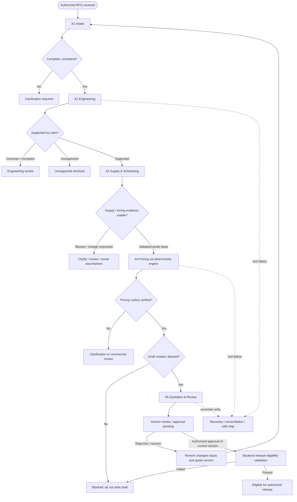

# Engineering RFQ Multi-Agent Copilot — Supervisor & LangGraph Architecture

**Recommended path:** `docs/architecture/supervisor_langgraph_architecture.md`  
**Project:** Engineering RFQ Multi-Agent Copilot  
**Roadmap:** Day 1 of 73 — Component 3: Supervisor Agent & LangGraph  
**Document status:** Approved *conceptual design baseline* for learning; implementation and integration tests not started  
**Data baseline:** Approved synthetic RFQ dataset `v1.1.0`  
**Manufacturer:** Meridian Fabrication Lab (fictional)  
**Related documents:** `business_workflow.md`, `agent_responsibilities.md`

> **Scope boundary:** This document defines the *intended orchestration architecture*. It does not claim working LangGraph code, a live MCP gateway, operational PostgreSQL, customer-facing release, or production-grade CAD/CAM capability. Specific schema names, tool names, policy decisions, and label semantics must be reconciled with the approved dataset's `contracts/`, `config/`, and business-rule documentation before implementation.

## 1. Objective

Design a **stateful, supervisor-coordinated RFQ workflow** that converts authorized customer requests and their relevant attachments into evidence-backed internal quotation drafts, or an appropriate clarification, review, decline, hold, or failure outcome.

**Design guarantees we intend to enforce:**

- Exactly one coordinating **Supervisor Agent (A0)** and five specialized agents: **Intake (A1), Engineering (A2), Supply & Scheduling (A3), Pricing (A4), Quotation & Review (A5)**.
- Only permitted operations run, and only after their prerequisites are met.
- Trusted policies and reference engines, not LLM-generated assertions, determine business eligibility, manufacturing checks, pricing, permissions and approvals.
- Agent handoffs contain *structured, attributable, version-aware* inputs and results.
- Customer-controlled content is data, not workflow instructions or authorization.
- All draft writes are authorized and idempotent; **customer-facing release requires an authorized human approval for the exact current quote version**.
- Recoverable faults can be handled without duplicate writes or false claims about uncertain side effects.
- Workflow progress and business outcomes remain auditable and can be resumed safely.

## 2. Why LangGraph

RFQs have branches: missing dimensions require clarification; unsupported designs require decline or engineering review; procurement or capacity constraints need evaluation; commercial policies may require extra review; tool failures may require bounded retry or reconciliation. A rigid linear chain cannot model all those paths cleanly.

**LangGraph primitives:**

| Concept | Meaning | RFQ usage |
|---|---|---|
| `StateGraph` | Declarative graph built around shared state | Top-level workflow coordinator |
| **State** | Typed snapshot of needed workflow facts | RFQ identity, requirement references, specialist results, blockers, quote version |
| **Node** | Unit of work that reads state and returns updates | Call Intake, validate engineering result, coordinate pricing, route human review |
| **Normal edge** | Unconditional transition | Start -> intake |
| **Conditional edge** | Transition selected by a router from state | Intake complete -> Engineering; incomplete -> clarification |
| **Reducer** | Rule for combining updates to a state key | Merge per-part results without overwriting siblings |
| `Command` | State update plus routing, or resumption after an interrupt | Use selectively when a node must update and route together |
| `Send` | Dynamic fan-out with task-specific inputs | Potentially dispatch independent checks for multiple parts |
| **Checkpointer / thread** | Persist graph state by run/thread | Resume after interruption/failure, review pending |
| `interrupt()` | Pause and await external input | Clarification or authorized human review (designed later) |
| `START` / `END` | Graph entry and exit markers | Begin execution / finish a current workflow run |

**Crucial distinctions:** A graph node need not be an AI agent; business-rule checks can be deterministic nodes. A checkpoint is *not* a business audit ledger or approval authorization. Reaching `END` does *not* mean the quotation is approved or released.

## 3. System-level control boundaries

| Layer | Responsibility | Forbidden shortcut |
|---|---|---|
| **FastAPI** | Authenticated RFQ submission and status/resume entry points | Caller cannot inject arbitrary graph state or approval flags |
| **LangGraph execution** | Run nodes, preserve state/checkpoints, enact valid routing | Graph completion must not be interpreted as commercial authorization |
| **A0 Supervisor** | Choose eligible delegated tasks, track dependencies and exceptions | Cannot override policy results or grant itself approval |
| **A1–A5 specialists** | Domain-scoped analysis and defined tool use | Cannot bypass checks outside their authority |
| **MCP gateway + backend** | Authenticate/authorize scoped reads and writes; validate operations | Cannot trust customer file text as credentials or permissions |
| **Reference engines** | Deterministic manufacturing, capacity, pricing, approval policy results | Cannot replace actual human sign-off with an LLM judgment |
| **PostgreSQL** | Durable business records, quote versions, approval and audit entities | A checkpoint alone is not the source of truth for business writes |
| **Human approver** | Authorize applicable decisions and approve current quote version | Approval is invalid if wrong actor/version or blocking policy exists |

## 4. Conceptual workflow graph

**Interpretation:** A0 is the *logical coordinator* over these nodes and branches. Not every dotted box is an AI agent or an unconditional transition. The diagram is an intended business dependency graph, not a claim that the current dataset supports every external communication or booking action. Human review and release eligibility are separate gates.

**Baseline end point:** `quote_draft_ready_for_approval` means **an internal draft is ready for human approval**, not that the quotation has been released. Actual external sending is outside the initial validated dataset simulator.

## 5. Supervisor behavior and task-routing principles

The Supervisor reads *validated workflow state* and decides which eligible agent or deterministic policy node to invoke. It is not allowed to invent prerequisites or override failed checks.

1. **Accept:** An authenticated RFQ/workflow identity and its assigned tenant/customer scope.
2. **Delegate Intake:** Supply only the assigned request and referenced attachments.
3. **Check prerequisites:** Missing or contradictory critical fields stop affected downstream quoting and produce a clarification path.
4. **Delegate Engineering:** Require a rule-backed feasibility result before unqualified manufacturing commitments.
5. **Delegate Supply & Scheduling:** Evaluate stock in **kg**, routing, supplier context, and weekly workcentre **hours**; do not treat schedule estimate as ship promise or reservation.
6. **Delegate Pricing:** Use validated inputs and pinned rule version **`price-v1.0`**; trusted `Decimal` engine computes amounts, LLM does not.
7. **Delegate Quotation & Review:** Check `draft_creation_allowed` before an authorized/idempotent draft write; preserve exact quote version and review state.
8. **Route human gates:** Distinguish optional additional manager review from *mandatory human customer-facing release approval*.
9. **Resolve exceptions:** Pause, clarify, decline, review, or recover according to documented policies and verified evidence.
10. **Record outcome:** Store the appropriate dataset-level outcome and durable references; do not conflate it with internal node status.

A Supervisor can *propose* a next step, but a deterministic routing/policy check must reject transitions that violate preconditions.

## 6. Proposed shared workflow state (conceptual schema)

The following are **design fields**, not finalized keys copied from the dataset's JSON schemas. Store references to large artifacts instead of duplicating whole PDFs or customer databases.

| Group | Suggested fields | Purpose |
|---|---|---|
| Identity | `tenant_id`, `customer_id`, `rfq_id`, `workflow_id`, `thread_id` | Strict isolation and correlation |
| Revision | `requirements_revision`, `quote_id`, `quote_version`, `policy_version`, `pricing_rule_version` | Staleness detection and approvals |
| Intake | `request_ref`, `attachment_refs`, `part_requirements`, `source_provenance`, `missing_fields`, `contradictions` | Verified customer needs |
| Engineering | `engineering_results_by_part`, `engineering_rule_refs`, `feasibility_status` | Evidence and blockers |
| Supply | `inventory_findings`, `capacity_findings`, `planning_estimates`, `supply_blockers` | Availability and timing evidence |
| Pricing | `pricing_results_by_part`, `totals_ref`, `pricing_evidence` | Verified prices and lineage |
| Draft & review | `draft_id`, `draft_version`, `draft_creation_allowed`, `manager_review_required`, `human_release_approval_required`, `review_status` | Controlled draft and approval workflow |
| Control | `current_step`, `pending_actions`, `completed_tasks`, `blockers`, `next_permitted_actions` | Graph routing and progress |
| Errors | `fault_instance_ref`, `retry_count`, `recovery_status`, `write_reconciliation_status` | Safe recovery and no duplicate writes |
| Trace | `event_refs`, `tool_call_refs`, `last_checkpoint_ref`, `timestamps` | Auditable operation without duplicating full logs |
| Outcome | `scenario_outcome` (when determined), `outcome_reason` | Evaluation and business interpretation |

### State design rules

- Store durable *facts*, source references, decisions and statuses; build LLM prompts from these values at call time rather than persisting large formatted prompts.
- Every specialist update must be explicitly validated and scoped to the current RFQ and relevant requirements revision.
- **Do not let parallel agents overwrite one shared scalar result field.** Use keyed per-part results or a well-defined reducer. Duplicate/conflicting updates to the same part/revision must be detected and resolved, not silently merged.
- Event/audit history should have its own durable append-only design; do not rely on a mutable `messages` transcript as a regulatory/business audit record.
- Do not store credentials, unauthorized customer records, hidden benchmark labels, or the whole dataset ZIP in runtime state.
- Do not treat state carried from a previous run or checkpoint as automatically current after a business-rule, customer, material or quote-version change.

## 7. Structured handoffs

### A0 -> specialist: task assignment

The Supervisor supplies the task ID, RFQ/customer/workflow identity, permitted scope, validated input or artifact references, prerequisite result IDs, applicable policy versions and expected result type.

### Specialist -> A0: task result

The specialist returns task ID, agent identity, per-part or RFQ-level result, `completed / blocked / needs_clarification / needs_human_review / failed` task status (conceptual), evidence references, tool/rule version, issues, and potentially a *non-authoritative suggestion* for the next step.

**Validation before accepting a handoff:** Correct tenant/RFQ; expected agent and task ID; current requirements/quote version; schema-valid payload; permitted tool evidence; no prohibited side effects; prerequisites satisfied.

### Handoff examples

- Intake -> Supervisor: `requirements_validated` or exact contradictory source references.
- Engineering -> Supervisor: supported/unsupported/review-required with evidence for each part.
- Supply -> Supervisor: kg availability, workcentre-hour/capacity constraints and *estimated planning week*.
- Pricing -> Supervisor: verified USD line prices, total, `price-v1.0` rule reference.
- Quotation -> Supervisor: controlled internal draft ID/version and pending human gates.

Handoffs never convey human authority merely by including `approved=true` in model-generated text.

## 8. Routing guards and invariants

A router uses **explicit deterministic checks** for eligibility, regardless of the Supervisor's textual recommendation.

| Proposed transition | Must already hold |
|---|---|
| Intake -> Engineering | Required fields complete, contradictions resolved or separately authorized for evaluation |
| Engineering -> Supply | Technically supported and validated quote basis; no unresolved hard engineering blocker |
| Supply -> Pricing | Inputs and planning assumptions sufficient; blocking date/material changes addressed or clearly routed to review |
| Pricing -> Draft | Price validated against pinned rule version; appropriate commercial gates satisfied for draft creation |
| Draft -> Review | `draft_creation_allowed=true`, idempotent authorized draft record and current version |
| Review -> Release-eligible | Authorized human approval **for exact current version**, applicable manager review complete, no customer hold, all release policies still pass |
| Any node -> Retry | Failure classification allows retry; budget/backoff and side-effect safety verified |
| Any node -> Rework | Revised inputs invalidate affected downstream artifacts and approvals as appropriate |

**Hard rules:** Never auto-substitute materials, invent price or lead time, bypass authorization, approve own quote, or treat a stale approval as current. Where clarification/review is needed, block the affected commitment and preserve the evidence.

## 9. Handling multiple parts and safe concurrency

A multipart RFQ may contain several lines, each with its own material, quantity, and process requirements. Each part needs separate validation and pricing input/output; the RFQ total can only use the applicable validated line results.

- **Correctness first:** Sequential processing is acceptable initially.
- **Potential optimization:** Independent per-part engineering or other read-only checks may fan out with `Send`, provided authorized inputs and rule versions are fixed.
- **Join:** A barrier or aggregation node verifies that all required part checks returned. Partial success must not turn into a silently complete quotation.
- **Reducer:** Results are merged by a stable `(rfq_id, part_id, requirements_revision, operation)` key, with explicit conflict handling and deterministic totals after all required results arrive.
- **Invalidation:** A change to material, quantity, dimensions, finish, routing or applicable policy requires rerunning dependent checks before using the old quote.
- **Writes:** Draft creation and approval changes are separately authorized, idempotent operations, not uncontrolled parallel side effects.

Parallelism must not depend on arbitrary completion order or permit one result to overwrite another.

## 10. Checkpointing, persistence and resumption

**Checkpoint:** LangGraph snapshot of the workflow's graph state at a safe execution boundary. It supports resuming a thread; it is not itself a quote, approval record, or authoritative PostgreSQL business transaction.

**Thread ID:** Stable execution identity used by the checkpointer to retrieve the appropriate state. It must be scoped/associated with the authenticated workflow and tenant. It is **not** a substitute for authentication/authorization.

**Planned storage:** Use a supported durable LangGraph checkpointer (PostgreSQL-backed integration is a suitable target), while separately using PostgreSQL business schemas for RFQs, quotations, approvals and audit events. Their responsibilities and transaction boundaries must be designed explicitly.

**Critical retry behavior:** LangGraph may re-execute a failed or interrupted *node* from the beginning on resume. Therefore, any side effects before an interrupt must be safe to replay, or factored into separately checkpointed/idempotent work. Checkpoints alone do not guarantee exactly-once external writes.

**RFQ example:** A controlled draft is created and a human decision is required. The graph saves its current state and pauses. When an authenticated human decision is recorded through the backend, the graph resumes using the same thread, verifies the decision and current quote version, then follows the permitted next route.

## 11. Human-interaction boundary (overview only)

LangGraph `interrupt()` can pause a workflow until an external decision arrives; the graph can be resumed using `Command(resume=...)`. The practical security rules are *not* supplied by `interrupt()` itself.

- Clarification: await the customer's authoritative correction through an authenticated/controlled business flow.
- Technical review: await qualified engineering disposition where the policy requires it.
- Manager review: honor `manager_review_required` independently of draft eligibility.
- Customer-facing release: honor **`human_release_approval_required` for every release**; approval must come from an authorized human, tied to the exact current quote version.
- Rejected/changed quote: preserve prior decision but require renewed valid approval for the changed version.

**Human approval is an externally validated business event, not a generated tool argument or an LLM assertion.** Component 5 will cover the complete design of the approval flow.

## 12. Failure, retry and idempotency design

| Failure | Required behavior |
|---|---|
| Transient read/tool timeout or rate limit | Apply documented bounded retry/backoff when safe; preserve fault and attempt history |
| Unsupported or malformed tool response | Validate response shape; do not treat unvalidated content as successful evidence |
| Draft write timeout, result unknown | Query/reconcile by stable idempotency key and operation scope before replay; **do not assume write count is zero** |
| Duplicate draft request | Return existing valid result or reject conflicting replay per backend idempotency policy; prevent duplicate drafts |
| Authorized decision missing | Pause/review, not forced success |
| Retry budget exhausted / unsafe write uncertainty | Stop or escalate, with audit data and an explicit failure outcome |
| Changed requirements/quote version | Invalidate stale dependent decisions and approvals, then re-evaluate affected paths |
| Permission or cross-customer violation | Deny at gateway/service boundary; record event; no downstream unauthorized write |

Scope operation idempotency to the authenticated tenant/customer context, RFQ/workflow and operation identity, using the approved recovery contracts. The dataset's failure oracles must remain inaccessible to runtime agents.

## 13. Dataset v1.1.0 outcome contract versus internal graph state

**These eight strings are dataset-level expected scenario outcomes, not a complete graph-state enumeration.** They should be derived from verified business and execution evidence:

| Dataset expected outcome | Typical routing interpretation |
|---|---|
| `quote_draft_ready_for_approval` | Internal draft is ready for human review/approval; no release claimed |
| `clarification_required` | Stop the affected path and request missing/contradictory requirements |
| `engineering_review_required` | Qualified human engineering review required |
| `commercial_review_required` | Commercial policy or terms require designated review |
| `customer_hold_blocked_release` | Release blocked by customer restriction, even if a draft exists |
| `unsupported_declined` | Business reference rules establish unsupported work |
| `recoverable_workflow_failure` | Fault has documented bounded recovery/reconciliation route under the test policy |
| `nonrecoverable_workflow_failure` | Workflow cannot safely proceed; stop and audit/escalate |

Graph task statuses, pending human decisions, run completion, and quote-version approvals are **separate dimensions**. Do not implement one misleading `approved` boolean to represent all of them.

Dataset v1.1.0 also distinguishes:

- `draft_creation_allowed`: permission to make an **internal draft**, not to release it.
- `manager_review_required`: whether an **additional** managerial review applies.
- `human_release_approval_required`: release must be authorized by a **human**; always mandatory for customer-facing release.

**Evaluation isolation:** Agent runtime may receive only the assigned RFQ and authorized business tool results. Keep `evaluation/ground_truth/`, `evaluation/agent_coordination_cases.json`, `evaluation/agent_exception_cases.json`, frozen answers, and fault/security expected-outcome labels exclusively in the scorer/test process.

## 14. Example trace: RFQ requests Aluminum 5052, 6061 is stocked

Illustrative only; *not* a specific dataset record.

1. Intake records requested Aluminum 5052, quantity and provenance; no silent rewrite.
2. Engineering checks whether requested 5052/design is supported. Suppose a **process/capability constraint** makes it unsupported. It reports the rule and blocker.
3. The Supervisor routes to decline or qualified engineering review. Merely replenishing 5052 cannot correct a process/capability failure.
4. A 6061 proposal, if considered, requires a separate engineering suitability assessment and appropriate customer authorization to change the requirement.
5. Only after a validated revised RFQ basis exists can dependent supply, pricing and draft checks continue.
6. The quote remains an internal versioned draft until required human approvals are valid; the Supervisor cannot release it.

**Correct result:** Explicit, evidence-backed review/clarification/decline instead of an unauthorized substitute or unsupported price.

## 15. Decisions deferred to implementation (do not guess today)

These are intentionally not encoded as imaginary final APIs or enums:

- Concrete Python state schema types, reducer functions and graph node names.
- Exact MCP tool names/permissions and handoff JSON Schema field names from `contracts/`.
- Whether certain eligible checks execute serially or concurrently after benchmarking.
- PostgreSQL business-table schemas, migrations and checkpointer deployment details.
- Human-review UX, authentication flows, release endpoints and notification mechanism.
- Retry budgets, timeouts and fault-to-outcome mapping from `config/` and recovery contract files.

Resolve these from verified v1.1.0 dataset contracts and then validate in tests. This Day 1 document gives **architectural intent and invariants**, not fabricated implementation certainty.

## 16. Component 3 design acceptance checklist

- [x] Supervisor controls delegation and dependencies while deterministic policies enforce authorization and business eligibility.
- [x] State, nodes, edges, conditional routing, reducers, `Send`, `Command`, and checkpoints are defined conceptually.
- [x] Specialist task/result handoffs are structured, attributable and version-aware.
- [x] Missing requirements, unsupported requests, supply constraints, commercial review and system failures have safe paths.
- [x] Multipart/concurrent execution cannot silently drop part-level results.
- [x] Rework invalidates stale engineering, supply, pricing, quote versions and approvals as appropriate.
- [x] Draft creation, managerial review and human release authorization remain distinct.
- [x] Checkpointing is separate from business persistence and human authorization.
- [x] Agent runtime cannot read hidden evaluation labels or grant itself tool permissions.
- [x] No production code or unverifiable deployment claims are included.

**Milestone closure:** Component 3 can be closed as a design-and-reading milestone at the project owner's direction without a quiz. Implementation, tests and runtime verification are future milestones.

## 17. Sources and references

**Current official LangGraph/LangChain documentation (consult again before coding):**

- [Graph API: state, nodes, edges, reducers, Send and Command](https://docs.langchain.com/oss/python/langgraph/graph-api)
- [Thinking in the Graph API](https://docs.langchain.com/oss/python/langgraph/thinking-in-graph-api)
- [Persistence and checkpoints](https://docs.langchain.com/oss/python/langgraph/persistence)
- [Interrupts and resume](https://docs.langchain.com/oss/python/langgraph/interrupts)
- [Supervisor/subagents architecture](https://docs.langchain.com/oss/python/langchain/multi-agent/subagents)

**Learning videos (conceptual; code may differ from current APIs):**

1. [LangGraph Explained Visually: Why Agents Need Graphs — Chapter 1](https://www.youtube.com/watch?v=GWBM2Ueqp6o)
2. [LangGraph State & Reducers Explained — Chapter 2](https://www.youtube.com/watch?v=IfGZrTuZDNA)
3. [LangGraph Nodes & Edges: Routing, Command and Send — Chapter 3](https://www.youtube.com/watch?v=gSKfgMQSTM4)
4. [LangGraph: Persistence — LangChain](https://www.youtube.com/watch?v=YE6A5d8kNp4)

**Approved RFQ data baseline:** synthetic dataset v1.1.0 `README.md`, `docs/business_rules.md`, `docs/multi_agent_evaluation.md`, `docs/mcp_mapping.md`, `docs/recovery_policy.md`, `contracts/`, and `config/`.
