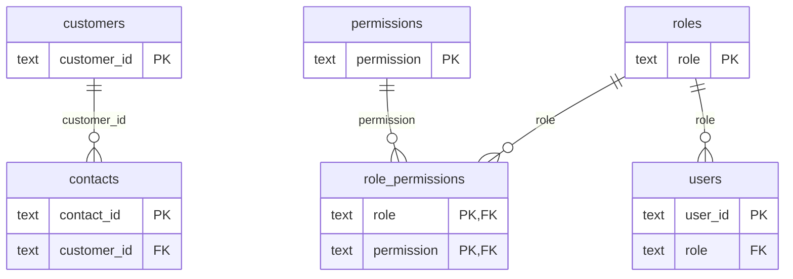
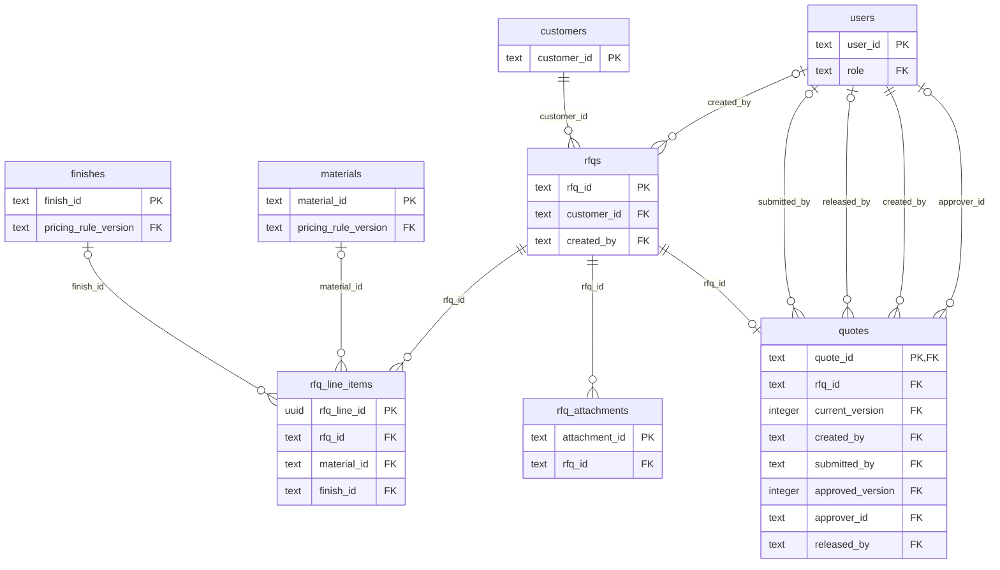
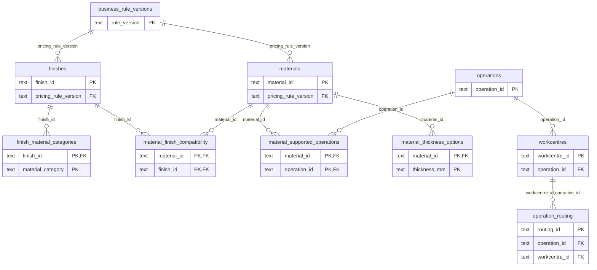
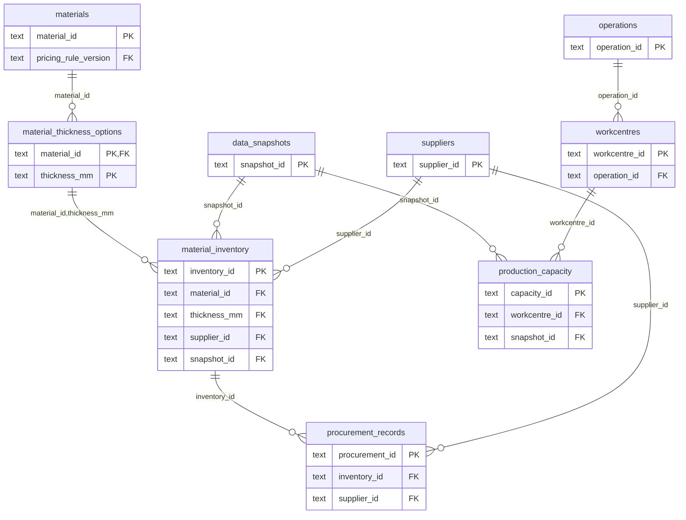
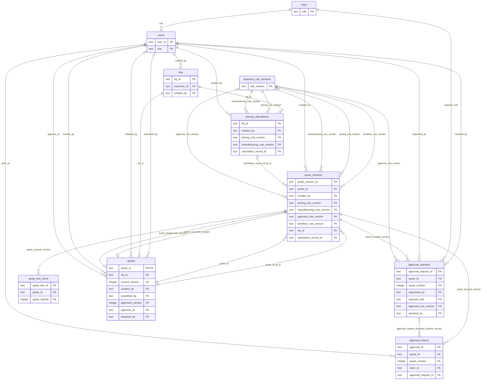
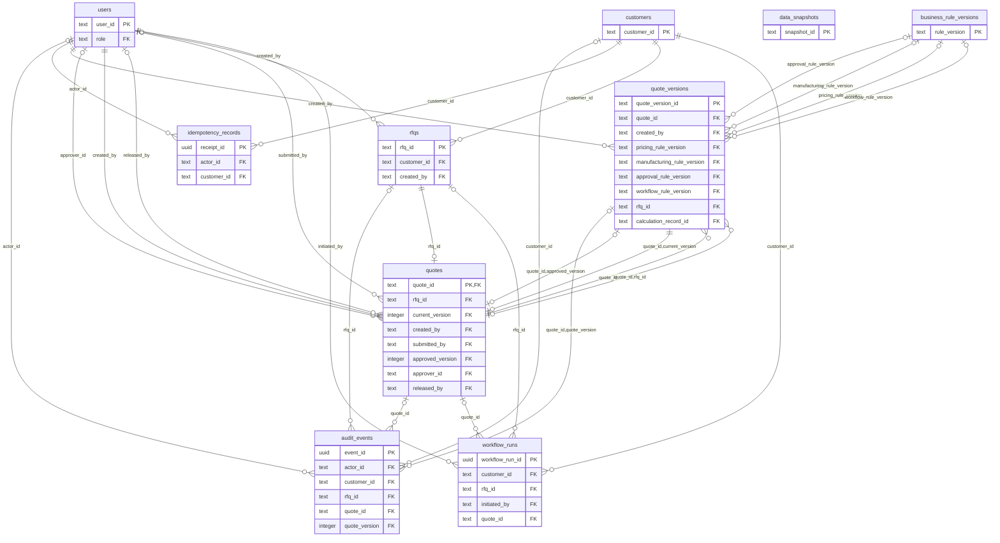

# PostgreSQL architecture and repositories

The current application maps 36 tables across `business` and `orchestration`. The active
contract is `CURRENT`, revision `20261118_01`; its exact shape, guard revisions, catalog
counts and accepted policy overlays are defined in
[`schema_contract.py`](../../src/rfq_copilot/schema_contract.py). All active migration bytes
and deferred branch files remain unchanged by documentation maintenance.

## Current ORM relationship graph

Generated from current ORM foreign-key constraints. Child multiplicity shows optional collections;
unique keys and header/version commit invariants are detailed in the table/constraint reference.

```mermaid
erDiagram
    approval_history {
        text approval_id PK
        text quote_id FK
        integer quote_version FK
        text actor_id FK
        text approval_request_id FK
    }
    approval_requests {
        text approval_request_id PK
        text quote_id FK
        integer quote_version FK
        text requested_by FK
        text required_role FK
        text approval_rule_version FK
        text resolved_by FK
    }
    audit_events {
        uuid event_id PK
        text actor_id FK
        text customer_id FK
        text rfq_id FK
        text quote_id FK
        integer quote_version FK
    }
    business_rule_versions {
        text rule_version PK
    }
    contacts {
        text contact_id PK
        text customer_id FK
    }
    customers {
        text customer_id PK
    }
    data_snapshots {
        text snapshot_id PK
    }
    finish_material_categories {
        text finish_id PK,FK
        text material_category PK
    }
    finishes {
        text finish_id PK
        text pricing_rule_version FK
    }
    idempotency_records {
        uuid receipt_id PK
        text actor_id FK
        text customer_id FK
    }
    material_finish_compatibility {
        text material_id PK,FK
        text finish_id PK,FK
    }
    material_inventory {
        text inventory_id PK
        text material_id FK
        text thickness_mm FK
        text supplier_id FK
        text snapshot_id FK
    }
    material_supported_operations {
        text material_id PK,FK
        text operation_id PK,FK
    }
    material_thickness_options {
        text material_id PK,FK
        text thickness_mm PK
    }
    materials {
        text material_id PK
        text pricing_rule_version FK
    }
    operation_routing {
        text routing_id PK
        text operation_id FK
        text workcentre_id FK
    }
    operations {
        text operation_id PK
    }
    permissions {
        text permission PK
    }
    pricing_calculations {
        text rfq_id FK
        text created_by FK
        text pricing_rule_version FK
        text manufacturing_rule_version FK
        text calculation_record_id PK
    }
    procurement_records {
        text procurement_id PK
        text inventory_id FK
        text supplier_id FK
    }
    production_capacity {
        text capacity_id PK
        text workcentre_id FK
        text snapshot_id FK
    }
    quote_line_items {
        text quote_line_id PK
        text quote_id FK
        integer quote_version FK
    }
    quote_versions {
        text quote_version_id PK
        text quote_id FK
        text created_by FK
        text pricing_rule_version FK
        text manufacturing_rule_version FK
        text approval_rule_version FK
        text workflow_rule_version FK
        text rfq_id FK
        text calculation_record_id FK
    }
    quotes {
        text quote_id PK,FK
        text rfq_id FK
        integer current_version FK
        text created_by FK
        text submitted_by FK
        integer approved_version FK
        text approver_id FK
        text released_by FK
    }
    rfq_assignments {
        text rfq_id PK,FK
        text user_id PK,FK
        text assigned_by FK
    }
    rfq_attachments {
        text attachment_id PK
        text rfq_id FK
    }
    rfq_line_items {
        uuid rfq_line_id PK
        text rfq_id FK
        text material_id FK
        text finish_id FK
    }
    rfqs {
        text rfq_id PK
        text customer_id FK
        text created_by FK
    }
    role_permissions {
        text role PK,FK
        text permission PK,FK
    }
    roles {
        text role PK
    }
    suppliers {
        text supplier_id PK
    }
    token_revocations {
        uuid revocation_id PK
        text user_id FK
        text created_by FK
    }
    user_customer_bindings {
        text user_id PK,FK
        text customer_id PK,FK
    }
    users {
        text user_id PK
        text role FK
    }
    workcentres {
        text workcentre_id PK
        text operation_id FK
    }
    workflow_runs {
        uuid workflow_run_id PK
        text customer_id FK
        text rfq_id FK
        text initiated_by FK
        text quote_id FK
    }
    users ||--o{ approval_history : "actor_id"
    approval_requests |o--o{ approval_history : "approval_request_id,quote_id,quote_version"
    quote_versions ||--o{ approval_history : "quote_id,quote_version"
    business_rule_versions ||--o{ approval_requests : "approval_rule_version"
    quote_versions ||--o{ approval_requests : "quote_id,quote_version"
    users ||--o{ approval_requests : "requested_by"
    roles ||--o{ approval_requests : "required_role"
    users |o--o{ approval_requests : "resolved_by"
    users |o--o{ audit_events : "actor_id"
    customers |o--o{ audit_events : "customer_id"
    quote_versions |o--o{ audit_events : "quote_id,quote_version"
    quotes |o--o{ audit_events : "quote_id"
    rfqs |o--o{ audit_events : "rfq_id"
    customers ||--o{ contacts : "customer_id"
    finishes ||--o{ finish_material_categories : "finish_id"
    business_rule_versions ||--o{ finishes : "pricing_rule_version"
    users ||--o{ idempotency_records : "actor_id"
    customers ||--o{ idempotency_records : "customer_id"
    finishes ||--o{ material_finish_compatibility : "finish_id"
    materials ||--o{ material_finish_compatibility : "material_id"
    material_thickness_options ||--o{ material_inventory : "material_id,thickness_mm"
    data_snapshots ||--o{ material_inventory : "snapshot_id"
    suppliers ||--o{ material_inventory : "supplier_id"
    materials ||--o{ material_supported_operations : "material_id"
    operations ||--o{ material_supported_operations : "operation_id"
    materials ||--o{ material_thickness_options : "material_id"
    business_rule_versions ||--o{ materials : "pricing_rule_version"
    workcentres ||--o{ operation_routing : "workcentre_id,operation_id"
    users ||--o{ pricing_calculations : "created_by"
    business_rule_versions ||--o{ pricing_calculations : "manufacturing_rule_version"
    business_rule_versions ||--o{ pricing_calculations : "pricing_rule_version"
    rfqs ||--o{ pricing_calculations : "rfq_id"
    material_inventory ||--o{ procurement_records : "inventory_id"
    suppliers ||--o{ procurement_records : "supplier_id"
    data_snapshots ||--o{ production_capacity : "snapshot_id"
    workcentres ||--o{ production_capacity : "workcentre_id"
    quote_versions ||--o{ quote_line_items : "quote_id,quote_version"
    business_rule_versions |o--o{ quote_versions : "approval_rule_version"
    pricing_calculations |o--o{ quote_versions : "calculation_record_id,rfq_id"
    users ||--o{ quote_versions : "created_by"
    business_rule_versions |o--o{ quote_versions : "manufacturing_rule_version"
    business_rule_versions |o--o{ quote_versions : "pricing_rule_version"
    quotes ||--o{ quote_versions : "quote_id"
    quotes |o--o{ quote_versions : "quote_id,rfq_id"
    business_rule_versions |o--o{ quote_versions : "workflow_rule_version"
    users |o--o{ quotes : "approver_id"
    users ||--o{ quotes : "created_by"
    quote_versions |o--o| quotes : "quote_id,approved_version"
    quote_versions ||--o| quotes : "quote_id,current_version"
    users |o--o{ quotes : "released_by"
    rfqs ||--o| quotes : "rfq_id"
    users |o--o{ quotes : "submitted_by"
    users ||--o{ rfq_assignments : "assigned_by"
    rfqs ||--o{ rfq_assignments : "rfq_id"
    users ||--o{ rfq_assignments : "user_id"
    rfqs ||--o{ rfq_attachments : "rfq_id"
    finishes |o--o{ rfq_line_items : "finish_id"
    materials |o--o{ rfq_line_items : "material_id"
    rfqs ||--o{ rfq_line_items : "rfq_id"
    users |o--o{ rfqs : "created_by"
    customers ||--o{ rfqs : "customer_id"
    permissions ||--o{ role_permissions : "permission"
    roles ||--o{ role_permissions : "role"
    users ||--o{ token_revocations : "created_by"
    users ||--o{ token_revocations : "user_id"
    customers ||--o{ user_customer_bindings : "customer_id"
    users ||--o{ user_customer_bindings : "user_id"
    roles ||--o{ users : "role"
    operations ||--o{ workcentres : "operation_id"
    customers ||--o{ workflow_runs : "customer_id"
    users ||--o{ workflow_runs : "initiated_by"
    quotes |o--o{ workflow_runs : "quote_id"
    rfqs |o--o{ workflow_runs : "rfq_id"
```



## Current schema evolution and authority

The detailed baseline references describe 33 source-derived logical tables. Current extensions
add `user_customer_bindings`, `rfq_assignments` and `token_revocations`, quotation calculation
provenance/version seals, customer and service roles, and durable queue/drafting columns.
`table_schemas.md` preserves parser-sensitive baseline expectations and lists current ORM
columns separately; `relationships_and_constraints.md` preserves its baseline index markers.

Owner credentials serve reviewed administration. Ordinary API/MCP, workflow worker, drafter
and human-decision credentials have restricted, separately checked authority. Customer and
assignment scope are applied in repository SQL. Version pointers, append-only history,
calculation evidence, approval/request binding and decision authority are guarded in PostgreSQL.
A selectable REST header does not activate the deferred multi-customer schema.

The source-mapping and domain diagrams below explain stable domain relationships. The dataset's
fourteen-tool design mapping is historical source context; the actual ten read-only MCP tools
are documented in [MCP architecture](../architecture/mcp_architecture.md). No application
repository imports hidden evaluation answers as business authority.


## Database architecture

<a id="database-architecture-1-architecture-and-evidence"></a>
### 1. Architecture and evidence

The Supervisor and five specialist agents request typed operations through the secure MCP gateway. The gateway authenticates the delegated actor, validates the contract and scope, and calls backend business services. Only those services use database repositories and deterministic manufacturing, supply, pricing and review logic. Agents never receive database credentials or unrestricted SQL. An agent name is an orchestration responsibility, **not an authenticated human business role**.

Three separately controlled persistence domains are required:

1. **Authoritative business:** customers, catalogs, RFQs, quotation revisions, approval events, committed write receipts and business audit. Proposed `business` schema, backend-only credentials. Prices and human decisions originate in trusted services.
2. **Execution state:** `orchestration.workflow_runs` and a later selected LangGraph saver in a separate schema/store with distinct credentials. Checkpoints resume execution; they never prove a business operation succeeded or a human approved it. No business FK points into the checkpoint store.
3. **Offline evaluation:** scenario manifests, hidden labels and scoring/security/failure/coordination fixtures stay in harness-only filesystem/storage or a separate evaluation database. They are not production-facing business tables. Production services cannot mount or query them.

Source precedence is actual validated records and machine-readable entity/tool contracts, then versioned config, dataset dictionary/docs, foundational design docs, then prior designs. The illustrative dataset SQL is not a complete schema. Primary sources inspected include all 17 business CSVs, historical RFQs, all scenario shapes/attachment metadata, five contracts, four policy JSONs, generation metadata, dataset database/dictionary/business/MCP/assumptions/evaluation/recovery/security docs, existing architecture/data docs, dataset validation log and checksum manifests. Detailed paths and fields are in [mapping](dataset_to_database_mapping.md); exact table/column/constraint authority is [table specifications](table_schemas.md).

<a id="database-architecture-2-verified-source-inventory"></a>
### 2. Verified source inventory

| Exact source path relative to data/rfq_synthetic_data | Rows |
| --- | --- |
| `master_data/contacts.csv` | 40 |
| `master_data/customers.csv` | 40 |
| `master_data/finishes.csv` | 7 |
| `master_data/materials.csv` | 15 |
| `master_data/operations.csv` | 8 |
| `master_data/roles_permissions.csv` | 27 |
| `master_data/suppliers.csv` | 6 |
| `master_data/users.csv` | 24 |
| `master_data/workcentres.csv` | 8 |
| `operations_data/material_inventory.csv` | 90 |
| `operations_data/operation_routing.csv` | 28 |
| `operations_data/procurement_records.csv` | 12 |
| `operations_data/production_capacity.csv` | 80 |
| `transactional_data/approval_history.csv` | 70 |
| `transactional_data/historical_quotes.csv` | 80 |
| `transactional_data/quote_line_items.csv` | 100 |
| `transactional_data/quote_versions.csv` | 96 |

The 17 CSVs contain **731 rows**, including 27 supplementary role-permission grants. There are **18 formal entity schemas and 18 relationship definitions**: 16 CSV entities, historical RFQ JSON, and scenario JSON. Roles/permissions CSV is supplementary, not a nineteenth formal contract entity. `transactional_data/historical_rfqs.json` has **80** RFQs. Scenario inputs number **240**: development **120**, validation **40**, frozen evaluation **80**. Attachment metadata contains **124** files. Dataset tree: **681** files; existing generated-asset manifest: **637** hashes. These counts have different scopes.

All 18 declared FK checks passed, including historical quote→historical RFQ. Additional checks covered current/approved quote versions, line/approval version pairs, version creators and header submitters, supported thicknesses, category/finish/operation references, route/workcentre operation equality, line ordinals and capacity-week uniqueness. Current quotation totals equal sums of current lines in all 80 cases; no data establishes complete older snapshots.

<a id="database-architecture-3-domain-decomposition-and-table-registry"></a>
### 3. Domain decomposition and table registry

| Domain | Domain tables |
| --- | --- |
| Rules | `business_rule_versions`, `data_snapshots` |
| Identity | `roles`, `permissions`, `role_permissions`, `users` |
| Customers | `customers`, `contacts` |
| Manufacturing | `materials`, `finishes`, `operations`, `workcentres`, `material_thickness_options`, `material_finish_compatibility`, `material_supported_operations`, `finish_material_categories`, `operation_routing` |
| Supply | `suppliers`, `material_inventory`, `procurement_records` |
| Scheduling | `production_capacity` |
| RFQ | `rfqs`, `rfq_line_items`, `rfq_attachments` |
| Quotation | `pricing_calculations`, `quotes`, `quote_versions`, `quote_line_items` |
| Approval | `approval_requests`, `approval_history` |
| Reliability | `idempotency_records`, `audit_events` |
| Workflow | `workflow_runs` |

Classification matters: customers/catalogs/operations/history are **existing dataset entities**; RBAC reference tables and four material/finish junctions are **normalized projections**; editable RFQ lines/attachments, calculation cache, approval queue, receipts, audit and snapshot/rule registries are **application support structures**. Four policy documents and five contract documents remain **versioned documents**, not one table per JSON key. `workflow_runs` is **orchestration metadata**. Scenario fixtures/answer keys remain **isolated evaluation artifacts**. Every baseline table has a complete column specification; no unspecified application table is needed for these diagrams.

No product/part master, tenant table, user_roles join, stock ledger, work-order system, or microservice fleet is introduced. Source `part_id` is a snapshot/reference identifier, not evidence of a standalone master entity. Stock/capacity estimates do not reserve resources.

<a id="database-architecture-4-relational-model-and-normalization"></a>
### 4. Relational model and normalization

**First Normal Form:** replace catalog multivalued arrays with one association per row, and keep scalar typed keys/quantities. JSONB documents intentionally remain structured values where preserving exact versioned evidence is the requirement; their presence is not a claim of fully normalized internal JSON fields.

**Second Normal Form:** a fact on a compound key depends on the whole pair. For example, grant.allowed belongs to (role,permission); role definitions do not. Thickness/compatibility rows contain no partial-key descriptions. A route is an association with sequence/predicate attributes, not an unqualified material-operation join.

**Third Normal Form:** customer/account facts stay on customers, user role on users, supplier defaults on suppliers, and revision pricing on quote_versions. A stock-specific supplier lead is intentionally retained as snapshot/override evidence. Do not update old quote amounts because today's material catalog changed.

| Source field | Target structure | Reason / deliberate limit |
| --- | --- | --- |
| users.role; roles_permissions.role/permission/allowed | roles, permissions, role_permissions; users.role FK | One role per user preserved; composite grant PK prevents duplicate grants. No multi-role expansion. |
| materials.supported_thickness_mm | material_thickness_options(material_id,thickness_mm) | 90 atomic options; composite inventory FK can enforce supported thickness. |
| materials.compatible_finishes | material_finish_compatibility(material_id,finish_id) | 50 explicit material/finish pairs; category eligibility remains an additional check. |
| materials.supported_operations | material_supported_operations(material_id,operation_id) | 90 pairs; no implication that every listed catalog operation is quote-routed. |
| finishes.material_categories | finish_material_categories(finish_id,material_category) | 19 category memberships; a small controlled vocabulary avoids unnecessary category tables. |
| operation_routing.operation_id/workcentre_id/sequence | operation_routing + workcentres composite target | Preserve routing_id and predicates; composite FK prevents mismatched assigned operation. Serial route UNIQUE(part_type,sequence) enforced by the schema. |
| historical_quotes version-sensitive fields; quote_versions | quotes current pointer + quote_versions financial facts | Exact (quote_id,version) key; source header details populate only its matching current version. |
| approval_history.quote_id/quote_version | approval_history exact-version FK; new approval_requests queue | Immutable events differ from actionable requests; no fake historical queue is reconstructed. |
| historical_rfq.part_ids | rfqs.part_ids JSONB | Opaque legacy references; do not invent standalone parts or editable extracted RFQ rows. |
| quote_line_items.part_json/cost_breakdown_json | Immutable JSONB snapshots plus typed quantity/line_total_usd | Preserve exact priced specification and high precision strings; no proven operation-cost reporting query justifies further tables. |

**Cardinalities:** customer→contacts/RFQs 1:N; operation→workcentres 1:N; quotation→versions and exact version→lines/events/requests 1:N; materials↔finishes/operations M:N via junctions. Composite keys implement association identity. No source pair proves a mandatory 1:1 relationship. The UNIQUE(quotes.rfq_id) creates an **optional one-to-one** RFQ→quotation-family relationship to prevent duplicate families: the creation service is scoped to one rfq_id. This is an explicit application choice, supported by all 80 observed unique RFQ/quote pairs, rather than a purported universal dataset rule. Alternatives/options would need a future family discriminator and revised contract.

Candidate keys are source business IDs; application alternate keys include users.authentication_subject, (quote_id,version), (workcentre_id,week_start), (part_type,sequence), and scoped idempotency tuples. Contact email, material grade, and supplier email are not assumed unique. See [seven ER diagrams](database_architecture.md) and [FK catalog](relationships_and_constraints.md).

<a id="database-architecture-5-controlled-denormalization-and-history"></a>
### 5. Controlled denormalization and history

- `quotes.current_version`, approval summary and status are mutable lifecycle conveniences. `quote_versions.is_current`/approval_valid are source-derived flags; an atomic service update keeps flags and pointer consistent. One partial unique index ensures at most one current flag, while the service ensures exactly one and matching header pointer. Versioned financial payloads and line snapshots are immutable.
- Source coverage is 96 version metadata rows, **80 priced current versions**, and **16 older metadata-only versions**. All 100 lines belong to current versions. Preserve missing amounts/rule/snapshot provenance as NULL with explicit snapshot_completeness; never clone current amounts into earlier versions. Historical approval flags do not establish present commercial clearance. Historical versions are not eligible for live release without a new fully validated complete revision where the configured transition permits. An expired quotation is terminal under workflow-v1.0; a fresh inquiry is needed rather than reviving that version.
- Available stock and capacity are generated from base quantities. Raw source values are validated before discard; they cannot be independently updated. Snapshot registry hashes immutable operational CSV archives for replay; current inventory/capacity tables hold only the selected current series. No unrequested reservation ledger or full event sourcing is claimed.
- Calculation cache retains trusted immutable parts/results so a calculation ID can be resolved after a checkpoint resume. Technical caching does not make calculate_quote a business state-changing tool. Workflow state may cache progress; business services reread authoritative records before any write.

<a id="database-architecture-6-identifier-unit-and-version-conventions"></a>
### 6. Identifier, unit and version conventions

Legacy IDs (`CUST-001`, `USER-001`, `MAT-001`, `HRFQ-0001`, `HQUOTE-0001`) remain exact TEXT keys/FKs. New business keys use collision-resistant prefix+UUID text within the contract's 64-character limit; source IDs are never converted. Native UUID is limited to new technical records and editable RFQ-line identity. Quote version is INTEGER ≥1; expected_version=0 is only a creation sentinel, never a stored version. BIGINT row_version detects same-version lifecycle conflicts.

USD cents are exact NUMERIC(18,2), rates NUMERIC(18,4), dimensions NUMERIC(12,3) mm, stock NUMERIC(18,6) kg, capacity NUMERIC(12,4) hours. DATE snapshots and Monday weeks are distinct from UTC TIMESTAMPTZ events. Currency, finite numeric validation, nullable business fields, JSON types and defaults are fully specified in [table conventions](table_schemas.md).

Rule documents keep exact source versions and byte hashes. The registry stores immutable JSONB+source path/hash; it does not relationalize every policy threshold. Contract identifiers without a standalone version use `kind@sha256:<full digest>` as a content-addressed TEXT rule_version (not subject to the business-ID 64-character bound). Version reuse with different bytes is rejected. Live quote versions pin manufacturing/pricing/approval/workflow policies and inventory/capacity tokens; graph runs additionally pin tool/entity/coordination/handoff contracts. Verify registry kind and snapshot kind in services. Configuration changes create new records and invalidate/recompute affected live results; they never mutate frozen source or past quote evidence.

## Runtime agent and database boundary

The executable ten-tool MCP registry is the authority for specialist permissions. Tools use
read-only repeatable-read snapshots. Customer scope comes from verified database bindings,
with optional RFQ assignments; a region string is not an authorization mechanism. The worker
uses a per-customer service identity and SourceGate. Quotation writes recompute stored RFQs,
and human decisions use a separate restricted credential. Frozen fourteen-tool proposals
are retained only in the dataset reference, not as a runtime operation list.

<a id="database-architecture-8-transactions-approval-and-recovery"></a>
### 8. Transactions, approval and recovery

[Constraint and transaction design](relationships_and_constraints.md) defines one atomic commit for each business mutation, its success audit and committed receipt. Customer/RFQ/quote/queue rows are locked in stable order; row_version and quote version are checked again under lock. Human approve/release recheck exact current version, independent approver, active account, commercial clearance and policy. Managerial review at **≥ USD 7,500.00**, credit breach or account restriction is additional to the always-human release gate. No tool exposes approve_quote/release_quote to AI.

Checkpoint commits are separate from business commits. A timeout after a business commit is recovered by authenticated receipt lookup with the same logical key; do not infer rollback from an old checkpoint. Revalidate resumed identity, customer, current quote and snapshot/rule pins. Contract max_autonomous_write_retry_count=0 means no autonomous write retry; reconcile first and escalate unknown outcomes. Read retries are bounded by trusted recovery policy. A verified committed receipt can be replayed without a second business effect; mismatched payloads or stale versions fail closed. No new fifteenth receipt-lookup MCP tool is invented: reconciliation is an internal gateway/service responsibility.

<a id="database-architecture-9-discrepancies-proposals-and-unresolved-dependencies"></a>
### 9. Discrepancies, proposals and unresolved dependencies

| Finding | Decision / limitation |
| --- | --- |
| MFG-001: configured hole_count_max=300 is skipped by scalar-limit path in reference validate_part | **Fixed in the application:** `check_manufacturing_capability` enforces the rule's `hole_count_max` (0–300, `OUT_OF_RANGE_HOLE_COUNT`) and raises on any rule limit it does not enforce. Regression tests prove 300 passes and 301 fails. The frozen reference `validate_part` still has the limitation and must remain unchanged (dataset v1.1.0 is frozen; it is a test oracle only). |
| Narrative MCP map has 13 tools; machine-readable contract has 14 | Use contract, including create_rfq. Frozen narrative unchanged. |
| Required CSV strings include empty values | Business-optional dates/approval fields become NULL. No empty string sentinel FK or bogus zero version. |
| Prior versions lack prices/lines and rule/snapshot provenance | Preserve 16 metadata-only versions; 80 current versions are priced_partial; no retrospective snapshots. |
| Source draft modeled 1:N quote families per RFQ | Final proposal is one family per RFQ with explicit UNIQUE, because create tool names RFQ and duplicate prevention is required; future alternatives need an explicit contract. |
| create_rfq input only customer_id/key; scenario has full request/attachments | Create draft shell only. Authorized content-ingestion interface remains a later design dependency. No fabricated tool fields. |
| create_quote_draft returns status constant draft; workflow revision state is revised_draft | Implemented creation/revision services enforce stored version and receipt checks; MCP remains read-only. |
| Tool schemas allow version zero; persisted/handoff versions start at one | Zero is creation sentinel only; request_approval(version=0) is rejected. |
| Handoff.workflow_id requires ^RFQ-[0-9]{4}$; legacy HRFQ/new RFQ-UUID do not match | Keep fixture external_workflow_id separate from business ID/run UUID. Production handoff needs a separately versioned contract extension before supporting those IDs; do not patch frozen contract or repurpose a fixture ID. |
| Dataset read-only planning does not define durable reservations or live refresh service | Keep current baseline + immutable snapshot archive; introduce reservation ledgers only with future authorized booking operations. |
| No LangGraph saver/version selected | Only application workflow metadata is specified. Saver physical checkpoint schema is a later workflow dependency, not guessed database implementation business DDL. |

SQLAlchemy models and Alembic migrations implement the relational schema, including the
application manufacturing guard. This design explains the source mapping; the active K5
contract and reviewed migrations define current physical integrity. Deployment acceptance
and deferred integration decisions remain separate requirements.

<a id="database-architecture-10-documentation-and-reference-authority"></a>
### 10. Documentation and reference authority

- [ER diagrams](database_architecture.md): seven views from one table/FK catalog.
- [Table specifications](table_schemas.md): every column, source/purpose, type, nullability, default, key and CHECK.
- [Relationships, constraints and indexes](relationships_and_constraints.md): authoritative enforcement categories, transaction protocol and query/index catalog.
- [Dataset mapping](dataset_to_database_mapping.md): exact fields/import dependencies/isolation.
- Historical execution and Git evidence is retained privately; see the [current verification scope](../../README.md#verification) for the reported backend baseline.

PostgreSQL references were checked for [declarative constraints and valid FK targets](https://www.postgresql.org/docs/18/ddl-constraints.html), [row locking](https://www.postgresql.org/docs/18/explicit-locking.html), and [partial indexes](https://www.postgresql.org/docs/18/indexes-partial.html). Cross-table policy checks remain transactional service rules; a row CHECK is not presented as a cross-table validator. These documentation references do not choose or install a PostgreSQL server version.


## Domain relationship diagrams (partial views)

<a id="er-diagram-2-customer-and-identity-management"></a>
### 2. Customer and identity management



<a id="er-diagram-3-rfq-management"></a>
### 3. RFQ management



<a id="er-diagram-4-materials-and-manufacturing"></a>
### 4. Materials and manufacturing



<a id="er-diagram-5-inventory-procurement-and-scheduling"></a>
### 5. Inventory, procurement, and scheduling



<a id="er-diagram-6-quotations-and-approvals"></a>
### 6. Quotations and approvals



<a id="er-diagram-7-audit-and-workflow-persistence"></a>
### 7. Audit and workflow persistence




## ORM model foundation

<a id="database-models-authority-and-scope"></a>
### Authority and scope

The [table specifications](table_schemas.md), [relationships/constraints/indexes](relationships_and_constraints.md), current ORM diagrams and [source mapping](dataset_to_database_mapping.md) provide independent schema references. The parser-sensitive source-derived baseline has 33 tables and 261 columns; current extensions are documented separately. The dataset contracts and earlier illustrative PostgreSQL schema were supporting evidence; their older table names/types did not replace the approved design.

The frozen dataset remains unchanged. There is no ORM table for scenarios, hidden labels, standalone master parts, multiple user roles or saver-owned checkpoint internals. The initial tables follow the database design; subsequent extensions are defined by reviewed later migrations and the active contract. Original implementation records are retained privately.

<a id="database-models-declarative-architecture-and-organization"></a>
### Declarative architecture and organization

[`models/base.py`](../../src/rfq_copilot/models/base.py) defines the only DeclarativeBase and MetaData, with default schema business and a naming convention for primary, foreign, unique, check and index names. Every class uses SQLAlchemy 2.x Mapped annotations and mapped_column. The existing [async connection/session layer](../development/local_development.md) is reused unchanged; no new engine/session factory or dependency was added.

Import [`rfq_copilot.models`](../../src/rfq_copilot/models/__init__.py) to register every model in Base.metadata. MODEL_CLASSES is the current static inventory of 36 mappings, including UserCustomerBinding, RfqAssignment and TokenRevocation added after the foundation. Importing any domain submodule first also initializes the package registry. Definitions are static Python; production model import reads no Markdown, dataset, environment file or credentials and performs no connection or physical DDL.

| Module under src/rfq_copilot/models | Mapped classes |
| --- | --- |
| `rules.py` | BusinessRuleVersion, DataSnapshot |
| `identity.py` | Role, Permission, RolePermission, User, UserCustomerBinding, RfqAssignment, TokenRevocation |
| `customers.py` | Customer, Contact |
| `manufacturing.py` | Material, Finish, Operation, Workcentre, Supplier, MaterialThicknessOption, MaterialFinishCompatibility, MaterialSupportedOperation, FinishMaterialCategory, OperationRouting |
| `supply.py` | MaterialInventory, ProcurementRecord, ProductionCapacity |
| `rfqs.py` | RFQ, RFQLineItem, RFQAttachment |
| `quotations.py` | PricingCalculation, Quote, QuoteVersion, QuoteLineItem |
| `approvals.py` | ApprovalRequest, ApprovalHistory |
| `reliability.py` | IdempotencyRecord, AuditEvent, WorkflowRun |

base.py provides the foundation; __init__.py imports/exports the domain classes. the current registry has 35 business tables and orchestration.workflow_runs. A mapped workflow run stores orchestration metadata and an opaque checkpoint reference, not a physical LangGraph checkpoint schema. No authoritative business FK points into checkpoint storage.

<a id="database-models-types-defaults-and-common-conventions"></a>
### Types, defaults and common conventions

- Legacy entity IDs remain TEXT with nonblank/1–64-character business-ID checks. User-FK aliases such as created_by/requested_by also obey that identity bound. Native UUID is used only for the four approved technical/RFQ-line keys, with application uuid4 callables. No legacy ID is converted and no default is invented for application-supplied TEXT IDs.
- Role, permission, rule-version, graph/dataset-version and correlation tokens remain nonblank TEXT. Opaque authentication subjects/correlation/external workflow references are not arbitrarily capped to 64 characters. Registry content-addressed rule-version keys can exceed that business-ID bound. Existing required hash fields use their documented lowercase 64-hex shape. The idempotency-key gateway limit of 256 remains a gateway rule rather than an invented SQL length CHECK.
- Money/dimensions/weights/hours use the exact approved Numeric precision/scale with asdecimal=True and Python Decimal. Every NUMERIC column has the approved finite-value CHECK. No floating-point currency type is present.
- Calendar dates use Date; events use DateTime(timezone=True). The existing connection layer supplies UTC sessions. Backend/import validation must still supply aware instants; mapped constructors do not certify timezone correctness or business chronology.
- PostgreSQL JSONB uses none_as_null=True so Python None means SQL NULL for missing nullable historical facts. Array/object shape CHECKs are explicit. Nested evidence/cost Decimal strings are preserved; Part contents, registry kinds, snapshot validity and authoritative results still require service validation.
- Documented SQL defaults are server_default expressions; Python uuid4 defaults run at insertion. Ordinary DeclarativeBase constructors do not automatically evaluate insertion defaults. No arbitrary empty, zero or current-time replacement is supplied for missing historical facts.
- Inventory available_kg and capacity available_hours/remaining_hours/utilization_fraction are Computed expressions over their documented base fields. STORED is the explicit SQLAlchemy physical-storage choice for the approved generated values; database design specified the expressions but not stored versus virtual persistence. It changes no formula or business constraint. Expressions do not chain through another generated column.
- updated_at has only its documented insertion default. No automatic onupdate, implicit quote-version bump, mapper version generator, event listener, business-rule override or inferred historical snapshot was added. row_version remains the service-owned optimistic-concurrency counter.

Constructors accept transient typed values and relationships; they do **not** execute or enforce PostgreSQL CHECK/FK/NOT NULL constraints before tables exist. Tests distinguish typed/source fixture construction from database-level enforcement. Standard JSONB containers have no speculative mutable-tracking extension; immutable snapshots and authorized modifications remain backend responsibilities.

<a id="database-models-relationships-and-referential-behavior"></a>
### Relationships and referential behavior

Every one of the 64 approved FKs has an explicit bidirectional relationship: **128 relationship properties** in total. Explicit primaryjoin and foreign_keys resolve multiple user roles, composite references and quote/version cycles without ambiguous paths or SQLAlchemy warnings. RFQ→quotation-family is optional one-to-one via the approved UNIQUE(rfq_id); quotation→versions and version→lines/events/requests are collections. Normalized membership models are association entities, not extra secondary tables.

All relationships use lazy=raise to prevent accidental implicit I/O in asynchronous code. A service must request eager loading, explicitly refresh a relationship, or use already-populated in-memory associations. See [SQLAlchemy relationship joins/overlaps](https://docs.sqlalchemy.org/en/21/orm/join_conditions.html) and [async loading guidance](https://docs.sqlalchemy.org/en/21/orm/extensions/asyncio.html).

Writable navigations use save-update/merge only; no delete/delete-orphan cascade is configured. Parent inverses use passive_deletes=all, so the ORM does not null child keys to circumvent database RESTRICT behavior. Every FK separately declares ON DELETE RESTRICT, ON UPDATE RESTRICT and MATCH SIMPLE. Relationship configuration never replaces a database FK.

Four edge pairs are deliberately viewonly on both directions:

| Association | Reason |
| --- | --- |
| quotes.current_version_record ↔ quote_versions.current_for_quote | Header pointer includes quote_id; navigation assignment must not rewrite the quotation PK or create a persistence cycle. |
| quotes.approved_version_record ↔ quote_versions.approved_for_quote | Exact approved revision remains an explicit service-owned header field. |
| approval_history.request ↔ approval_requests.history_events | The optional request triple shares quote_id/quote_version with the required exact-version FK. The request must not overwrite that version lineage. |
| audit_events.version_record ↔ quote_versions.audit_events | The optional version FK shares quote_id with the independent quote-header association. |

viewonly is a navigation choice, **not removal or relaxation of a database FK**. Set the documented primitive pointer/request fields in the trusted transaction service. Read-only associations do not synchronize in-memory inverse lists on assignment. All other FK associations have ordinary back_populates synchronization. Inventory material ownership is represented by inventory.thickness_option.material; routing operation ownership by routing.workcentre.operation. No unsupported extra direct material/workcentre/operation FK was added.

The two header→version FKs remain DEFERRABLE INITIALLY DEFERRED. They use use_alter=True for SQLAlchemy DDL ordering to break the structural cycle with quote_versions.quote_id→quotes. Named AddConstraint compilation includes both exact header pointers; ordinary CreateTable compilation intentionally omits those two until the separate constraint step. This is metadata ordering only, not an executed migration or post_update workaround.

<a id="database-models-constraint-and-index-inventory"></a>
### Constraint and index inventory

| Object category | Implemented metadata |
| --- | --- |
| Tables / columns | 33 / 261 |
| Primary keys | 33, including approved composite junction keys |
| Foreign keys | 64, including composites and the two deferred pointers |
| Additional nonpartial UNIQUE constraints | 14 |
| Table-specific approved CHECK expressions | 65 |
| Shared/column convention CHECK expressions | 142 |
| Total CHECK constraints | 207 |
| Explicit B-tree indexes | 14, including seven partial indexes |
| Bidirectional ORM relationship properties | 128 |

The three partial unique indexes enforce primary contacts, current-version flags and pending review uniqueness. The remaining explicit indexes preserve exact names, column order (including submitted_at DESC), predicates and uniqueness from database design. No GIN/redundant standalone PK/UNIQUE indexes were added. PostgreSQL supplies the indexes backing primary-key and unique constraints when migrations
are applied. The active contract defines current catalog counts.

All constraints have stable naming-convention names. The 65 table-specific checks retain document order as rule_01, rule_02, etc.; common checks use column/purpose labels. SQLAlchemy's convention handles PostgreSQL identifier truncation. See [constraints/naming](https://docs.sqlalchemy.org/en/21/core/constraints.html) and [server/computed defaults](https://docs.sqlalchemy.org/en/21/core/defaults.html).

Cross-table totals, exact-one-current-flag consistency, valid policy/snapshot kinds, immutable historical business records, row locks/CAS, RBAC/customer isolation and human-only approval/release remain the approved service/gateway/configuration rules. ORM metadata does not certify a human decision, allow an agent to release a quote, fix MFG-001, or turn a checkpoint into a committed business operation.

<a id="database-models-source-reconciliation-and-nonblocking-details"></a>
### Source reconciliation and nonblocking details

The approved database design table list, columns, key/check/index semantics, nullability and defaults matched across the table specifications, FK/index catalog and all seven ER views. Earlier dataset table names (historical_rfqs/inventory/capacity/quote_lines) and generic money precision did not replace the approved rfqs/material_inventory/production_capacity/quote_line_items and exact final/intermediate Numeric scales. Historical metadata-only versions keep nullable prices/rule/snapshot fields; no old prices or queue events are fabricated.

One nonblocking documentation metadata discrepancy was recorded: the business_constraints.json row in [database design source mapping](dataset_to_database_mapping.md) labels its source version as properties.schema_version.const=1.1. The `data/rfq_synthetic_data/contracts/business_constraints.json` (private package) has neither that properties tree nor a standalone version. The database design architecture already provides kind@sha256 content addressing for versionless contracts. No ORM column/default or seeding logic depends on the mistaken label, so no schema decision was required and neither approved documentation nor dataset was changed. Imports must use actual source metadata and content addressing.

Other preexisting dependencies (MFG-001, fixture-only handoff ID format, ingestion/delegation and saver selection) remain as recorded in database design. They do not justify speculative ORM tables or business-policy changes. No blocking schema contradiction was found.

<a id="database-models-metadata-compilation-and-alembic-discovery"></a>
### Metadata compilation and Alembic discovery

Alembic configuration imports the registered metadata:

```python
from rfq_copilot.models import Base

target_metadata = Base.metadata
```

The migration configuration includes both managed schemas with scope filtering. Schema changes belong in reviewed new revisions; do not rewrite applied migration history. See the [migration guide](../development/local_development.md).

Offline inspection compiles CreateTable for all 33 tables, AddConstraint for the two use_alter FKs, and CreateIndex for all 14 indexes with the PostgreSQL dialect. Compilation produces strings only; no engine executes those statements. A guarded fresh-process import blocks engine construction, connections, socket connections and physical table creation and still registers/configures all models successfully.


## Repository reads and query boundaries

The internal `rfq_copilot.repositories` package implements seven async read operations over the existing ORM. It contains `queries.py` (bound SQLAlchemy queries and input validation), `results.py` (typed result wrappers), `__init__.py` (public exports), and `demo.py` (a read-only execution/verifier command). These are repository-level reads; authenticated API/MCP adapters and business engines are separate layers. For current capabilities, see the [project overview](../../README.md).

<a id="database-queries-public-functions-and-results"></a>
### Public functions and results

All functions accept the caller's explicitly scoped `AsyncSession`. No function creates an engine/session, commits, reserves resources or modifies records.

| Function signature | Return type | Entities and behavior |
| --- | --- | --- |
| `get_customer(session, customer_id: str)` | `CustomerDetails \| None` | Customer plus only its associated contacts, sorted by contact_name/contact_id. |
| `get_rfq(session, rfq_id: str, *, customer_id: str)` | `RFQDetails \| None` | Customer-scoped RFQ/customer, opaque historical part references, separately loaded runtime RFQ lines. |
| `get_material_availability(session, material_id: str, *, thickness_mm: Decimal \| None = None, availability="all")` | `MaterialAvailability \| None` | Material and matching current inventory rows, with exact Decimal sum of generated available_kg. |
| `get_manufacturing_capabilities(session, material_id: str, *, part_type: str \| None = None)` | `ManufacturingCapabilities \| None` | Stored thickness options, compatible finishes, supported operations, their workcentres and optional part-type routing. |
| `get_workcentre_capacity(session, workcentre_id: str, *, week_start: date \| None = None, week_end: date \| None = None)` | `WorkcentreCapacity \| None` | Workcentre/operation and inclusive Monday-week capacity rows in hours, with Decimal sum of remaining_hours. |
| `list_quotation_history(session, customer_id: str, *, rfq_id: str \| None = None)` | `tuple[QuotationDetails, ...]` | One root per quote; all versions with their own supplied lines, preserving incomplete historical versions. |
| `list_pending_approvals(session, *, customer_id: str, required_role="sales_manager")` | `tuple[ApprovalRequest, ...]` | Actual pending request rows, scoped through exact quote version → quote → RFQ → customer. |

Result wrappers are frozen dataclasses containing ORM entities and sorted tuples; they do not make the contained entities immutable. Read/serialize the required fields while the caller's session is active. Unrequested relationships use raiseload, preventing implicit async lazy IO. The existing Database owner closes sessions/pools; queries never close a caller-owned session or introduce competing transaction management.

<a id="database-queries-historical-versus-runtime-data"></a>
### Historical versus runtime data

The approved seed stores historical RFQ part identities in `RFQ.part_ids` JSONB and deliberately leaves `business.rfq_line_items` empty. `RFQDetails.historical_part_ids` returns those opaque references only for `source_type=historical_internal`. `runtime_lines` comes only from actual RFQLineItem records. No geometry or editable extraction line is invented from history or priced quotation snapshots.

QuotationDetails contains its Quote and a tuple of QuoteVersionDetails. Each version wrapper contains the exact QuoteVersion and its own line items. Older metadata-only versions retain NULL prices/pins and zero synthesized lines. Monetary NUMERIC columns remain Decimal, and nested monetary/mass JSON evidence remains the source's exact strings. No quote recalculation or historical-value repair occurs.

Pending approval requests and historical approval events are distinct. The frozen seed has no pending requests; runtime submissions create them. Returning `()` is correct for the empty baseline despite 70 historical events. Nonempty pending-request behavior is tested with permitted isolated test-only request records, never with invented development queue rows or reconstructed historical decisions.

<a id="database-queries-filters-ordering-and-empty-results"></a>
### Filters, ordering and empty results

- Identifiers must be nonblank strings of at most 64 characters, with no NUL. They are preserved, never trimmed or fuzzily resolved. Malformed input raises a safe ValueError; well-formed missing IDs return None for single-object operations or an empty tuple for collection operations.
- RFQ retrieval requires customer_id. Quotation history and pending approval queries always require customer scope. A mismatched customer/RFQ returns empty without revealing another customer's records.
- Inventory thickness must be a finite positive Decimal with supported column precision/scale (NUMERIC(12,3)); binary floats and silently rounded inputs are rejected. `all` returns matching rows, `available` selects available_kg > 0, and `unavailable` selects available_kg = 0. These are stock-presence filters, not a promise that a requested job is feasible. A known material with no matching inventory returns an empty inventory tuple and Decimal zero.
- Capacity date filters must be Monday calendar dates; datetime inputs, non-Mondays and reversed bounds are rejected. Start/end are inclusive; a single start is a lower bound. To request exactly one week, supply the same start/end date. A known workcentre with no matching week returns empty weeks and Decimal zero hours.
- Manufacturing part-type filters use the six approved stored types. Operations/finishes come from the material's explicit junction records; workcentres/routing are limited to supported operations. Retrieval does not decide manufacturability.
- The approved approval_requests CHECK permits only required_role=sales_manager. Other role-filter inputs are rejected rather than implying a different queue policy.
- Inventory sorts by thickness/warehouse/ID; capabilities by stable catalog IDs and routing part_type/sequence/ID; capacity by week/ID. Quotes sort by created_at descending then quote_id, versions ascending by version/ID, lines by ordinal/ID, and requests by requested_at/ID. Sorting result tuples does not mutate ORM relationship collections.

<a id="database-queries-session-and-authorization-boundary"></a>
### Session and authorization boundary

Use the existing application Database and one session per operation/task. Prefer a read-only Database for batches of reads. Functions use `session.no_autoflush`, including eager-loader execution, so a caller's pending ORM edits are not unexpectedly flushed even if autoflush=True. Caller-owned dirty objects can still affect identity-map representations; use a clean scoped session for authoritative reads. Functions never refresh/overwrite pending state or commit it.

```python
from rfq_copilot.repositories import get_customer, get_rfq

async def read_customer_inquiry(database, authorized_customer_id, rfq_id):
    async with database.session() as session:
        async with session.begin():
            customer = await get_customer(session, authorized_customer_id)
            inquiry = await get_rfq(
                session, rfq_id, customer_id=authorized_customer_id
            )
            return {
                "customer_found": customer is not None,
                "rfq_found": inquiry is not None,
                "historical_part_count": (
                    len(inquiry.historical_part_ids) if inquiry else 0
                ),
            }
```

The application supplies `database` through its existing infrastructure; there is no engine per query. Query values use SQLAlchemy bound parameters, with ORM joins and no caller SQL interpolation. Customer filters reduce accidental cross-customer reads, but do not authenticate or authorize the caller. Future backend services must verify actor identity, active role, permissions, assigned customer/region and safe response projection before exposing these internal results through FastAPI/MCP. A supplied sales_manager string does not grant approval authority. These repositories are not directly agent-facing tool contracts.

<a id="database-queries-query-count-verification-and-limits"></a>
### Query-count verification and limits

Customer contacts use selectinload; RFQ/customer uses a scalar joinedload plus selectinload for runtime lines; manufacturing catalogs use batched eager loading; quotation versions and lines use nested selectinload. These strategies avoid multiplying root quotation rows and per-child queries. Only requested relationships are loaded; other navigation raises.

Real SQL instrumentation, including consumption of returned children, measured these SELECT counts for representative seeded results: customer 2, RFQ 2, inventory 2, manufacturing 6, capacity 2, quotation history 3, pending approvals 1. Tests verify these counts and parameter binding. All observed repository statements were SELECTs, with no INSERT/UPDATE/DELETE or commit. Local milliseconds in the execution evidence are observations on this small dataset, not production performance claims. Large-history pagination and deployment authorization belong to later requirements; no speculative cache/pagination/security service is added here.

<a id="database-queries-read-only-examples-and-verification"></a>
### Read-only examples and verification

```bash
.venv/bin/python -m rfq_copilot.repositories.demo --target development --env-file .env
```

The example runner validates target identity/schema and runs representative queries inside
one read-only repeatable-read transaction, comparing state before/after. Its safe summary
contains identifiers, counts and quantities, not credentials or customer contact details.
`verify_query_examples` also supports the guarded integration fixture without committing.

`tests/test_database_queries.py` covers lookups, customer mismatch, ordering, exact decimals,
loading/query counts and rollback-isolated fixtures. Historical input/output tables and
execution receipts are retained privately. See the [current verification scope](../../README.md#verification).
See the verification guide for current executable checks and prerequisites.

<a id="database-queries-parts-and-rule-versions"></a>
### Parts and rule versions

Two reads extend the same pattern (bound identifiers, `raiseload("*")`, `no_autoflush`, caller-owned session, no commit):

- `get_rfq_parts(session, rfq_id, *, customer_id)` delegates to `get_rfq` and converts runtime `rfq_line_items` to immutable `rfq_copilot.entities.Part` objects in `line_number` order. Returns `None` for a missing or out-of-scope RFQ, `()` for a historical RFQ (no runtime lines). Two SELECTs, same as `get_rfq`.
- `get_rule_version(session, rule_kind, rule_version, *, expected_sha256=None)` reads one `business.business_rule_versions` row in one SELECT. It raises `RuleIntegrityError` when the stored kind differs, the stored sha256 is malformed, the caller's pin differs, a versioned document declares another version, or a hash-named rule's name no longer matches its stored hash. The document is parsed from PostgreSQL's jsonb text with `parse_float=Decimal` and returned deeply read-only. `fingerprint` is sha256 of that canonical jsonb text and can be recomputed at any time; `sha256` is the seeded source file's hash (provenance), which JSONB storage cannot reproduce.

`Part` checks types only (exact Decimal at the `Numeric(12, 3)` scale, strict int, nonblank ≤64-character identifiers, no unknown keys, no floats). Manufacturing ranges and missing-field findings belong to the manufacturing validator.

<a id="database-queries-material-lookup"></a>
### Material lookup

- `find_materials(session, *, grade=None, category=None, thickness_mm=None, finish_id=None)` returns the material IDs matching every given filter, ordered by ID, in one SELECT. `grade` matches case-insensitively after trimming; `thickness_mm` (exact `Decimal`, compared numerically) and `finish_id` are `EXISTS` checks against `material_thickness_options` and `material_finish_compatibility`. Unknown values return `()`. Arguments are validated before any SQL; the thickness rule is the shared `_thickness` helper also used by `get_material_availability`.

The decisions built on it (supported thickness, finish compatibility, findings) live in `rfq_copilot.services.materials`, not in the repository layer.

<a id="database-queries-part-routing"></a>
### Part routing

- `list_part_routing(session, part_type)` returns the stored `business.operation_routing` steps for one part type, ordered by `sequence` then `routing_id`, in one SELECT. Unknown part types return `()`. Unlike the routing inside `get_manufacturing_capabilities`, it is not filtered by a material's supported operations, so the validator can detect a routed operation the material does not support.

<a id="database-queries-material-catalog-rows-for-costing"></a>
### Material catalog rows for costing

- `list_materials(session, material_ids)` returns the `business.materials` rows for the distinct given IDs, ordered by `material_id`, in one SELECT (`raiseload("*")`, `no_autoflush`). An empty list issues no SQL; unknown IDs are simply absent. It is the only service read of `cost_usd_per_kg`; the material catalog `MaterialSpec` deliberately excludes cost. Costing checks each row's `pricing_rule_version` against the pinned pricing rule.

<a id="database-queries-operation-catalog-rows-for-pricing"></a>
### Operation catalog rows for pricing

- `list_operations(session, operation_ids)` returns the `business.operations` rows for the distinct given IDs, ordered by `operation_id`, in one SELECT. An empty list issues no SQL. Pricing uses `is_quoted` to refuse any routed operation that is catalog-only (TD-001).
