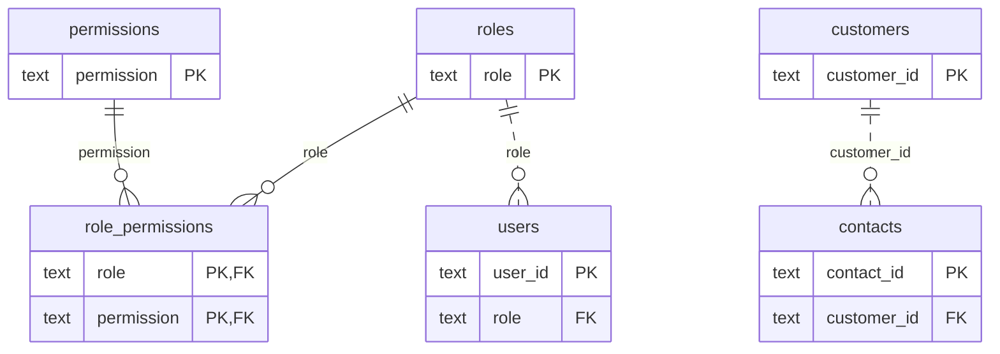
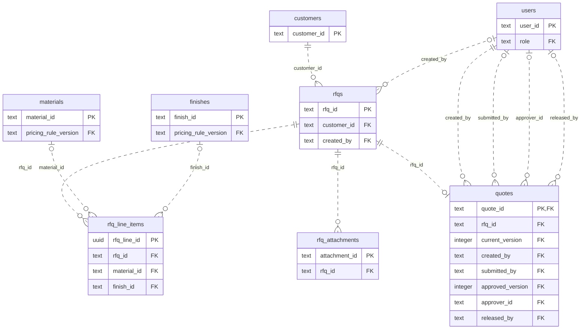
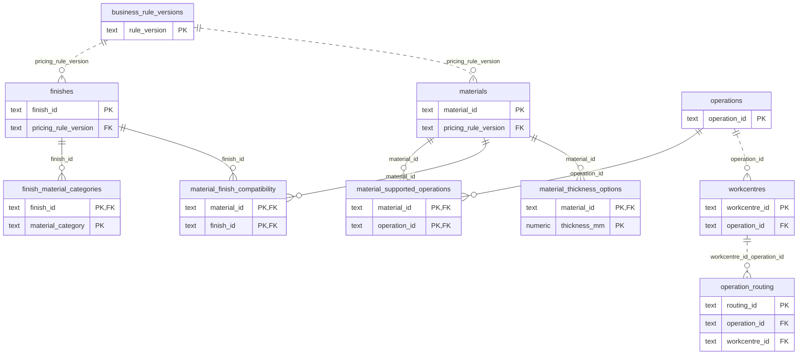
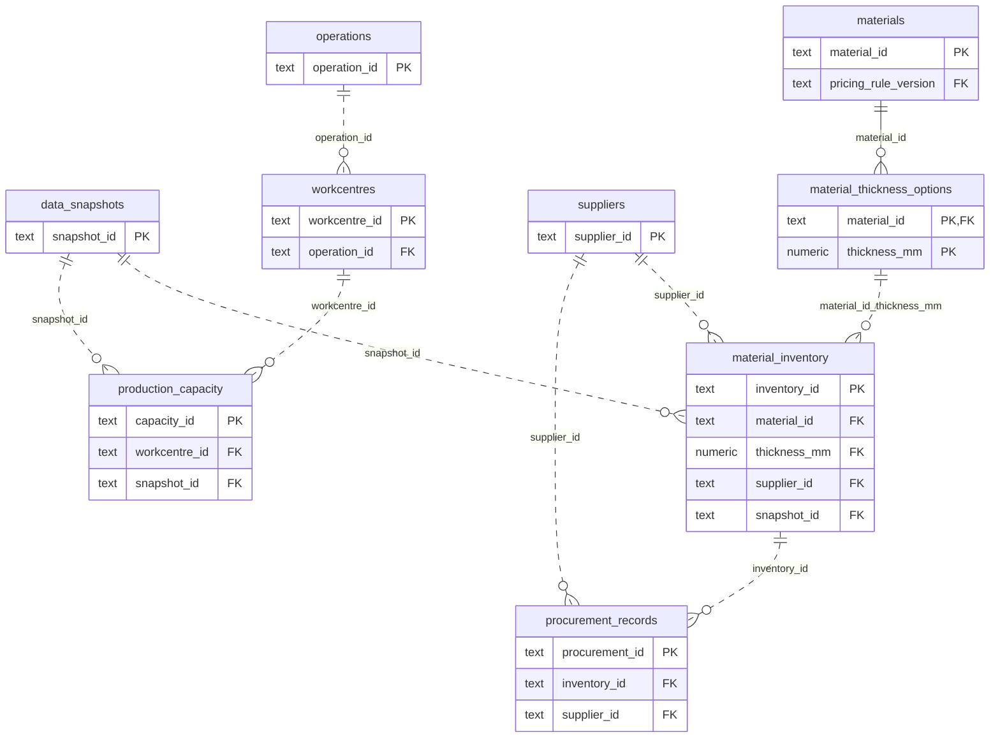
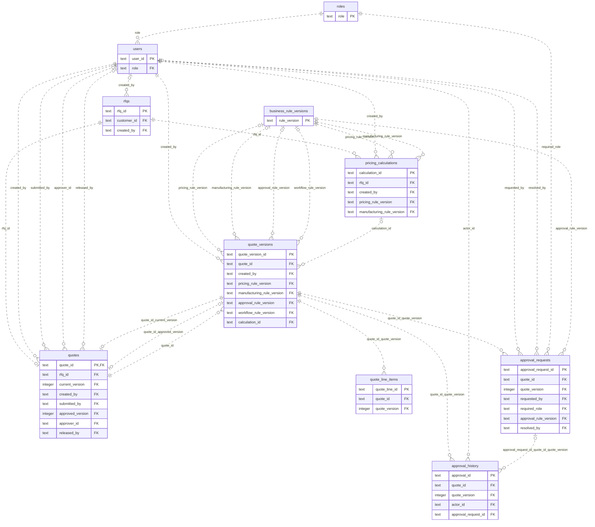
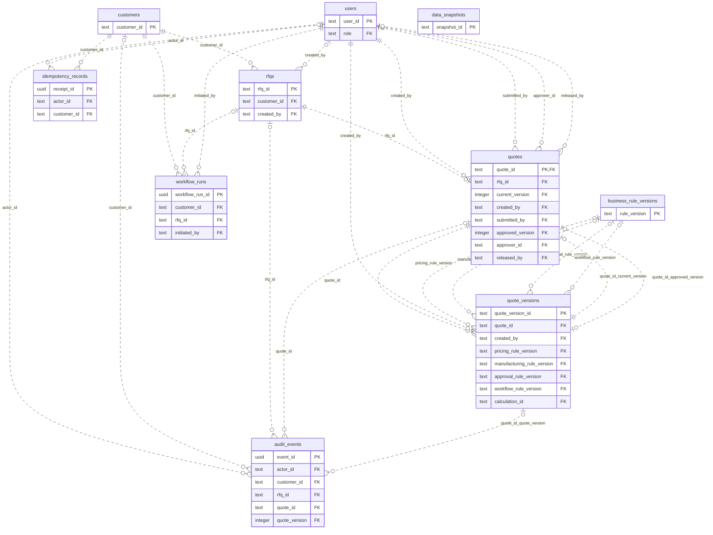

# Day 4 — Proposed relational ER diagrams

These seven Mermaid `erDiagram` blocks describe the [33 specified logical tables](table_schemas.md). They are design documentation, not deployed schema. The overall block includes every specified FK; domain blocks show relationships whose endpoints are in that domain view. Field subsets show PK/FK columns; complete types, nullability, checks, alternate keys and generated values are in the table specifications.

`||` means exactly one; `|o` / `o|` means zero or one; `o{` means zero or many. A child FK that permits NULL has an optional parent. Parent-to-child multiplicity starts at zero because an FK alone does not require any children. Solid lines identify a relationship whose FK is part of the child PK; dotted lines are non-identifying. A composite FK is **one relationship**, not independent single-column links. Labels give its child columns. The RFQ→quote zero-or-one relationship depends on the explicit proposed UNIQUE(rfq_id) policy.

Header→current-version and header→approved-version pointers coexist with quote→versions ownership. The two header pointers are deferred; the current pointer is mandatory, the approval pointer optional. A quote owns at least one version at transaction commit through that current pointer, although ownership alone is displayed zero-or-many. `is_current` flag consistency and exactly one current flag are transactional rules beyond ER notation. Business records never point to a workflow checkpoint. `workflow_runs` has optional RFQ association before RFQ creation, mandatory customer and initiating user.

Saver-owned checkpoint physical tables and hidden evaluation records are not application tables and are deliberately absent. The `checkpoint_ref` in workflow_runs is an external store reference, not an invented FK. See [workflow/security boundary](database_architecture.md).

## 1. Overall logical relational model

```mermaid
erDiagram
    business_rule_versions {
        text rule_version PK
    }
    data_snapshots {
        text snapshot_id PK
    }
    roles {
        text role PK
    }
    permissions {
        text permission PK
    }
    role_permissions {
        text role PK,FK
        text permission PK,FK
    }
    users {
        text user_id PK
        text role FK
    }
    customers {
        text customer_id PK
    }
    contacts {
        text contact_id PK
        text customer_id FK
    }
    materials {
        text material_id PK
        text pricing_rule_version FK
    }
    finishes {
        text finish_id PK
        text pricing_rule_version FK
    }
    operations {
        text operation_id PK
    }
    workcentres {
        text workcentre_id PK
        text operation_id FK
    }
    suppliers {
        text supplier_id PK
    }
    material_thickness_options {
        text material_id PK,FK
        numeric thickness_mm PK
    }
    material_finish_compatibility {
        text material_id PK,FK
        text finish_id PK,FK
    }
    material_supported_operations {
        text material_id PK,FK
        text operation_id PK,FK
    }
    finish_material_categories {
        text finish_id PK,FK
        text material_category PK
    }
    operation_routing {
        text routing_id PK
        text operation_id FK
        text workcentre_id FK
    }
    material_inventory {
        text inventory_id PK
        text material_id FK
        numeric thickness_mm FK
        text supplier_id FK
        text snapshot_id FK
    }
    procurement_records {
        text procurement_id PK
        text inventory_id FK
        text supplier_id FK
    }
    production_capacity {
        text capacity_id PK
        text workcentre_id FK
        text snapshot_id FK
    }
    rfqs {
        text rfq_id PK
        text customer_id FK
        text created_by FK
    }
    rfq_line_items {
        uuid rfq_line_id PK
        text rfq_id FK
        text material_id FK
        text finish_id FK
    }
    rfq_attachments {
        text attachment_id PK
        text rfq_id FK
    }
    pricing_calculations {
        text calculation_id PK
        text rfq_id FK
        text created_by FK
        text pricing_rule_version FK
        text manufacturing_rule_version FK
    }
    quotes {
        text quote_id PK,FK
        text rfq_id FK
        integer current_version FK
        text created_by FK
        text submitted_by FK
        integer approved_version FK
        text approver_id FK
        text released_by FK
    }
    quote_versions {
        text quote_version_id PK
        text quote_id FK
        text created_by FK
        text pricing_rule_version FK
        text manufacturing_rule_version FK
        text approval_rule_version FK
        text workflow_rule_version FK
        text calculation_id FK
    }
    quote_line_items {
        text quote_line_id PK
        text quote_id FK
        integer quote_version FK
    }
    approval_requests {
        text approval_request_id PK
        text quote_id FK
        integer quote_version FK
        text requested_by FK
        text required_role FK
        text approval_rule_version FK
        text resolved_by FK
    }
    approval_history {
        text approval_id PK
        text quote_id FK
        integer quote_version FK
        text actor_id FK
        text approval_request_id FK
    }
    idempotency_records {
        uuid receipt_id PK
        text actor_id FK
        text customer_id FK
    }
    audit_events {
        uuid event_id PK
        text actor_id FK
        text customer_id FK
        text rfq_id FK
        text quote_id FK
        integer quote_version FK
    }
    workflow_runs {
        uuid workflow_run_id PK
        text customer_id FK
        text rfq_id FK
        text initiated_by FK
    }
    roles ||--o{ role_permissions : "role"
    permissions ||--o{ role_permissions : "permission"
    roles ||..o{ users : "role"
    customers ||..o{ contacts : "customer_id"
    business_rule_versions ||..o{ materials : "pricing_rule_version"
    business_rule_versions ||..o{ finishes : "pricing_rule_version"
    operations ||..o{ workcentres : "operation_id"
    materials ||--o{ material_thickness_options : "material_id"
    materials ||--o{ material_finish_compatibility : "material_id"
    finishes ||--o{ material_finish_compatibility : "finish_id"
    materials ||--o{ material_supported_operations : "material_id"
    operations ||--o{ material_supported_operations : "operation_id"
    finishes ||--o{ finish_material_categories : "finish_id"
    workcentres ||..o{ operation_routing : "workcentre_id_operation_id"
    material_thickness_options ||..o{ material_inventory : "material_id_thickness_mm"
    suppliers ||..o{ material_inventory : "supplier_id"
    data_snapshots ||..o{ material_inventory : "snapshot_id"
    material_inventory ||..o{ procurement_records : "inventory_id"
    suppliers ||..o{ procurement_records : "supplier_id"
    workcentres ||..o{ production_capacity : "workcentre_id"
    data_snapshots ||..o{ production_capacity : "snapshot_id"
    customers ||..o{ rfqs : "customer_id"
    users |o..o{ rfqs : "created_by"
    rfqs ||..o{ rfq_line_items : "rfq_id"
    materials |o..o{ rfq_line_items : "material_id"
    finishes |o..o{ rfq_line_items : "finish_id"
    rfqs ||..o{ rfq_attachments : "rfq_id"
    rfqs ||..o{ pricing_calculations : "rfq_id"
    users ||..o{ pricing_calculations : "created_by"
    business_rule_versions ||..o{ pricing_calculations : "pricing_rule_version"
    business_rule_versions ||..o{ pricing_calculations : "manufacturing_rule_version"
    rfqs ||..o| quotes : "rfq_id"
    users ||..o{ quotes : "created_by"
    users |o..o{ quotes : "submitted_by"
    users |o..o{ quotes : "approver_id"
    users |o..o{ quotes : "released_by"
    quote_versions ||..o| quotes : "quote_id_current_version"
    quote_versions |o..o| quotes : "quote_id_approved_version"
    quotes ||..o{ quote_versions : "quote_id"
    users ||..o{ quote_versions : "created_by"
    business_rule_versions |o..o{ quote_versions : "pricing_rule_version"
    business_rule_versions |o..o{ quote_versions : "manufacturing_rule_version"
    business_rule_versions |o..o{ quote_versions : "approval_rule_version"
    business_rule_versions |o..o{ quote_versions : "workflow_rule_version"
    pricing_calculations |o..o{ quote_versions : "calculation_id"
    quote_versions ||..o{ quote_line_items : "quote_id_quote_version"
    quote_versions ||..o{ approval_requests : "quote_id_quote_version"
    users ||..o{ approval_requests : "requested_by"
    users |o..o{ approval_requests : "resolved_by"
    roles ||..o{ approval_requests : "required_role"
    business_rule_versions ||..o{ approval_requests : "approval_rule_version"
    quote_versions ||..o{ approval_history : "quote_id_quote_version"
    users ||..o{ approval_history : "actor_id"
    approval_requests |o..o{ approval_history : "approval_request_id_quote_id_quote_version"
    users ||..o{ idempotency_records : "actor_id"
    customers ||..o{ idempotency_records : "customer_id"
    users |o..o{ audit_events : "actor_id"
    customers |o..o{ audit_events : "customer_id"
    rfqs |o..o{ audit_events : "rfq_id"
    quotes |o..o{ audit_events : "quote_id"
    quote_versions |o..o{ audit_events : "quote_id_quote_version"
    customers ||..o{ workflow_runs : "customer_id"
    rfqs |o..o{ workflow_runs : "rfq_id"
    users ||..o{ workflow_runs : "initiated_by"
```

## 2. Customer and identity management

## 3. RFQ management

## 4. Materials and manufacturing

## 5. Inventory, procurement, and scheduling

## 6. Quotations and approvals

## 7. Audit and workflow persistence

## Verification scope

The local environment has no `mmdc` renderer. All seven blocks receive static checks for supported ER syntax, balanced entity blocks, defined entities/columns, PK/FK markers, FK targets, composite-key uniqueness, relationship coverage and optional/unique multiplicity. **No rendered-image or visual-layout success is claimed.** No renderer or dependencies were installed for this documentation task.
